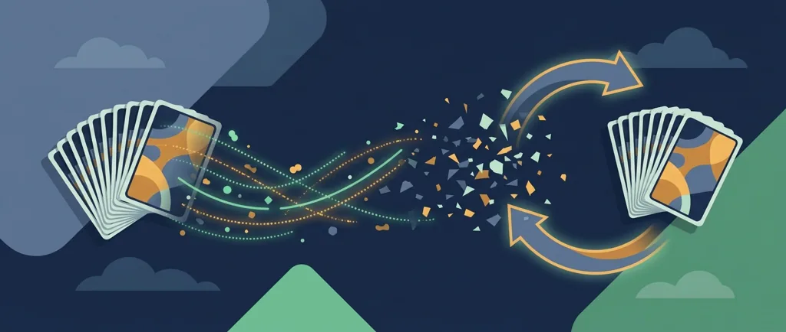

Title: Броене на карти в блекджек: работи ли и защо не онлайн
Meta: Броенето на карти в блекджек дава малко предимство само на живо с ръчно тесте. Онлайн срещу RNG и на маса с CSM разбъркването го свежда до нула.

# Броене на карти в блекджек: работи ли и защо не онлайн

Автор: Георги Тодоров · Публикувано: 12.10.2026 · Актуализирано: 12.10.2026
Числата за домашното предимство и механиката на броенето са проверени към 12.10.2026 по международни референции за математиката на блекджека, а не по данни на конкретен оператор.

Броенето на карти (card counting) работи, но само на жива маса, където едно тесте се раздава няколко ръце подред, и само като дребно статистическо предимство, не като система за сигурна печалба. Онлайн и срещу машина за непрекъснато разбъркване то не носи нищо, защото броенето стъпва на памет в тестето, а при разбъркване преди всяка ръка памет няма. Правилата на блекджека и основната стратегия стоят на [страницата за блекджек](/kazino-igri/blakdzhak/) в [раздела казино игри](/kazino-igri/), и няма да ги повтаряме, защото броенето надгражда върху тях.

## Какво всъщност следи броячът

Системата Хай-Ло (Hi-Lo) закача по една стойност на всяка карта, докато тя излиза от тестето. Малките карти, от 2 до 6, носят +1. Седмица, осмица и деветка са неутрални и оставят броя на място, тоест 0. Десетките, фигурите и асото, тоест 10, J, Q, K, A, свалят по −1. Минеш ли през цяло тесте и събереш всичко, сумата излиза точно 0. Заради това Хай-Ло минава за балансиран брояч от ниво 1: прост за носене наум и достатъчно точен, за да върши работа. Че подходът носи предимство, е математика, доказана още преди десетилетия от Едуард Торп в книгата „Beat the Dealer".

Високите карти и асата играят за играча. С тях идват повече блекджеци с естествено плащане и по-силни удвоявания, а дилърът, принуден да тегли към твърда ръка, фалира по-често. Докато тези карти още седят в тестето, а дребните вече са излезли, положението на масата клони към играча. Положителният брой маркира такъв момент: в остатъка е останало непропорционално много от онова, което помага. Отрицателният брой казва обратното. Тестето е олекнало откъм високи карти и предимството се връща при казиното.

## От текущ брой към реален брой

Докато картите излизат, броячът държи една сурова сума, текущия брой (running count). Проблемът с нея е, че не отчита колко тесте е останало. Текущ брой +6, когато в обувката е останало едно тесте, е силен сигнал. Същите +6, размазани в шест неизиграни тестета, почти нищо не казват.

Решението е реалният брой (true count): текущият брой, разделен на броя неизиграни тестета. Колко остава се оценява на око, по купчината вече изиграни карти. Текущ брой +6 при около 3 неизиграни тестета дава реален брой +2. Залогът се чете от тази нормализирана стойност. Суровата сума сама по себе си не върши работата. Висок реален плюс значи вдигаш залога, защото предимството е на твоя страна за няколко ръце напред. Нула или минус значи сваляш до минимум и чакаш.

## Защо дълбочината решава всичко

Дълбочината на проникване (penetration) е основата на цялата техника. Колкото повече карти се раздадат, преди дилърът да разбърка, толкова по-надеждна е информацията в броя и толкова по-голямо е предимството, което можеш да използваш. Маса с плитко проникване, която разбърква рано, оставя почти нищо за работа.

## Колко голямо е предимството в действителност

С перфектна основна стратегия домашното предимство на блекджека пада под около 0,5% при четири или повече тестета и стандартни правила. Точната стойност се мести според правилата на масата, тоест дали дилърът тегли на мека 17, позволено ли е удвояване след сплит и има ли предаване (surrender), плюс броя тестета и дълбочината на проникване. При осем тестета казиното обикновено държи малко повече, около 0,57%. Опитен брояч, който варира залога правилно при игра с шест тестета и добра дълбочина, обръща приблизително 1% в своя полза. Това е целият диапазон: от лек минус за играча до лек плюс. Нищо по-драматично.

В евро се вижда колко е дребно. Предимство от около 0,5% за казиното означава средна загуба под €1 на всеки €100 заложени, грубо €0,50. Добрият брояч при идеални условия на живо завърта същата сметка на малко под €1 в своя полза на всеки €100 оборот. Всички тези стойности са ориентировъчни и мърдат заедно с правилата на масата.

*Стойностите по Хай-Ло, размерът на предимството на всеки €100 и защо онлайн проникването, а с него и предимството, пада до нула.*

Рекламите на „системи" прескачат честната част. Предимство от процент не значи печалба всяка вечер, нито всяка седмица. Дисперсията в кратък срок е огромна. Можеш да играеш безупречно, да броиш безупречно и пак да излезеш на минус месеци наред, защото резултатът се люлее силно в двете посоки, преди да се доближи до средното. Предимството се проявява върху огромен брой ръце, никога в рамките на една вечер. Затова ти трябва банкрол, който издържа лошите серии, и дисциплина да не вдигаш залога извън това, което реалният брой позволява. И търпение, защото без достатъчно време предимството няма как да се прояви. Броенето е бавна работа за дисциплинирани хора. Представено като билет за бързи пари, то противоречи на собствената си математика: лекото предимство се връща единствено в дългия период.

## Защо броенето умира онлайн

В повечето онлайн казина с RNG софтуер (генератор на случайни числа) тестето се разбърква наново в началото на всяко раздаване. Всяка ръка тръгва от пълно, току-що разбъркано тесте. Между две ръце няма памет: няма изчерпани високи или ниски карти, няма състав, който бавно да се мени. Текущият брой, който с толкова усилие си държал, не носи никаква информация, понеже следващата ръка не зависи от предишната.

Предимството на брояча е функция на дълбокото проникване, а разбъркването преди всяка ръка свежда проникването до нула. Нулево проникване дава нулево предимство, колкото и чисто да броиш. Къщата си запазва предимството непокътнато, защото самата предпоставка на техниката, тоест променящ се състав на тестето, който следиш, тук липсва.

Всяка оферта за „система за броене за онлайн блекджек" продава нещо, което математиката на играта изключва. Няма вярна система и няма какво да заобиколиш, защото информацията, която броиш, е нулева.

Блекджекът на живо със стрийминг и истинско тесте стои по-близо до физическата маса, където броенето пак има смисъл. Там обаче чака друго препятствие със същия ефект. Повече за формата има на [страницата за казино на живо](/kazino-igri/kazino-na-zhivo/).

## Машините за непрекъснато разбъркване

На жива маса, и при част от стрийминг масите, все по-често стои машина за непрекъснато разбъркване (continuous shuffle machine, CSM). Устройството връща изиграните карти в тестето след почти всяка ръка и бърка постоянно, така че дълбоко проникнато тесте никога не се събира. Ефектът върху брояча е същият като онлайн, само пренесен на физическа маса: без натрупано проникване няма какво да проследяваш и предимството на традиционните техники се срива почти до нула. CSM по същество налагат минимално проникване, и това е целият номер. Масата, която изобщо си струва за броене, е с ръчно тесте и късно разбъркване, тоест обратното на CSM. Видиш ли машина, която бърка без спиране, механизмът, който правеше броенето възможно, вече го няма.

## Законно ли е и може ли казиното да откаже

Броенето наум, без устройство и без помощник на масата, не е престъпление в западните юрисдикции. Държиш информация в главата си и залагаш според нея, а това е позволено. Никой не може да те задължи да играеш по-зле, отколкото умееш.

Другата страна е, че казиното е частен бизнес. По общите си условия операторът обикновено си запазва правото да откаже или да прекрати обслужване по своя преценка, включително когато смята, че играч брои карти. Умението ти остава законно, но заведението пак може да те помоли да напуснеш, и в това няма противоречие.

За онлайн и RNG играта въпросът пада от само себе си. Няма какво да броиш, значи няма и за какво да те спрат. Живата маса е частен обект със свои правила за достъп, а онлайн масата просто не дава механизма.

Ако блекджекът е спрял да е забавление и усещаш, че вдигаш залозите, за да гониш загуба, сложи си таван, който можеш да загубиш спокойно, и го спазвай преди първия залог, не след десетия. Инструментите за самоограничаване и националната забрана са описани на [страницата за отговорна игра](/otgovorna-igra/).

Георги Тодоров

---

**За автора:** Георги Тодоров тества лицензирани в България казино сайтове от 2024 г. със собствен бюджет и проверява лиценза в публичния регистър на НАП преди регистрация. Пише за Всички Казина за реалната цена на бонусите, скоростта на тегленията и математиката зад игрите.

**За Всички Казина:** Всички Казина е независим сайт за сравнение на онлайн казина с лиценз за българския пазар. Не сме оператор и не организираме игри. Сравняваме, проверяваме и обясняваме, за да избирате с отворени очи. Казината оценяваме по публична формула с шест претеглени критерия ([Как оценяваме](/kak-ocenyavame/)), а партньорските връзки, които финансират сайта, са обозначени. Тази статия не съдържа партньорски връзки.

**Отговорна игра:** *18+ Хазартът може да пристрасти. Играйте отговорно.* Насоки за лимити и самоизключване: [отговорна игра](/otgovorna-igra/). Самоизключване от всички лицензирани организатори в България: национален регистър на уязвимите лица към НАП (заявява се писмено от самия засегнат). Помощ: Национална информационна линия за наркотиците, алкохола и хазарта „Солидарност" 0888 99 18 66, делнични дни 10:00–17:00.

От 1 август 2026 г. дейността на афилиейт оператори в България се лицензира съгласно Закона за държавния бюджет за 2026 г. (ДВ, бр. 69 от 31.07.2026 г.). Всички Казина е подало заявление за лиценз пред Националната агенция по приходите и очаква издаването му.
