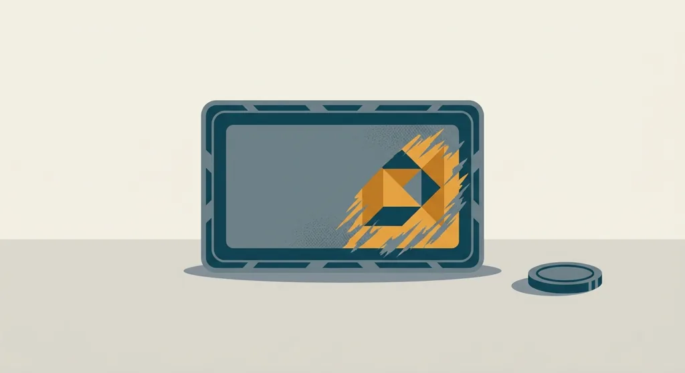
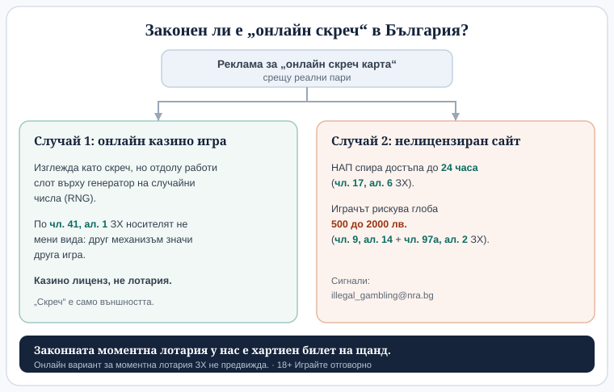

# Скреч карти и моментни лотарии: как работят и могат ли да бъдат онлайн

Автор: Георги Тодоров

Резултатът върху една скреч карта вече съществува, преди билетът да е стигнал до щанда. Печатницата го е заложила в мига, когато е излязла цялата серия. Сребристото покритие не решава нищо; изтриването му само показва изход, фиксиран отдавна. Оттук идва и една типично българска подробност. Законната скреч карта у нас е хартиен билет, купен на щанд, и зад това стоят няколко реда от закона.

## Какво всъщност е моментната лотария

По Закона за хазарта (ЗХ) моментната лотария е вид лотарийна игра и влиза в едно семейство с традиционната лотария, томболата и числовите лотарийни игри (тото, лото, бинго, кено). „Скреч карта", „скреч карти за изтриване" и „моментна лотария" са три имена на едно и също нещо, тоест билет с предварително заложен награден фонд, чийто резултат се разкрива на място. Това е само едно от няколкото лотарийни семейства, а по-подробно сравнение на [видовете лотария](/blog/lotaria-vidove/) показва къде се вписва спрямо останалите.

Когато серията влезе в печат, всичко вече е преброено. Знае се колко билета ще има и колко печеливши от всяко ниво ще се паднат в тиража. Теглене няма, жребий няма, а никое действие на играча не мести изхода. Купуваш билета и под сребристото се появява готов отговор. При залога върху мач събитието тепърва предстои; тук то вече е минало. Печалбите са разпределени, преди първият билет да смени собственика си. Купуването не ви вкарва в предстоящо събитие. То просто вади един запечатан отговор от ограничен куп.

Оттук и безсмислието на всяка „система". Няма значение дали ще изберете билет от края на ролката или ще смените щанда; по-удачен ден също не съществува. Шансът не помръдва, защото резултатът върху конкретния билет е вече отпечатан. Същото важи за дизайна „за малко": двата еднакви символа и третият, който едва се разминава с тях. Оформлението кара загубата да изглежда като едва изпусната печалба, и толкова. Друго няма да ви каже.

Понеже наградите в тиража са преброени и крайни, всеки изтеглен голям печеливш билет буквално смалява онова, което остава. Фондът е затворен съд, а не извор без дъно. На практика това не дава предимство на никого, защото не се знае кои билети са продадени и кои още чакат. Отстрани играта изглежда и се държи напълно случайно. Крайният фонд обяснява защо голямата награда „свършва" в някакъв момент, без да подсказва къде се е скрила. В същото неведение е и продавачът на щанда; той също не вижда кой билет какво крие.

## Реалният шанс и защо билетът „губи" средно

Цената на билета винаги стои над средната очаквана печалба. В тази разлика няма измама. От нея се плащат наградите, операторът и каузата или бюджетът зад играта. Ако някой изкупи целия тираж до последния билет, ще си върне по-малко, отколкото е оставил на щанда. Така е при всяка моментна игра по света. Разстоянието между платеното и върнатото е сметнато предварително и вградено в самата серия, без да зависи от късмета на отделния щанд.

Общите шансове да спечелиш какъвто и да е приз обикновено пишат в правилата на серията или на гърба на билета. Истинската информация стои там, а не в рекламния надпис. При международните моментни игри делът за най-ниското ниво често се върти около 1 към 3 или 1 към 4, но това са примерни чуждестранни стойности, не български: повечето билети не носят нищо, а повечето „печалби" връщат горе-долу цената на самия билет. За конкретна българска серия точните шансове и награден фонд стоят единствено в официалните ѝ правила, затова ги търсете там, преди да припишете на билета каквото и да е число.

## Защо в България скреч картата е физически билет

Границата минава през две алинеи на един член от Закона за хазарта.

Чл. 41, ал. 1 ЗХ казва, че начинът и техническите средства, чрез които се предлага една игра, не променят вида ѝ. Онлайн рулетката си остава казино игра. Тото фишът, попълнен през интернет, си остава числова лотарийна игра. Носителят не размества категорията.

Чл. 41, ал. 2 ЗХ пък изрежда кои игри могат да се организират и онлайн, и прави едно изключение за томболата и моментната лотарийна игра. От целия списък хазартни игри по закона скреч картата попада в тесен кръг от само две, за които онлайн вариант изобщо не е предвиден.

Затова законната българска моментна лотария е хартиен билет, купен на щанд. Държавният тотализатор например пуска такива тото моментни игри на хартия, сред които „Златният билет", „Големият удар" и „Магичната 8". Какъвто и да е носителят, по закон моментната лотария не живее онлайн. Как се подрежда всичко това в общата [регулаторна рамка по ЗХ](/blog/regulations-taxes/) е по-голям разговор; за скреча самото правило е тясно и еднозначно.

## Тогава какво е „онлайн скреч карта"?

Щом видите реклама за „онлайн скреч карта" срещу реални пари, по дефиниция гледате нещо, което българският закон не признава за моментна лотария. Вариантите са два.

Първият е игра в онлайн казино, която изглежда като скреч карта, но отдолу работи слот върху генератор на случайни числа (RNG). Визуално „изтривате" поле и под него излиза резултат, само че отдолу стои казино игра, не лотарийна. Това е точно логиката на чл. 41, ал. 1, според която друг механизъм означава друг вид игра. „Скреч" е само външността. Разликата не е само юридическа. Тя е и в математиката. Физическата моментна лотария има краен, предварително отпечатан фонд: толкова билета, толкова печеливши в тях. RNG версията няма такъв съд, от който да вади. Всяко завъртане е независимо и наградите не се „изчерпват", понеже ограничен тираж няма. На екрана двете може да си приличат, но ги управляват различни правила и различен лиценз. За играч, свикнал с класическото усещане на хартиения билет, екранният „скреч" е просто друга игра със заето име.

Вторият вариант е по-опасен: нелицензиран сайт. От 1 август 2026 г. достъпът до сайтове без лиценз се спира с решение на НАП в рамките на 24 часа (чл. 17, ал. 6 ЗХ). Рискът обаче не свършва при сайта. Играч, който заложи при нелицензиран организатор, също нарушава закона и подлежи на глоба от 500 до 2000 лв. (чл. 9, ал. 14 във връзка с чл. 97а, ал. 2 ЗХ). Сигнали за такива сайтове се подават на illegal_gambling@nra.bg. Блокирането идва бързо, но то пази пазара. Парите, заложени при такъв сайт, не се връщат от само себе си.

*„Онлайн скреч" за реални пари у нас винаги е едно от двете: друга игра под казино лиценз или нелицензиран сайт, който НАП блокира.*

Във Всички Казина проверяваме лиценза в публичния регистър на НАП, преди да оценим който и да е оператор. Същата проверка си струва преди първия заложен лев, а не след него. Повече по темата има на страницата [законно ли е](/zakonno-li-e/).

## Как да подходите разумно

Моментната игра се продава като няколко секунди напрежение и най-добре е да се приема именно така. Дребно забавление с предварително известна цена, не източник на доход. НАП препоръчва хазартният бюджет да не надхвърля 5% от нетния доход. Всеки, който усети, че играта започва да тежи повече, отколкото му се иска, може да се впише в регистъра на уязвимите лица по чл. 10г ЗХ и така сам да ограничи достъпа си. Националната линия за помощ при хазартна зависимост „Солидарност" е 0888 99 18 66, а как точно работи самоограничаването е описано в [отговорната игра](/otgovorna-igra/).

## Изводът

Скреч картата е сред най-простите хазартни игри и точно затова най-лесно я разбираме погрешно. Резултатът е решен още на печатната машина, средната стойност е под цената на билета и никаква „стратегия" не може да го промени. Българската особеност е по-интересна. За разлика от почти всичко друго в хазарта, тук законен онлайн вариант просто няма; моментната лотария и томболата са единствените две игри, на които ЗХ не отваря врата към интернет. Значи всичко, рекламирано като „онлайн скреч" срещу реални пари, е едно от двете. Или друга игра под казино лиценз, или сайт, който е по-добре да подминете. В първия случай поне знаете, че играете нещо друго. Във втория слагате на масата и собствената си глоба.

18+ Хазартът може да пристрасти. Играйте отговорно. Ако усещате, че играта излиза извън контрол, вижте [отговорната игра](/otgovorna-igra/) и регистъра на уязвимите лица.

---

**Георги Тодоров**
Публикувано: 13.10.2026 · Последна редакция: 13.10.2026

Георги Тодоров е от София и тества лицензирани в България казино сайтове със собствени пари от 2024 г., като хоби, не по служба. Преди да се регистрира някъде, проверява лиценза в публичния регистър на НАП, а тегленията изпробва сам, с реална верификация и без активен бонус. Водещото му правило е просто: банерът е реклама, правилата на играта са договорът.

**За Всички Казина:** Всички Казина е независим сайт за сравнение на онлайн казина с лиценз за българския пазар. Не сме оператор и не организираме игри. Сравняваме, проверяваме и обясняваме, за да избирате с отворени очи. Казината оценяваме по публична формула с шест претеглени критерия ([Как оценяваме](/kak-ocenyavame/)), а партньорските връзки, които финансират сайта, са обозначени.

**Отговорна игра.** 18+ Хазартът може да пристрасти. Играйте отговорно. Ако усетиш, че играта излиза извън контрол или искаш да я ограничиш, виж [инструментите за отговорна игра](/otgovorna-igra/) и възможността за самоизключване чрез националния регистър на уязвимите лица към НАП (подава се писмено само от засегнатото лице). Национална информационна линия за наркотиците, алкохола и хазарта („Солидарност") 0888 99 18 66, делнични дни 10:00–17:00.

**Разкриване.** Тази статия няма партньорски връзки и не препоръчва оператор. На други страници Всички Казина се финансира от партньорски връзки, а партньорите са обозначени. От 1 август 2026 г. дейността на афилиейт оператори в България се лицензира съгласно Закона за държавния бюджет за 2026 г. (ДВ, бр. 69 от 31.07.2026 г.). Всички Казина е подало заявление за лиценз пред Националната агенция по приходите и очаква издаването му.
