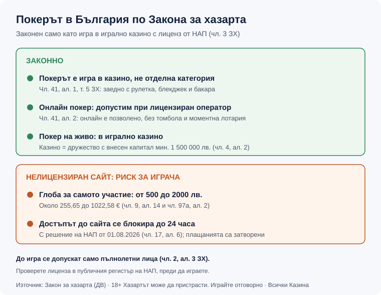

<!-- STAGE: Step 3 — Humaniser pass. Broke template symmetry, varied paragraph shapes, asymmetric ending; preserved every number/link/RG line. No numbers changed vs 02. -->

Title tag: Законно ли е покерът в България: онлайн и жив | Всички Казина
Meta description: Покерът е законен в България само като игра в казино с лиценз от НАП - онлайн и на живо. Какво рискува играчът при нелицензиран сайт и къде се проверява лицензът.

# Законно ли е да играете покер в България - онлайн и на живо

Покерът е законен в България, но не като отделна категория сам за себе си. Законът за хазарта (ЗХ) го третира като игра в игрално казино, затова е позволен само там, където организаторът има съответния лиценз от НАП: на живо в лицензирано казино или онлайн на сайт с валиден лиценз. Няма „покер лиценз" и няма легален начин да заложите пари на покер при оператор без такъв. По-малко известното е, че участието при нелицензиран организатор е забранено и за самия играч, не само за сайта.

*Тази статия обяснява правната рамка на разбираем език и не е правен съвет. Данъчното третиране на печалбите и стъпките за самоизключване не са тема тук. Актуалният текст на закона се публикува в „Държавен вестник".*

## Покерът пред закона: игра в казино, не отделна категория

Законът за хазарта изброява пет вида хазартни игри в чл. 41, ал. 1: лотарийни игри; залагания върху спортни състезания и надбягвания с коне и кучета; залагания върху случайни събития и познаване на факти; игри с игрални автомати; и игри в игрално казино. Покерът не е посочен като шести вид. Той попада в последната група, заедно с рулетката, блекджека и бакарата, защото в казино се играе срещу залог и с елемент на късмет.

Оттук следва практическият извод. Чл. 3, ал. 1 изисква всяка хазартна игра на територията на страната да се организира само с лиценз, издаден от изпълнителния директор на НАП, а ал. 3 добавя, че лицензът важи само за изрично посочената в него игра. Отделен „покер лиценз" в закона просто не съществува. За да предложи легално покер, операторът трябва да държи лиценз за игри в казино. Държавният надзор над целия сектор е при НАП от 08.08.2020, когато функциите преминаха от закритата Държавна комисия по хазарта.

## Онлайн покер: разрешен, но само при лицензиран оператор

Онлайн покерът е допустим. Чл. 41, ал. 2 позволява всички изброени игри да се организират и онлайн, с изключение на томболата и моментната лотарийна игра, а покерът не е сред тези две изключения. Тук работи и чл. 41, ал. 1: начинът и техническите средства, чрез които се предлага играта, не променят вида ѝ. Покерът през браузъра или приложението си остава игра в казино и изисква лиценз за казино, точно както масата на живо. Легалният онлайн покер в България не е новост, първите лицензи за онлайн покер бяха издадени още през 2014 г.

Лицензът не е формалност на хартия. Чл. 6, ал. 1 изисква онлайн операторът да регистрира и идентифицира всеки участник, а данните за игралните сесии, залозите и изплатените печалби да се подават в реално време към сървър на НАП. Затова проверката на самоличността при регистрация не е прищявка на сайта, а условие на собствения му лиценз. Как да се уверите, че конкретен сайт наистина има лиценз, а не просто го твърди, описахме отделно в [ръководството за проверка на лиценз](/blog/proverka-licenz-kazino/); общата рамка на онлайн хазарта събрахме в [законен ли е онлайн хазартът в България](/zakonno-li-e/).

## Покер на живо в лицензирано казино

На живо покерът се играе в наземните казина, които държат лиценз за игри в казино. Прагът за влизане в този бизнес е висок: игралното казино се организира от дружество с внесен капитал най-малко 1 500 000 лв. или равностойността в евро (чл. 4, ал. 2 ЗХ), плюс изискванията за помещения, видеонаблюдение и проверка на самоличността на входа. Кеш маси и турнири се провеждат в рамките на този казино лиценз. Самите правила на играта, видовете покер и подредбата на ръцете разглеждаме в [как се играе покер в казино](/blog/kak-se-igrae-poker-kazino/); тук темата е само правният статут.

## Какво рискува играчът при нелицензиран сайт

Рискът при нелицензиран покер сайт обикновено се свежда до въпроса „ще ми изплатят ли печалбата". Законът гледа и от другата страна на екрана. Чл. 9, ал. 14 (в сила от 2024 г., ДВ бр. 42 от 2024) забранява на физическите лица да участват в хазартни игри при организатор без лиценз по ЗХ, а глобата по чл. 97а, ал. 2 е от 500 до 2000 лв. По фиксирания курс 1,95583 лв. за 1 евро това е около 255,65 € до 1022,58 €; как точно се прилага равностойността в евро след 01.01.2026, проверете в актуалния текст на закона. Нарушение е самото участие, а санкцията е за човека, който е играл, не само за сайта.

Достъпът до такива сайтове и без това е нетраен. От 01.08.2026 НАП спира достъпа до нелицензиран организатор с решение в срок до 24 часа (чл. 17, ал. 6). Паричните канали също са затворени: банки, платежни институции и дружества за електронни пари не могат да извършват плащания за онлайн хазарт към и от организатори без лиценз (чл. 9, ал. 13), така че отказано плащане към непознат сайт за покер често се обяснява именно тук. Сигнали за нелегален хазарт се подават на illegal_gambling@nra.bg, като анонимни сигнали не се разглеждат.

*Покерът като игра в казино по ЗХ: кога е законен и какви са санкциите за играча при нелицензиран оператор.*

## Данъци и частни игри - двата въпроса, които всички задават

Дали печалбата от покер се облага и как се декларира е отделна тема, която зависи от вида на организатора и от конкретния случай, затова не бива да се приема наготово от общо ръководство. Разгледали сме я поотделно в [данъците върху печалбите от онлайн казино](/blog/danaci-pechalbi-onlajn-kazino/); за собствената ви ситуация питайте счетоводител или НАП. [VERIFY: данъчното третиране на печалбите от покер да се потвърди към актуалния ЗКПО/ЗДДФЛ и НАП преди да се посочват ставки или прагове.]

Домашната игра между приятели е сивата зона, за която законът не прави изрично изключение. Чл. 3 изисква лиценз за всяка хазартна игра на територията на страната, а покерът за пари е хазартна игра. Организирането на платена покер вечер извън лицензирано казино затова не попада в легална категория, независимо колко безобидно изглежда. Това не е правен съвет за конкретен случай, а само прочит на общото правило.

## Ако решите да играете

Изводът е тесен, но ясен. Легален покер в България означава лицензирано казино на живо или сайт с валиден лиценз от НАП, проверен в публичния регистър, а не просто сайт, който предлага турнири и изглежда убедително. Всичко извън това прехвърля риска върху вас, и то не само финансов.

Преди първия залог определете бюджет, който можете да загубите изцяло, за предпочитане малка част от нетните си доходи, като НАП посочва ориентир от около 5%. До игра се допускат само пълнолетни (чл. 2, ал. 3 ЗХ). Останалите материали за правилата и данъците събираме в раздела [Регулации и данъци](/blog/regulations-taxes/).

18+ Хазартът може да пристрасти. Играйте отговорно.

---

**Георги Тодоров**
Публикувано: 15.10.2026 · Последна редакция: 15.10.2026

Георги Тодоров е от София и тества онлайн казино сайтове със собствени пари от 2024 г., като хоби, не по служба. Преди да се регистрира някъде, проверява лиценза в публичния регистър на НАП, а тегленията изпробва сам, с реална верификация и без активен бонус. Водещото му правило е просто: банерът е реклама, общите условия са договорът.

[About Всички Казина boilerplate]

**Отговорна игра.** 18+ Хазартът може да пристрасти. Играйте отговорно. Ако усетиш, че играта излиза извън контрол или искаш да я ограничиш, виж [инструментите за отговорна игра](/otgovorna-igra/) и възможността за самоизключване чрез националния регистър на уязвимите лица към НАП (подава се писмено само от засегнатото лице). Национална информационна линия за наркотиците, алкохола и хазарта („Солидарност") 0888 99 18 66, делнични дни 10:00–17:00.

**Разкриване на партньорства.** Всички Казина съдържа партньорски (афилиейт) връзки; когато отвориш оферта през такава връзка, това може да финансира сайта, без да променя цената за теб и без да влияе на оценките ни. От 1 август 2026 г. дейността на афилиейт оператори в България се лицензира съгласно Закона за държавния бюджет за 2026 г. (ДВ, бр. 69 от 31.07.2026 г.). Всички Казина е подало заявление за лиценз пред Националната агенция по приходите и очаква издаването му.
