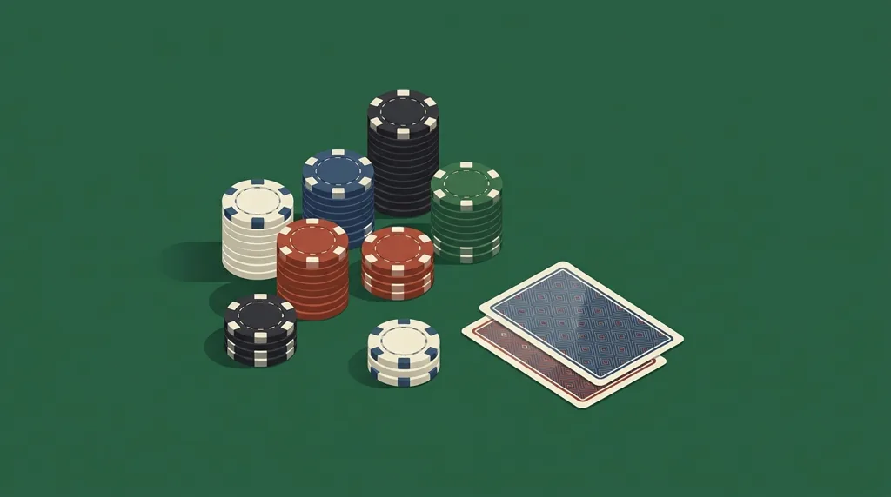
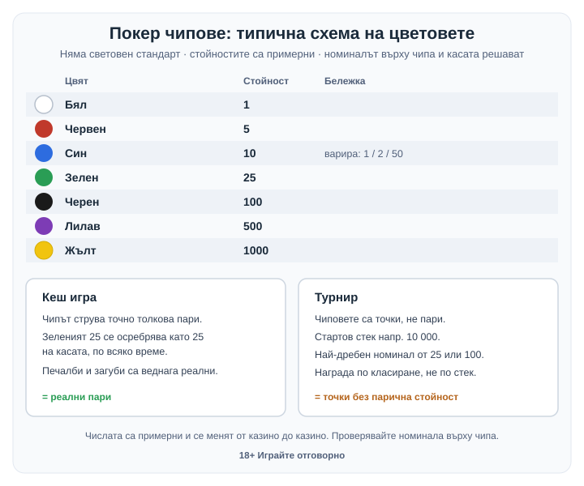

Title tag: Покер чипове: цветове, стойности и броене
Meta description: Покер чипове: защо няма единен стандарт за цветовете, кои стойности са типични (примерни), разликата кеш срещу турнир и как се редят на купчини.

---

# Покер чипове: цветове, стойности и какво значат на масата

Чиповете на покер масата вършат една основна работа: превръщат парите ти в нещо, което се брои и мести бързо, но спира да прилича на пари. Купуваш ги на касата, играеш с тях цяла вечер и ги връщаш в кеш чак на излизане. Заради това е лесно да изгубиш сметката колко реално си заложил. Ако тепърва сядаш на [казино покер](/blog/kak-se-igrae-poker-kazino/), те са първото, което ще видиш пред себе си.

## Защо на масата има чипове, а не пари

Чиповете решават няколко практични проблема наведнъж. Броят се по-бързо от банкноти, не искат ресто и дилърът вижда с един поглед кой колко залага. Еднаквият размер и тегло ги правят трудни за подправяне, а дизайнът на конкретното казино ги връзва към неговата каса, така че чип от едно заведение не върви в друго. Чиповете на големите зали носят и скрити означения и точно тегло по спецификация, за да ги разпознават касата и машините за броене. Така играта тече бързо, а залата държи контрол върху това какво влиза и излиза от нея.

Когато залагаш с пластмаса вместо с банкноти, сумата се усеща абстрактно, което е удобно за ритъма на играта и неудобно за бюджета. Добър повод да си сложиш лимит, преди да купиш първите чипове, а не след като вечерта вече е тръгнала.

## Цветовете и стойностите: защо няма един стандарт

Начинаещите често очакват цветовете да значат едни и същи пари навсякъде. В действителност няма световен стандарт за това коя стойност стои зад кой цвят; всяко казино определя своята схема и най-често я отпечатва направо върху чипа. Номиналът върху чипа и касата са истинският източник, цветът е само удобна условност.

Все пак има типична схема, която се среща в повечето американски и европейски зали. Стойностите в нея са примерни: бял чип за 1, червен за 5, син за 10, зелен за 25, черен за 100, лилав за 500 и жълт за 1000. Сините варират най-много, на места един син чип струва 1, 2 или дори 50 вместо 10. В евро един бърз пример при тази схема: сто чипа по 5 правят 500, а две купчини по 20 зелени чипа по 25 излизат 1000. Числата са илюстративни и важат само ако касата на конкретната маса потвърди същата схема. На непозната маса затова се чете номиналът, а чак после се разчита на цвета.

*Примерна схема на цветовете и стойностите, плюс разликата между кеш и турнирни чипове. Числата са примерни и се менят от казино до казино.*

## Кога чиповете са пари и кога са само точки

В кеш играта всеки чип отговаря на точно толкова пари и можеш да станеш от масата и да го осребриш когато поискаш: зеленият чип за 25 се връща като 25 на касата. Залагаш реални пари на всяка ръка и печалбите и загубите са веднага осезаеми.

Турнирните чипове са друго нещо: нямат парична стойност и служат само вътре в турнира, като точки. Плащаш вход веднъж, получаваш стартов стек от да речем 10 000 турнирни чипа и тези числа са едри нарочно, за да стигат за дълга игра. Наградата накрая зависи от класирането, не от това колко чипа си натрупал. Можеш да завършиш с планина пластмаса пред себе си и пак да вземеш по-малко от някой, който е приключил по-напред с по-малък стек. Номиналите в турнира ги определя организаторът и най-дребният често тръгва от 25 или 100 нагоре. Тези чипове не напускат турнирната маса и не се носят на касата: на изхода остава само паричната награда според мястото ти, ако изобщо си в платената зона.

## Как се броят и редят чиповете

Чиповете се трупат на купчини по 20 от един цвят. Така и дилърът, и играчите ги броят с един поглед, без да ги местят, което пести време на всяка ръка. Четири купчини по 20 правят 80, пет правят 100. Оттам идва и стандартният стелаж, с който дилърът носи чиповете: 5 тръби по 20, тоест 100 чипа от един номинал. Тавите и поставките за чипове са направени точно за тези размери, затова един пълен ред си личи, без да се брои на парче.

Навикът с купчините по 20 идва от практиката на турнирните директори, защото ускорява и преброяването при смяна на цвета, и всеки спор кой колко има на масата. Стекът ти стои открито и не е прието да трупаш едрите чипове отзад, за да изглеждаш с по-малко, отколкото имаш. Опитният играч чете чуждия стек по височината на купчините, без да пита.

## Смяна на цвета (color up)

Натрупат ли се прекалено много дребни чипове, се прави смяна на цвета, на масата наричана color up: връщаш шепа дребни и получаваш по-малко на брой, но по-едри чипове на тяхно място. В кеш играта това става най-вече на излизане, за да носиш десет чипа до касата вместо сто. В турнирите смяната върви заедно с растящите блайндове. Когато най-дребният номинал вече не върши работа, той се изважда от игра и стековете се окрупняват, иначе масата щеше да затъне в пластмаса. Дилърът води смяната на открито, за да се вижда всичко.

## Няколко правила на масата

Няколко неписани правила спестяват неудобни моменти. Не се пипат чужди чипове и не се бърка в чужд стек. Обмяната на пари за чипове и обратно минава през дилъра или касата, не от ръка на ръка със съседа по маса. Най-едрият чип обикновено стои отпред и видим, не скрит под другите. А на непозната маса първо се питат или прочитат номиналите, вместо да залагаш по памет от друго казино, където синьото може да е значело съвсем друга сума.

Чиповете остават просто инструмент за броене. Не носят предимство и няма какво да „победиш" с тях, за разлика от подредбата на ръцете, където наистина има какво да се научи в [покер комбинациите](/blog/poker-kombinacii/). Единственото, за което си струва да внимаваш, е собственото ти усещане за пари, което пластмасата притъпява. Бюджетът се решава преди да купиш чипове, а инструментите за лимити и самоизключване стоят на [отговорна игра](/otgovorna-igra/). Повече за правилата на отделните маси има при [казино игрите](/kazino-igri/).

18+ Хазартът може да пристрасти. Играйте отговорно.

**Георги Тодоров**
Публикувано: 19.10.2026 · Последна редакция: 19.10.2026

[About Всички Казина boilerplate]

**Отговорна игра.** 18+ Хазартът може да пристрасти. Играйте отговорно. Ако усетиш, че играта излиза извън контрол или искаш да я ограничиш, виж [инструментите за отговорна игра](/otgovorna-igra/) и възможността за самоизключване чрез националния регистър на уязвимите лица към НАП (подава се писмено само от засегнатото лице). Национална информационна линия за наркотиците, алкохола и хазарта („Солидарност") 0888 99 18 66, делнични дни 10:00–17:00.

**Разкриване на партньорства.** Всички Казина съдържа партньорски (афилиейт) връзки; когато отвориш оферта през такава връзка, това може да финансира сайта, без да променя цената за теб и без да влияе на оценките ни. От 1 август 2026 г. дейността на афилиейт оператори в България се лицензира съгласно Закона за държавния бюджет за 2026 г. (ДВ, бр. 69 от 31.07.2026 г.). Всички Казина е подало заявление за лиценз пред Националната агенция по приходите и очаква издаването му.
