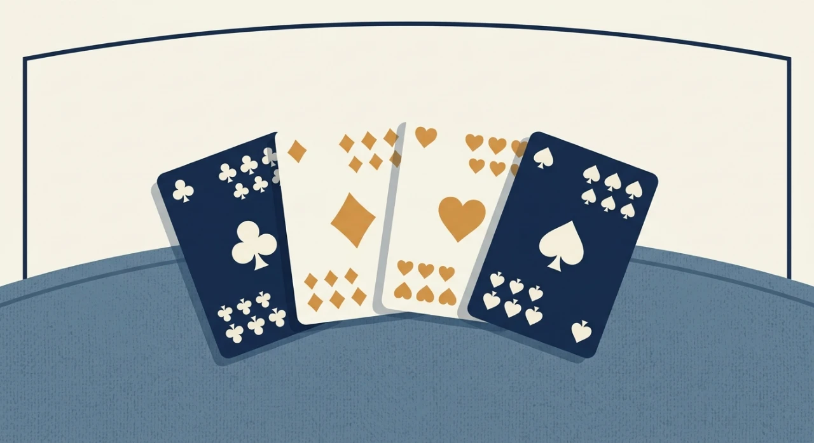
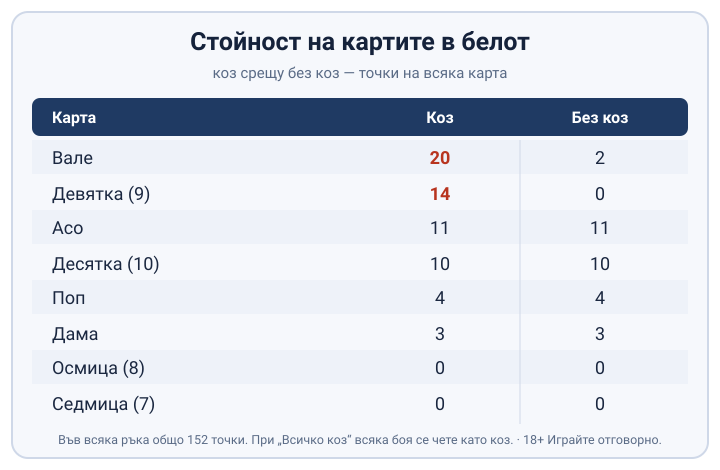
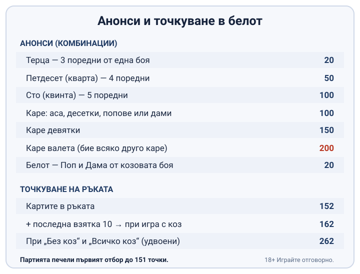

# Белот правила и точкуване за начинаещи

Белот се играе с тесте от 32 карти, от четирима души в два отбора, и партията се печели от отбора, който пръв събере 151 точки. Тук вървят по реда, по който идват на масата, от раздаването до последната взятка.

Вариантът по-долу е обикновеният белот, този, който повечето хора в България наричат просто „белот". Правилата му се учат за една вечер, а малкото неща, които се менят от маса на маса, са отбелязани накрая, за да не ги приемете за твърд закон.

## Масата, тестето и раздаването

Тестето е скъсено: във всяка от четирите бои стоят само 7, 8, 9, 10, Вале (J), Дама (Q), Поп (K) и Асо (A), нищо под седмицата. Четиримата играчи образуват два отбора по двама, партньорите сядат един срещу друг, а играта тече обратно на часовниковата стрелка. Раздаването минава на две порции: първо по 3 карти на всеки, после по 2, така че всеки държи по 5 и идва ред на наддаването. Чак след наддаването падат последните по 3 карти и всеки стига до 8. Раздаващият говори и играе последен, което му дава дребно, но реално предимство, защото чува всички останали, преди да реши какво да обяви. Понеже наддавате върху частична ръка от пет карти, решавате за коза с непълна информация, а последните три карти после могат да потвърдят избора ви или да го обърнат.

## Наддаването и как се избира козът

Наддаването избира с какво ще се играе ръката. Редът върви възходящо по сила на боята: Спатия ♣ → Каро ♦ → Купа ♥ → Пика ♠ → Без коз → Всичко коз. Всеки следващ анонс стои по-високо от предишния, тоест който обяви Купа, надгражда само с Пика, Без коз или Всичко коз. Контра удвоява залога (×2). Реконтра го качва на ×4. Щом паднат три последователни паса, наддаването приключва и боята, на която всички са се спрели, става коз за цялата ръка. При „Без коз“ никоя боя не е силна. При „Всичко коз“ силни са всички. Какво ще обявите зависи от това какво държите. Силна боя с козовите Вале и девятка почти винаги оправдава анонс. Тези две карти носят най-много точки и прибират най-много взятки. Разпръсната ръка, богата на аса и десетки, клони към „Без коз“ или „Всичко коз“.

## Стойността на картите

Една и съща карта струва различно според това дали боята ѝ е коз. Във всяка ръка на масата лежат общо 152 точки.

| Карта | Коз | Без коз |
|---|---|---|
| Вале | 20 | 2 |
| Девятка (9) | 14 | 0 |
| Асо | 11 | 11 |
| Десятка (10) | 10 | 10 |
| Поп | 4 | 4 |
| Дама | 3 | 3 |
| Осмица (8) | 0 | 0 |
| Седмица (7) | 0 | 0 |

*Стойността на всяка карта при коз и при „Без коз“. Козовите Вале и девятка носят най-много.*

Козовите Вале и девятка носят най-много, 20 и 14, затова се пазят за решаващите взятки. При „Без коз" стойностите падат на колоната отдясно, а при „Всичко коз" всяка боя се чете като коз, тоест всяко Вале е 20, всяка девятка 14, и така нататък по цялата маса.

## Силата на картите при взятка

Коя карта бие коя също зависи от коза. При коз редът е Вале, девятка, Асо, десятка, Поп, Дама, осмица, седмица и не следва обикновеното подреждане. Без коз редът е интуитивният: Асо, десятка, Поп, Дама, Вале, девятка, осмица, седмица, и по него се четат всички бои при игра „Без коз".

## Анонсите: терца, петдесет, сто, каре и белот

Анонсите са бонус точки за силни комбинации в ръката. Обявяват се при изиграването на първата карта и не важат при игра „Без коз".

Три последователни карти от една боя образуват **терца** и носят 20 точки. Терцата е най-малката от редиците; четири последователни карти правят **петдесет**, което по част от масите се нарича кварта, и носят 50 точки, а пет последователни са **сто**, другаде квинта, за 100 точки. Същата логика на последователни карти важи и при [комбинации в покера](/blog/poker-kombinacii/), където подреждането е разписано по-подробно.

**Каре** е друг тип комбинация: четири еднакви карти, чиято стойност зависи от ранга им. Четири аса, десетки, попове или дами дават 100 точки, четири девятки 150, а четири валета 200 и бият всяко друго каре на масата. Каре от седмици и осмици не се брои за нищо.

**Белот** е Поп и Дама от козовата боя, държани от един играч. Носят 20 точки и се обявяват в мига, в който се играят.

Редът на обявяване тежи при спор за терца. Когато двама играчи имат по една, по-високата, тоест завършващата с по-силна карта, отменя по-ниската и само печелившата страна си вписва точките. Затова е прието да се казва с коя карта завършва редицата, не просто че човек има терца.

## Броенето на точки

Картите в една ръка носят 152 точки. Към тях се прибавят 10 за последната взятка и сборът при игра с коз става 162. При „Без коз" и „Всичко коз" тези точки се удвояват и ръката струва 262. Отгоре идват анонсите, терца, петдесет, сто, каре и белот, които често тежат повече от самите карти.

При записване точките се закръглят до десетици: 142 се вписват като 14. Партията печели първият отбор, който стигне 151 точки. Една ръка с голямо каре и терца може да стигне прага по-бързо от няколко редови ръце, така че анонсите решават изхода също толкова, колкото редовната игра.

*Точки за всеки анонс и сборовете за ръката. Партията печели първият отбор до 151 точки.*

## Когато точките висят

Ако двата отбора завършат ръката наравно, точките не се присъждат веднага, а „висят" и се прибавят към следващата изиграна ръка. Отборът, който е наддал и определил играта, поема риска. Той трябва да събере повече точки от противника, иначе играта е „вкарана“ и всичките точки от ръката отиват у противниковия отбор. Затова високият анонс не е безплатен; обявите ли повече, поемате и риска да подарите цялата ръка на противника.

## Къде правилата се уговарят предварително

Белот има регионални варианти. Част от „правилата“ всъщност са договорка на масата. Прагът 151 е най-разпространеният стандарт, но някои компании играят до друго число и го определят преди първото раздаване. Капо, когато един отбор прибере всички взятки, носи бонус точки, чиято стойност се различава по регион и по маса, затова се уговаря предварително, вместо да се приема за дадена. Същото важи за майорна терца и за имената на комбинациите: на едни маси казват петдесет и сто, на други кварта и квинта за едни и същи неща.

Съществуват и отделни разновидности със свои правила, например бридж-белот, който мнозина играят паралелно с обикновения белот. Преди да седнете на непозната маса, попитайте какъв праг се играе, как се брои капо и дали важи майорна терца.

## Белот на пари онлайн - законно ли е?

Обикновеният белот между приятели е социална игра, не хазарт. Залог на реални пари в онлайн среда вече е хазарт. В България организирането на хазартни игри е под надзора на НАП и легалната линия за играча е ясна: ако ще се играе на пари, това става единствено в лицензирано от НАП казино, чийто лиценз е вписан в публичния регистър, а как се проверява законността сме описали на страницата [законно ли е](/zakonno-li-e/). Белот на пари не е източник на доход и не бива да се третира така: ако изобщо играете със залог, важат същите граници, както при всяка игра в [лицензирано казино](/blog/kak-se-igrae-poker-kazino/), а именно фиксиран бюджет, който можете да загубите, и предварителни лимити, зададени преди първия залог. Помощни ресурси ще намерите на страницата ни за [отговорна игра](/blog/responsible-gambling/).

---

**Георги Тодоров**
Публикувано: 20.10.2026 · Последна редакция: 20.10.2026

**За Всички Казина.** Независим сайт за сравнение на онлайн казина, лицензирани за българския пазар. Оценяваме всяко казино по публична методика с шест претеглени критерия и проверяваме лиценза в регистъра на НАП, преди да дадем оценка. Не сме оператор и не продаваме съвети за печалба; сравняваме, проверяваме и обясняваме, за да избираш с отворени очи.

**Отговорна игра.** 18+ Хазартът може да пристрасти. Играйте отговорно. Ако усетиш, че играта излиза извън контрол или искаш да я ограничиш, виж [инструментите за отговорна игра](/otgovorna-igra/) и възможността за самоизключване чрез националния регистър на уязвимите лица към НАП (подава се писмено само от засегнатото лице). Национална информационна линия за наркотиците, алкохола и хазарта („Солидарност") 0888 99 18 66, делнични дни 10:00-17:00.

**Разкриване на партньорства.** Сайтът съдържа партньорски (афилиейт) връзки; когато отвориш оферта през такава връзка, това може да финансира сайта, без да променя цената за теб и без да влияе на оценките ни. От 1 август 2026 г. дейността на афилиейт оператори в България се лицензира съгласно Закона за държавния бюджет за 2026 г. (ДВ, бр. 69 от 31.07.2026 г.). Всички Казина е подало заявление за лиценз пред Националната агенция по приходите и очаква издаването му.
