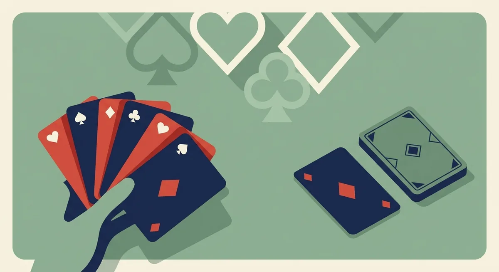
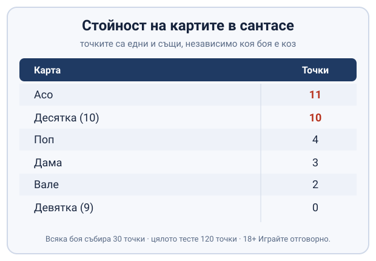
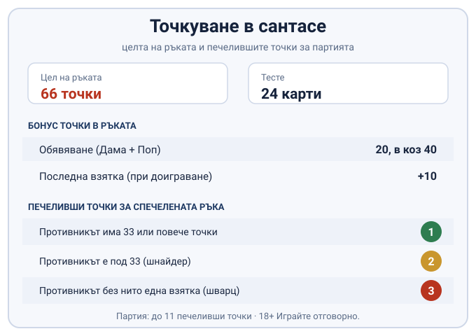

# Сантасе правила: как се играе сантасе (66)

Сантасе се играе от двама души с тесте от 24 карти, а всяка ръка я печели онзи, който пръв събере 66 точки. Самата игра пък е поредица от такива ръце, докато единият стигне до нужните печеливши точки.

По-долу е описан обичайният вариант, този, по който сядат повечето хора. Няколкото неща, които се менят от маса на маса и от приложение на приложение, са събрани накрая, за да не ги приемете за твърд закон.

## Тестето и раздаването

Тестето е скъсено. Във всяка от четирите бои стоят само Асо, Десятка, Поп, Дама, Вале и Девятка, нищо под деветката. Раздаването минава на две порции: първо по три карти на всеки, после още по три, а между тях раздаващият обръща една карта с лицето нагоре и нейната боя става коз за ръката. Картите, които остават нераздадени, се трупат като талон върху коза, така че откритата козова карта се подава изпод тях.

Всеки започва с по шест карти в ръка. Раздаващият играе последен в първата взятка, което е дребно предимство, защото вижда какво прави противникът, преди да реши сам.

## Колко струва всяка карта

Стойностите са едни и същи независимо коя боя е коз. Запомнят се бързо, защото са само шест:

| Карта | Точки |
|---|---|
| Асо | 11 |
| Десятка (10) | 10 |
| Поп | 4 |
| Дама | 3 |
| Вале | 2 |
| Девятка (9) | 0 |

Всяка боя събира 30 точки, а цялото тесте 120. Десятката е почти толкова тежка, колкото асото, и точно затова е карта, за която си струва да се води борба. Валето и девятката, обратно, не носят почти нищо на масата и често се хвърлят, когато трябва да се пусне боя без изгледи за взятка.

*Стойността на всяка карта. Десятката е почти толкова тежка, колкото асото.*

## Кой бие кого

Редът на силата вътре в една боя не върви по стойността на точките. От най-силна към най-слаба картите се нареждат така: Асо, Десятка, Поп, Дама, Вале, Девятка. Тоест десятката бие попа, дамата и валето, макар да изглежда по-дребна. Същата особеност, десятката над попа, важи и при [белот](/blog/belot-pravila/). Козът пък стои над всичко: коя да е козова карта бие коя да е карта от другите бои. Когато и двамата пуснат от една и съща не-козова боя, печели по-високата по този ред; пусне ли някой коз на чужда боя, прибира взятката, стига другият да няма по-висок коз.

## Обявяванията: 20 и 40

Дама и Поп от една и съща боя, държани в една ръка, носят бонус. Обикновено обявяване струва 20 точки, а ако двете карти са от козовата боя, струва 40. Обявява се само когато сте на ход да водите: играете едната от двете карти, показвате другата и си вписвате точките. Същата логика на силни комбинации от подредени карти ще срещнете и при [комбинациите в покера](/blog/poker-kombinacii/), макар там подреждането да върши друга работа.

Едно предупреждение, което лесно се пропуска: обявяване не минава, след като талонът свърши или бъде затворен. Докато има какво да се тегли, бонусът важи; затвори ли се играта, оставате само с картите в ръка.

## Девятката коз и смяната ѝ

Девятката на коза е най-слабата козова карта, но пак върши работа. Който я държи, може да я размени за откритата козова карта изпод талона и така да вземе по-силен коз в ръката си. Смяната става само когато сте на ход да водите и сте спечелили поне една взятка, и само докато в талона още има карти за теглене. Щом играта наближи края си или някой затвори, прозорецът за смяна се затваря.

## Двете фази: докато има талон и след това

Докато талонът е пълен, играта е свободна. Не сте длъжни нито да следвате боята, нито да биете; може да пуснете каквото прецените. След всяка взятка първо тегли спечелилият, после другият, и двамата се връщат на по шест карти.

Нещата се сменят, когато талонът свърши или когато някой го затвори нарочно. Тогава правилата стягат: длъжни сте да отговорите на боята, с която се води, и да я биете, ако можете; нямате ли по-висока карта от същата боя, пускате по-ниска от нея; нямате ли изобщо тази боя, трябва да сечете с коз, ако имате. Чак ако нямате нито боята, нито коз, пускате каквото е останало.

Затварянето на талона, някъде го наричат капак, е ход за онзи, който вярва, че ще прибере останалите взятки и ще стигне 66 без помощта на новите карти. Откритата козова карта се обръща с лицето надолу, тегленето спира и играта влиза в стегнатата фаза. Залогът е ясен: затвориш ли и не стигнеш 66, точките отиват у противника.

## Как се стига до 66

Шейсет и шестте се обявяват, не се случват сами. Може да кажете, че сте стигнали, само веднага след като сте взели взятка или сте направили обявяване, тоест в момента, в който точките ви току-що са се вдигнали. Ако обявите 66 и се окаже, че ги нямате, губите две печеливши точки за ръката, така че броенето наум трябва да е сигурно, преди да проговорите.

Ако никой не обяви и ръката се доиграе докрай, последната взятка носи допълнителни 10 точки и ръката се печели от онзи с повече точки. Затова към края дребните взятки, които иначе не струват нищо, изведнъж започват да тежат.

## Печелившите точки за цялата игра

Събирането на 66 печели ръката, но не непременно с еднаква тежест. Ако противникът също е събрал 33 или повече, ръката носи една печеливша точка. Остане ли под 33, печелите две, което по масите се нарича шнайдер. А ако противникът не е прибрал нито една взятка през цялата ръка, тоест е останал на шварц, печелите три.

Цялата игра обикновено върви до 11 печеливши точки. Затова една ръка, спечелена чисто, струва повече от три извоювани на ръба, и защитата на противника да не падне под 33 понякога е по-важна от собственото ви бързане към 66.

*Точкуването в една ръка и печелившите точки за партията.*

## Какво се уговаря на масата

Голяма част от онова, което хората изговарят като „правило", всъщност е договорка. Прагът от 11 печеливши точки е разпространеният стандарт, но някои играят до 7, а други до фиксиран брой изиграни ръце; определя се преди първото раздаване. Дали последната взятка носи 10 точки, точният момент, в който се разменя девятката, имената на обявяванията, всичко това се чува различно по различните маси, а и приложенията налагат собствените си версии, без да питат.

Затова, преди да седнете срещу непознат противник или да инсталирате ново приложение, най-разумно е да сверите четири неща: до колко точки се играе партията, брои ли се бонусът за последна взятка, кога е позволена смяната на девятката и как се присъждат печелившите точки. Пет минути уговорка спестяват един спор по средата на играта.

## Сантасе на пари онлайн - законно ли е?

Сантасе между приятели е социална игра, не хазарт. Сложи ли се залог на реални пари в онлайн среда, вече говорим за хазарт, а в България организирането на хазартни игри е под надзора на НАП. Легалната линия за играча е една: ако ще се играе на пари, това става само в казино с лиценз от НАП, вписан в публичния регистър, а как се проверява законността сме описали на страницата [законно ли е](/zakonno-li-e/).

Струва си да се каже направо: сантасе на пари не е източник на доход и не бива да се третира така. Ако изобщо решите да играете със залог, важат същите граници, както при всяка игра в [лицензирано казино](/blog/kak-se-igrae-poker-kazino/), а именно бюджет, който можете да загубите, без това да ви засегне, и лимити, зададени преди първия залог. Помощни ресурси ще намерите на страницата ни за [отговорна игра](/blog/responsible-gambling/).

---

**Георги Тодоров**
Публикувано: 21.10.2026 · Последна редакция: 21.10.2026

**За Всички Казина.** Независим сайт за сравнение на онлайн казина, лицензирани за българския пазар. Оценяваме всяко казино по публична методика с шест претеглени критерия и проверяваме лиценза в регистъра на НАП, преди да дадем оценка. Не сме оператор и не продаваме съвети за печалба; сравняваме, проверяваме и обясняваме, за да избираш с отворени очи.

**Отговорна игра.** 18+ Хазартът може да пристрасти. Играйте отговорно. Ако усетиш, че играта излиза извън контрол или искаш да я ограничиш, виж [инструментите за отговорна игра](/otgovorna-igra/) и възможността за самоизключване чрез националния регистър на уязвимите лица към НАП (подава се писмено само от засегнатото лице). Национална информационна линия за наркотиците, алкохола и хазарта („Солидарност") 0888 99 18 66, делнични дни 10:00-17:00.

**Разкриване на партньорства.** Сайтът съдържа партньорски (афилиейт) връзки; когато отвориш оферта през такава връзка, това може да финансира сайта, без да променя цената за теб и без да влияе на оценките ни. От 1 август 2026 г. дейността на афилиейт оператори в България се лицензира съгласно Закона за държавния бюджет за 2026 г. (ДВ, бр. 69 от 31.07.2026 г.). Всички Казина е подало заявление за лиценз пред Националната агенция по приходите и очаква издаването му.
