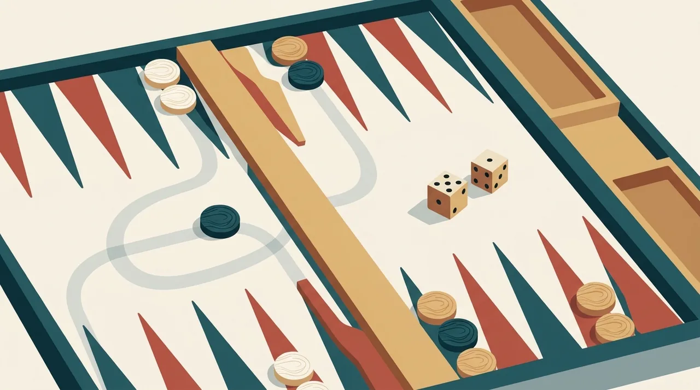
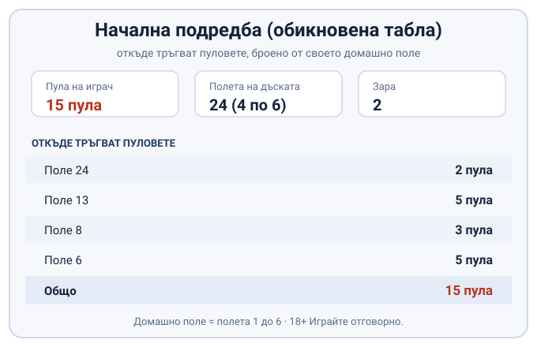
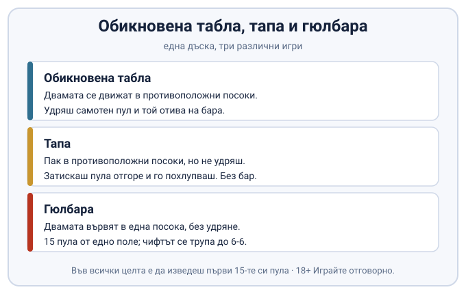

Title tag: Табла правила: как се играе (обикновена, тапа, гюлбара)
Meta description: Табла правила на ясен език: подредба, зарове и чифт, удряне и бар, изваждане и марс. Плюс как се различават обикновена табла, тапа и гюлбара.

---

# Табла: правилата и как се играе, с тапа и гюлбара

Табла се играе от двама, всеки с по петнайсет пула и два зара. Във всяка версия целта е една: да изведеш първи всичките си петнайсет пула от дъската. Основните правила се учат за десет минути, а после цял живот спориш кой как ги разбира.

Защото „табла" не е една игра. Под едно и също име се крият няколко. Кажеш ли на някого „хайде на табла", той най-вероятно сяда за обикновената табла, онази с удрянето и бара. На същата дъска обаче се играят и тапа, и гюлбара, всяка със своя цел и свои забрани. Като настолна игра таблата стои някъде между чистия късмет на [хазартните игри](/blog/hazartni-igri-vidove/) и преценката, с която се играят карти като [сантасе](/blog/santase-pravila/): заровете казват какво можеш да направиш, ти решаваш какво да направиш с него.

## Дъската, пуловете и подредбата

Дъската има двайсет и четири полета, подредени в четири групи по шест. По средата минава барът и дели дъската на две половини. Всеки играч има по петнайсет пула и ги мести с хвърлянето на два зара. Една от четворките полета е неговото домашно поле, шестте полета от 1 до 6, в които накрая трябва да събере всичките си пулове, преди да започне да ги изкарва.

Началната подредба в обикновената табла е огледална за двамата. Броено от собственото домашно поле, всеки започва с два пула на поле 24, пет на поле 13, три на поле 8 и пет на поле 6. Петнайсет на брой. Двамата се движат в противоположни посоки, всеки към своето домашно поле, тоест от по-високите полета към по-ниските. Целият път на един пул минава през дъската, докато стигне у дома и чака да бъде изкаран.

*Откъде тръгват 15-те пула в обикновената табла.*

## Как върви ходът и какво значи чифт

Преди първия ход всеки хвърля по един зар. По-високото число започва и първият ход се играе с двете паднали числа. Паднат ли еднакви, хвърля се наново.

Всеки от двата зара е отделен ход. Можеш да местиш два различни пула, по един с всяко число, или да прекараш един пул през двете числа наведнъж, но само ако междинното поле е свободно за него. Паднеш ли чифт, да речем 2-2, не го играеш веднъж, а четири пъти: четири отделни хода по две. Тук важи правило, което лесно се пропуска: длъжен си да изиграеш всички възможни ходове. Ако можеш да изиграеш само едното от двете числа, играеш по-голямото.

Поле, върху което противникът държи два или повече пула, е капия. Там не стъпваш, колкото и да ти отърва паднатото число. С капиите се затваря път и другият остава с хвърляне, което няма къде да отиде.

## Удряне, блот и бар

Оттук нататък говорим за обикновената табла. Самотен пул на поле се нарича блот. Падне ли противников пул точно върху него, блотът е ударен и отива на бара. Преди да направиш какъвто и да било друг ход, трябва да го върнеш в игра, и то от страната на противниковото домашно поле. Докато не влезе, нищо друго не мърда. А ако полетата за влизане са затворени с капии, целият ход пропада и чакаш следващото хвърляне.

## Прибиране вкъщи и изваждане на пуловете

Изваждането, тоест изкарването на пуловете от дъската, започва едва след като и петнайсетте са прибрани в домашното поле, полетата от 1 до 6. Докато макар и един пул още обикаля навън, не можеш да извадиш нито един.

Щом всички са вкъщи, вадиш според зара. Паднало число изкарва пул от полето със същия номер. Няма ли пул там, местиш от по-високо поле вместо да вадиш. А когато нищо по-високо не е заето, махаш от най-горното поле, на което още стоят пулове. Който пръв изкара и петнайсетте, печели партията.

## Кой печели и какво е марс

Печели онзи, който пръв извади всичките си петнайсет пула, и това обикновено носи една точка. Марсът обаче е двойна игра: ако губещият не е извадил нито един от своите петнайсет пула, печалбата се брои двойно, две точки вместо една. В мач до определен брой точки това е голяма разлика, защото един марс навакса цяла изостанала партия наведнъж. Накрая често се стига до чисто надбягване, в което и двамата вече изкарват пулове, а решава чии зарове излизат по-удачно.

## Обикновена табла, тапа и гюлбара: три игри под едно име

Трите игри се различават по две неща: накъде вървят пуловете и какво става, когато срещнеш самотен противников пул. Обикновената табла е описаната дотук, с противоположните посоки, удрянето и бара. Тапа и гюлбара ползват същата дъска и същите пулове, но сменят сърцевината на правилата.

*Една дъска, три игри: какво сменят тапата и гюлбарата.*

В тапата целта не е да удряш, а да затиснеш. Вместо да събориш самотния противников пул, слагаш свой отгоре и го похлупваш. Докато твоят пул седи върху него, похлупеният е в капан и не може да мръдне. „Тапа" е точно това, капачка. Бар и удряне тук няма. Два твои пула на едно поле, както и един похлупващ, правят опора, на която противникът не може да стъпи. Движението пак е в противоположни посоки, а изваждането пак чака всички пулове първо да се приберат. На маса тапата обикновено е третата игра в мача, след правата табла и гюлбарата, и пръв играе онзи, който е спечелил предишната.

Гюлбарата нарежда дъската другояче. И петнайсетте пула стоят накуп на едно-единствено поле, в най-далечния ъгъл, а складовете на двамата играчи са в диагонално срещуположни ъгли. Движението е в една и съща посока за двамата, успоредно, обратно на часовниковата стрелка. Удряне и тук няма: самотен пул владее полето си и противникът не може да стъпи върху него. Чифтът обаче тежи повече, отколкото в правата табла. Падне ли дубъл, играеш го, а с него и всеки следващ дубъл нагоре до 6-6, така че по-късно в партията едно 2-2 може да повлече след себе си четири двойки, четири тройки и нагоре чак до шестиците. В първите хвърляния това не важи, а частите, които няма как да изиграеш, се губят. Приемайте каскадата като особеност на този вариант, не като твърдо правило за всяка маса. Печалбата е една точка, а при марс две, ако противникът не е извадил нито един пул.

## Какво всъщност се уговаря на масата

Голяма част от онова, което наричаме „правило на таблата", всъщност е уговорка. До колко точки върви мачът, брои ли се марсът двойно, как точно се трупа чифтът в гюлбара, в какъв ред се играят трите игри, тръгва ли изложен пул пръв: всичко това се разбира преди започване или го налага приложението, в което играете. Както при [белота](/blog/belot-pravila/), където всяка компания държи на дребните си домашни правила, тук е по-разумно да сверите версията, преди да хвърлите първия зар, отколкото да спорите на третата партия.

## Табла на пари онлайн: законно ли е?

Табла между приятели, на маса, за една ракия или просто за тръпката, е социална игра. Не е хазарт. Сметката се мени в мига, в който на екрана залагате реални пари срещу непознат. Тогава играта попада под надзора на НАП и единственото законно място за нея е лицензирано казино или организатор. Кое е позволено и кое не, е разписано на страницата [законно ли е](/zakonno-li-e/).

Табла на пари не е източник на доход, колкото и добре да въртите заровете. В дълъг план домашното предимство и случайността на зара тежат повече от уменията ви, и това не се обръща със стратегия. Към играта на пари важи същото, което важи за всяка друга: с бюджет, който можете да загубите изцяло, и с лимит, сложен преди да депозирате. Усетите ли, че залозите вече не са забавление, [инструментите за отговорна игра](/blog/responsible-gambling/) са мястото да спрете навреме.

18+ Хазартът може да пристрасти. Играйте отговорно.

---

**Георги Тодоров**
Публикувано: 22.10.2026 · Последна редакция: 22.10.2026

*Георги Тодоров тества лицензирани в България казино сайтове от 2024 г. със собствен бюджет и проверява лиценза в публичния регистър на НАП преди регистрация. Пише за Всички Казина за реалната цена на бонусите, скоростта на тегленията и математиката зад игрите.*

**За Всички Казина:** Всички Казина е независим сайт за сравнение на онлайн казина с лиценз за българския пазар. Не сме оператор и не организираме игри. Сравняваме, проверяваме и обясняваме, за да избирате с отворени очи. Казината оценяваме по публична формула с шест претеглени критерия ([Как оценяваме](/kak-ocenyavame/)), а партньорските връзки, които финансират сайта, са обозначени. Тази статия не съдържа партньорски връзки.

**Отговорна игра.** 18+ Хазартът може да пристрасти. Играйте отговорно. Ако усетиш, че играта излиза извън контрол или искаш да я ограничиш, виж [инструментите за отговорна игра](/otgovorna-igra/) и възможността за самоизключване чрез националния регистър на уязвимите лица към НАП (подава се писмено само от засегнатото лице). Национална информационна линия за наркотиците, алкохола и хазарта („Солидарност") 0888 99 18 66, делнични дни 10:00-17:00.

**Разкриване на партньорства.** Всички Казина съдържа партньорски (афилиейт) връзки; когато отвориш оферта през такава връзка, това може да финансира сайта, без да променя цената за теб и без да влияе на оценките ни. От 1 август 2026 г. дейността на афилиейт оператори в България се лицензира съгласно Закона за държавния бюджет за 2026 г. (ДВ, бр. 69 от 31.07.2026 г.). Всички Казина е подало заявление за лиценз пред Националната агенция по приходите и очаква издаването му.
