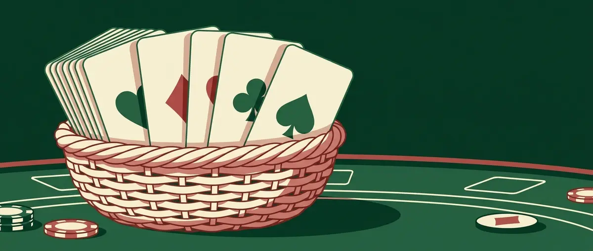

Title tag: Канаста: правила, точкуване и разновидности
Meta description: Канаста: правила, стойност на картите, точкуване, мелдове, червени тройки и разновидности за 2, 3 и 4 играчи. Научете как се играе.

---

# Канаста: правила, точкуване и разновидности

Канаста е игра от семейството на румито. Събираш карти от един и същ ранг и ги сваляш на масата на групи, а отборът ти се цели да стигне пръв 5000 точки. Дотам се върви през няколко раздавания, не с едно сполучливо тесте. Класическата канаста се играе от четирима в два отбора, партньорите сядат един срещу друг. Има работещи версии за двама и за трима, но правилата по-долу следват класическия четиримен вариант; където версиите се разминават, отбелязваме го изрично.

## Какво е нужно

Едно тесте за канаста се състои от 108 карти: две стандартни колоди по 52 плюс четири джокера, разбъркани и играни като едно. При четирима всеки получава по 11 карти. Играта за двама иска повече в ръка, по 15 на човек, като на всеки ход се теглят две карти от талона и се изхвърля една, а за излизане са нужни две канасти. При трима раздаването е по 13 карти (някои маси играят с 11).

## Колко струва всяка карта

Стойността на всяка карта е фиксирана.

- Джокер: 50 точки.
- Асо и двойка: по 20.
- Поп, дама, вале, 10, 9 и 8: по 10.
- 7, 6, 5 и 4: по 5.
- Черна тройка: 5, но се брои само когато е свалена на масата в момента на излизане.

Червените тройки са отделен случай, с много по-тежко тегло; за тях малко по-надолу.

*Стойността на картите и основните бонуси в канаста (класически вариант).*

## Диви карти

Дивите карти заместват липсваща карта в групата. В канаста това са джокерите и всички двойки. Група само от диви карти не е разрешена.

## Червени тройки

Червените тройки не се играят като останалите карти. Щом ви дойде такава, я слагате открито пред себе си и теглите нова отгоре. Всяка носи 100 точки на отбора, при условие че отборът е свалил поне един мелд; ако в края на раздаването няма нито един, същите тройки стават минус 100 всяка. Четирите червени тройки заедно носят не 400, а удвоените 800, със симетричния минус 800, ако отборът не е мелднал нищо.

## Какво е мелд

Мелдът е групата от карти с един и същ ранг, свалена на масата. За да е валиден, трябва да събира поне три карти, от които поне две естествени и най-много три диви. Изцяло диви мелдове няма. Отборът не държи две отделни групи от един ранг: новите карти от този ранг влизат в съществуващата група. Мелдовете се трупат общо за отбора, а не поотделно за всеки играч, така че партньорите градят заедно.

## Канаста

Канаста се нарича мелд от седем или повече карти от един ранг, и той носи най-тежките точки в играта. Чиста канаста, съставена само от естествени карти, струва 500 точки; смесена, с поне една дива вътре, струва 300. Без поне една канаста отборът няма право да излезе, колкото и други мелдове да е свалил.

## Как тече един ход

Теглиш, по избор мелдваш, изхвърляш. Тегленето е или горната карта от талона, или целият куп с изхвърлените карти. След това можеш да свалиш нови мелдове или да добавиш карти към вече свалени на масата. Изхвърлянето на една карта затваря хода и предава реда на следващия.

## Вземане на купа и замразяване

Можеш да вземеш целия куп с изхвърлените карти наведнъж, но само при точни условия. Взимаш го, ако веднага меднеш горната му карта: с две естествени карти от ръката си или като я добавиш към готов отборен мелд от същия ранг. Когато най-горе лежи дива карта или черна тройка, купът не се взема. Замразяването е отделно правило. Купът е замразен за всички, ако съдържа дива карта или е започнат с червена тройка, и замразен за твоя отбор дотогава, докато отборът не е свалил първия си мелд. Замразен куп се взема единствено с две естествени съвпадащи карти от ръката; кърпене с дива карта тук не върши работа.

## Черни тройки

Черните тройки спират следващия играч. Изхвърлиш ли черна тройка, следващият не може да вземе купа на този ход, без това да замразява купа. Самите тройки влизат в мелд само при излизане, като група от три или четири без диви в нея.

## Първоначалният мелд

Първия път, когато отборът сваля мелдове в едно раздаване, той трябва да събере определен минимум точки наведнъж. Този минимум зависи от текущия сбор на отбора.

- отрицателен сбор: 15 точки;
- от 0 до 1495: 50;
- от 1500 до 2995: 90;
- 3000 и нагоре: 120.

Бонусите от червени тройки и от канасти не влизат в този минимум; брои се само стойността на свалените карти.

## Излизане и скрито излизане

За да излезе, отборът трябва вече да държи поне една канаста. Оттам сваля всичко освен една карта и изхвърля последната, или сваля цялата си ръка наведнъж, без последно изхвърляне. При скрито излизане играчът излиза в един ход с цялата си ръка, включително пълна канаста, без отборът да е свалял нищо дотогава. То добавя 100 точки отгоре, тоест 200 общо вместо обикновените 100 за излизане.

## Точкуване накратко

За едно раздаване сборът е бонуси плюс стойността на свалените карти, минус картите, останали в ръка. Бонусите идват от канастите, червените тройки и излизането. Играта свършва, щом партньорство стигне 5000 точки за всички изиграни раздавания, и по-високият общ сбор печели.

## Разновидности

Масите се различават по няколко точки, затова уговорете ги предварително.

- брой играчи и раздаване: 11 при четирима, 15 при двама, 13 (или 11) при трима;
- тесте: класическите 108 карти, но някои версии добавят трети джокер и играят със 110;
- таргет: класическите 5000 срещу по-високите цели в модерни американски версии;
- домашни правила около червените тройки и дребните случаи.

Числата 110 и по-високите цели идват от различни справочници, не от едно задължително правило за всяка маса.

## На пари и накратко за закона

Канаста рядко се играе на пари. Ако все пак някъде се играе, в България легална среда означава само оператор с лиценз от НАП, а всичко извън това е сива зона. Повече по темата има в [кога игра на пари е законна](/zakonno-li-e/), а при този граничен случай канаста попада и сред [видовете хазартни игри](/blog/hazartni-igri-vidove/). Обичате ли игрите с карти, вижте и правилата на [баккара](/blog/bakara-pravila/).

Играйте за удоволствие, залагайте само суми, които няма да ви липсват, и спирайте, когато престане да е забавно. Ако усетите, че играта излиза извън контрол, [отговорната игра](/blog/responsible-gambling/) не е формалност, а самоизключването минава през регистъра на уязвимите лица; започнете оттам.

18+ Хазартът може да пристрасти. Играйте отговорно. [Отговорна игра](/otgovorna-igra/)

---

Автор: Георги Тодоров, Всички Казина
Публикувано: 24.10.2026 · Обновено: 24.10.2026
