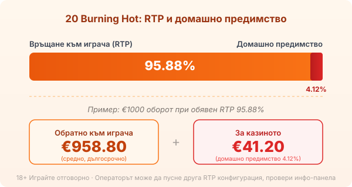

# 03-HUMANISED — vk-0291 · 20 Burning Hot

## PHASE 1 EVALUATION
Byline: editorial (publ. Георги Тодоров). Persona: none — editorial.

Layer scan:
- Em-dashes: 0. PASS.
- Banned connectives (освен това / в допълнение / в заключение / заслужава да се отбележи / в днешно време): none. PASS.
- Signposting lead-ins: none ("Тук е и честната разлика с оригинала" is a stated fact, not a label-before-calculation). PASS.
- Rhetorical-question openers: 0. PASS.
- Repeated paragraph template (fact→what-it-means→example→takeaway across 3+ sections): not present; section shapes vary by design. PASS.
- Paragraph rhythm: varied (single-flow analytical, short mechanical, 3-4 build). PASS.
- Fabricated anecdote: none. PASS.
- Asymmetric ending: present (takes a side). PASS.
- "не A, а B" mirrored negation as a PARAGRAPH-ENDING habit: found at 3 paragraph ends (5×3, скатери, волатилност). Dictionary: keep at most one as an ender. → FIX two.

VERDICT: MIXED (one recurring structural tell). Light rewrite applied: two of the three mirrored-negation enders rebuilt to end on a plain fact; the single contrast ender in the 5×3 section kept as the one allowed instance. All facts, numbers, links, dates and RG lines preserved exactly.

## REVISED ARTICLE

Byline: Editorial Team | Market: bg — guide, publ. под Георги Тодоров.

---

# 20 Burning Hot: какво сменят 20-те линии (и RTP 95.88%)

20 Burning Hot е 20-линейната версия на огнената класика, която много български играчи познават още от залите: същите плодове, звънци и червени седмици, същият разширяващ се wild, само че печелившите линии вече са двадесет вместо пет. Логиката подсказва, че повече линии значат повече шансове. Сметката показва друго. Обявеният RTP тук е 95.88%, под 96.45% на оригиналния петлинеен Burning Hot. Повече линии значат повече едновременно покрити начини за печалба на едно завъртане, но и по-висок общ залог, с който плащаш за тях.

## От EGT до Amusnet: кой я прави

Играта излиза на 24 август 2017 г. от студиото, което тогава се казваше EGT Interactive, онлайн подразделението на софийската Euro Games Technology. През юни 2022 г. EGT Interactive завърши ребрандирането си към Amusnet Interactive. Компанията и портфолиото са същите, сменена е само марката, затова в едно казино ще срещнеш 20 Burning Hot под логото на EGT, а в друго под Amusnet. Самата игра е от 2017 г. и предхожда смяната на името.

## 5×3 и двадесетте фиксирани линии

Полето е пет барабана на три реда, а линиите са двадесет на брой и са фиксирани. Не ги избираш и не ги включваш една по една, всяко завъртане играе и двадесетте, отляво надясно. Това е основната разлика с петлинейния Burning Hot: при пет линии един залог покрива пет начина да се подредят символи, при двадесет покриваш двадесет. Повече покрити линии наистина вдигат честотата, с която нещо се връща на екрана, но всяка линия се финансира от залога ти, така че и общият облог на завъртане е по-голям. По-широкото покритие не е по-добро математическо предимство, а просто по-широко и по-скъпо.

## RTP 95.88% и честната разлика с оригинала

Обявеният RTP на 20 Burning Hot е 95.88%. Това е процентът, който играта връща средно за милиони завъртания, не обещание за твоята сесия. Домашното предимство е разликата до сто процента, тоест 100 − 95.88 = 4.12%. При €1000 оборот това значи средно връщане от €958.80 към играча и €41.20, задържани от казиното, разпределени върху много завъртания, не изтеглени наведнъж.

Тук е и честната разлика с оригинала. Класическият петлинеен Burning Hot върви с обявен RTP 96.45%, а двадесетлинейната версия стои под него. Повече линии не компенсират по-ниското връщане, напротив: при същия бюджет плащаш по-голям залог на спин срещу малко по-ниско средно връщане. EGT и Amusnet доставят заглавията си в няколко RTP конфигурации и операторът избира коя да пусне, затова единственото сигурно число е това в инфо-панела на самата игра в конкретното казино. [Методологията ни](/kak-ocenyavame/) гледа реалния RTP, а не рекламния.

*Примерно разпределение на €1000 оборот при обявен RTP 95.88%. Операторът може да пусне друга конфигурация, проверявай инфо-панела.*

## Разширяващият се wild

Дивият символ е четирилистната детелина и се появява само на средните три барабана, втори, трети и четвърти. Когато влезе, се разширява и покрива целия барабан, а замества всеки символ без двата скатера. Това разширяване е основният начин играта да сглоби линия от плодове, които иначе не биха се подредили. На двадесет линии един разширен wild в средата докосва повече линии наведнъж, отколкото при петлинейната версия, и това е най-осезаемата добавена стойност от повечето линии.

## Два скатера, без безплатни завъртания

20 Burning Hot няма безплатни завъртания, и това изненадва играчи, свикнали всеки нов слот да ги предлага. Вместо тях има два скатера, които плащат директно, от произволна позиция, без да е нужно да лягат на линия. Символът долар се брои отвсякъде по полето и носи до 100 пъти общия залог. Лилавата звезда се появява само на първи, трети и пети барабан и плаща 20 пъти общия залог. Скатерите тук изплащат директно и с това приключват, без бонус рунд зад себе си.

## Рисковата игра

След печалба играта предлага рискова игра: показва обърната карта и трябва да познаеш цвета ѝ, червено или черно. Познаеш ли, печалбата се удвоява, сбъркаш ли, изчезва цялата. Шансът е горе-долу колкото хвърляне на монета и в дългосрочен план рисковата игра не добавя стойност над RTP-то. Разбърква отделния резултат нагоре или надолу, без да мести средната сметка.

## Jackpot Cards: прогресивът

Много EGT казина въртят 20 Burning Hot заедно с мистерийния прогресив Jackpot Cards. Той се задейства на случаен принцип при платено завъртане, не при определена комбинация, и има четири нива по боите на картите: спатия, каро, купа и пика, като пиката е най-големият джакпот. При активиране виждаш дванадесет обърнати карти и обръщаш, докато събереш три от една боя, което решава кое ниво печелиш. Шансът да влезеш расте с размера на залога, не с умение или стратегия, тоест по-големите залози пълнят по-бързо едновременно бюджета и шанса за прогресива.

## Волатилност и какво да очакваш

По скалата на разработчика волатилността е 2 от 5, ниска до ниско-средна. На практика балансът се движи с чести дребни връщания и без дълги сухи серии, но и без грамадните удари на модерните волатилни ротативки. Таванът е 3000 пъти залога на линия за пет червени седмици на една линия, и това е на линия, не върху общия залог, и без прогресива. Случва се рядко и не бива да го залагаш в сметката за сесията.

Преди реални пари [слот игрите](/slot-igri/) обикновено имат демо режим, в който да усетиш темпото на двадесетте линии, без да залагаш. Казиното е платено забавление с позната цена, не начин за доход, и всяко завъртане дългосрочно работи за оператора. Задай си лимит за загуба и за време преди първото завъртане. 18+ Хазартът може да пристрасти. Играйте отговорно. Ако усетиш, че играта излиза извън контрол, виж [инструментите за отговорна игра](/otgovorna-igra/).

## Класика с ясна сметка

20 Burning Hot не е надстройка на петлинейния оригинал, а по-скъпа негова версия с по-ниско обявено връщане. Двадесетте линии и разширяващият се wild я правят по-жива на екрана, прогресивът и рисковата игра добавят адреналин, но нито едно от тях не мести 4.12% домашно предимство в твоя полза. Ако търсиш носталгията по плодовете и седморките, отвори я в демо и провери RTP-то в инфо-панела, преди да вложиш първото евро. Ако търсиш по-добри шансове от оригинала заради повечето линии, няма ги.

---

[AUTHOR BIO BLOCK — Георги Тодоров]
[BRAND BOILERPLATE]
[18+ / RG LINE]

[DATA NEEDED]: none.
