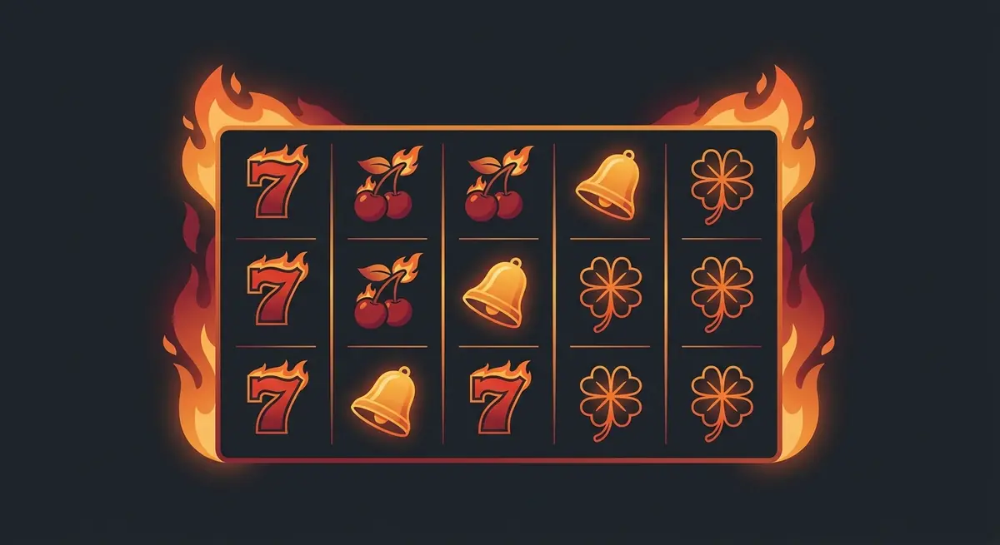

Title tag: 20 Burning Hot: RTP 95.88% и 20-те линии (Amusnet)
Meta description: Как работи 20 Burning Hot на EGT/Amusnet: 5×3, 20 фиксирани линии, разширяващ се wild, два скатера и Jackpot Cards. Защо RTP 95.88% е под оригинала.

---

# 20 Burning Hot: какво сменят 20-те линии (и RTP 95.88%)

20 Burning Hot е 20-линейната версия на огнената класика, която много български играчи познават още от залите: същите плодове, звънци и червени седмици, същият разширяващ се wild, само че печелившите линии вече са двадесет вместо пет. Двайсетте линии покриват повече начини за печалба на едно завъртане. Обявеният RTP обаче е 95.88%, под 96.45% на оригиналния петлинеен Burning Hot, а по-широкото покритие идва и с по-висок общ залог, с който го плащаш.

## От EGT до Amusnet: кой я прави

Играта излиза на 24 август 2017 г. от студиото, което тогава се казваше EGT Interactive, онлайн подразделението на софийската Euro Games Technology. През юни 2022 г. EGT Interactive завърши ребрандирането си към Amusnet Interactive. Компанията и портфолиото са същите, сменена е само марката, затова в едно казино ще срещнеш 20 Burning Hot под логото на EGT, а в друго под Amusnet. Самата игра е от 2017 г. и предхожда смяната на името.

## 5×3 и двадесетте фиксирани линии

Полето е пет барабана на три реда, а линиите са двадесет на брой и са фиксирани. Не ги избираш и не ги включваш една по една, всяко завъртане играе и двадесетте, отляво надясно. Тук е и основната разлика с петлинейния Burning Hot: един залог финансира двайсет линии вместо пет. Повече покрити линии вдигат честотата, с която нещо се връща на екрана, но всяка от тях се плаща от залога ти, затова общият облог на завъртане расте с броя линии.

## RTP 95.88% и честната разлика с оригинала

Обявеният RTP на 20 Burning Hot е 95.88%. Това е дългосрочно средно за милиони завъртания; в рамките на една твоя сесия отклонението нагоре и надолу е голямо. На казиното остават 4.12% домашно предимство, тоест от всеки €1000 оборот играта връща средно по €958.80 на играча, а €41.20 се задържат, разпределени върху много завъртания, не изтеглени наведнъж.

Тук е и съществената разлика с оригинала. Класическият петлинеен Burning Hot върви с обявен RTP 96.45%, а двадесетлинейната версия стои под него, така че повечето линии не компенсират по-ниското връщане. EGT и Amusnet доставят заглавията си в няколко RTP конфигурации и операторът избира коя да пусне, затова единственото сигурно число е това в инфо-панела на самата игра в конкретното казино. [Методологията ни](/kak-ocenyavame/) гледа реалния RTP, а не рекламния.

*Примерно разпределение на €1000 оборот при обявен RTP 95.88%. Операторът може да пусне друга конфигурация, проверявай инфо-панела.*

## Разширяващият се wild

Дивият символ е четирилистната детелина и се появява само на средните три барабана, втори, трети и четвърти. Когато влезе, се разширява и покрива целия барабан, а замества всеки символ без двата скатера. Това разширяване е основният начин играта да сглоби линия от плодове, които иначе не биха се подредили. На двадесет линии един разширен wild в средата докосва повече линии наведнъж, отколкото при петлинейната версия, и това е най-осезаемата добавена стойност от повечето линии.

## Два скатера, без безплатни завъртания

20 Burning Hot няма безплатни завъртания. Ролята им поемат два скатера, които плащат директно, от произволна позиция, без да е нужно да лягат на линия. Символът долар се брои отвсякъде по полето и носи до 100 пъти общия залог. Лилавата звезда се появява само на първи, трети и пети барабан и плаща 20 пъти общия залог. Скатерите тук изплащат директно и с това приключват, без бонус рунд зад себе си.

## Рисковата игра

След печалба играта предлага рискова игра: показва обърната карта и трябва да познаеш цвета ѝ, червено или черно. Познаеш ли, печалбата се удвоява, сбъркаш ли, изчезва цялата. Шансът е горе-долу колкото хвърляне на монета и в дългосрочен план рисковата игра не добавя стойност над RTP-то. Разбърква отделния резултат нагоре или надолу, без да мести средната сметка.

## Jackpot Cards: прогресивът

Много EGT казина въртят 20 Burning Hot заедно с мистерийния прогресив Jackpot Cards. Той се задейства на случаен принцип при платено завъртане, не при определена комбинация, и има четири нива по боите на картите: спатия, каро, купа и пика, като пиката е най-големият джакпот. При активиране виждаш дванадесет обърнати карти и обръщаш, докато събереш три от една боя, което решава кое ниво печелиш. Шансът да влезеш расте с размера на залога: по-големите залози пълнят по-бързо едновременно бюджета и шанса за прогресива.

## Волатилност и какво да очакваш

По скалата на разработчика волатилността е 2 от 5, ниска до ниско-средна. На практика балансът се движи с чести дребни връщания и без дълги сухи серии, но и без грамадните удари на модерните волатилни ротативки. Таванът е 3000 пъти залога на линия за пет червени седмици на една линия, и това е на линия, не върху общия залог, и без прогресива. Случва се рядко и не бива да го залагаш в сметката за сесията.

Преди реални пари [слот игрите](/slot-igri/) обикновено имат демо режим, в който да усетиш темпото на двадесетте линии, без да залагаш. Казиното е платено забавление с позната цена, не начин за доход, и всяко завъртане дългосрочно работи за оператора. Задай си лимит за загуба и за време преди първото завъртане. 18+ Хазартът може да пристрасти. Играйте отговорно. Ако усетиш, че играта излиза извън контрол, виж [инструментите за отговорна игра](/otgovorna-igra/).

## Класика с ясна сметка

Остава си носталгична класика с огнени седморки, само в по-забързана и по-скъпа двайсетлинейна опаковка. Разширяващият се wild и прогресивът я държат жива на екрана, но предимството на казиното не помръдва заради тях. Отвори я в демо и виж реалния RTP в инфо-панела, преди да вложиш първото евро, и не очаквай повечето линии да ти върнат по-добри шансове, защото ги няма.

---

**Георги Тодоров**
Публикувано: 26.10.2026 · Последна редакция: 26.10.2026

[About Всички Казина boilerplate]

**Отговорна игра.** 18+ Хазартът може да пристрасти. Играйте отговорно. Ако усетиш, че играта излиза извън контрол или искаш да я ограничиш, виж [инструментите за отговорна игра](/otgovorna-igra/) и възможността за самоизключване чрез националния регистър на уязвимите лица към НАП (подава се писмено само от засегнатото лице). Национална информационна линия за наркотиците, алкохола и хазарта („Солидарност") 0888 99 18 66, делнични дни 10:00–17:00.

**Разкриване на партньорства.** Всички Казина съдържа партньорски (афилиейт) връзки; когато отвориш оферта през такава връзка, това може да финансира сайта, без да променя цената за теб и без да влияе на оценките ни. От 1 август 2026 г. дейността на афилиейт оператори в България се лицензира съгласно Закона за държавния бюджет за 2026 г. (ДВ, бр. 69 от 31.07.2026 г.). Всички Казина е подало заявление за лиценз пред Националната агенция по приходите и очаква издаването му.
