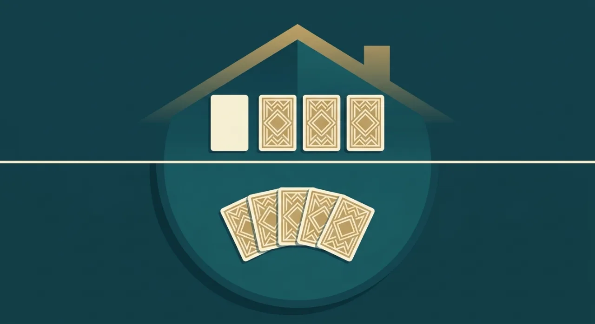
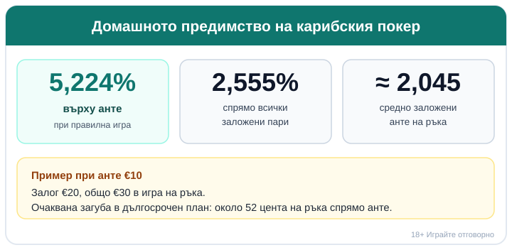

# Карибски покер (Caribbean Stud): правила, залози и домашно предимство

Карибският покер изглежда като покер, но се играе срещу казиното, а не срещу хората около масата. Няма друг играч, чиято ръка да ви интересува, няма общи карти и няма блъфиране: получавате пет карти, дилърът също, и единственото, което решавате, е дали да продължите, или да се откажете.

Затова „покер" в името е само наполовина вярно. Комбинациите са същите като в класическия покер, но уменията, които печелят пари на истинска маса, тук почти не играят роля.

## Срещу казиното, не срещу масата

Всяка ръка е самостоятелна и противникът ви е един: дилърът. Няма наддаване между играчите и общи карти на масата, а блъфът отпада, защото насреща е само дилърът, който следва фиксирани правила. Сядате, залагате, виждате петте си карти и ги мерите срещу ръката на дилъра по обикновената подредба на покер комбинациите. Ако искате опреснение коя ръка бие коя, вижте [комбинациите в покера](/blog/poker-kombinacii/); а за по-широкия контекст на покер игрите в казино има отделно [въведение](/blog/kak-se-igrae-poker-kazino/).

## Залозите: анте и един по избор

Започвате със залог, наречен анте, преди да видите картите. Повечето маси предлагат и втори, незадължителен залог върху прогресивен джакпот, обикновено с фиксирана малка стойност. Прогресивният залог е отделна игра със собствени правила и по-късно ще стане ясно защо е доста по-скъп от основния. Засега го оставете настрана: анте е това, с което играете карибски покер.

## Раздаването

След като залозите са направени, всеки играч и дилърът получават по пет карти. Вашите пет са скрити и ги гледате само вие. От картите на дилъра една се обръща с лицето нагоре, а останалите четири остават скрити до развръзката. Тази една открита карта е целият „прозорец" към ръката на дилъра и върху нея се градят малкото стратегически решения, които имате.

## Единственото решение: пас или залог

След като погледнете петте си карти, или се отказвате, и тогава губите само анте, или продължавате, като добавяте залог, точно двойно на анте. Няма теглене на нови карти, замяна или второ наддаване: толкова е свободата ви на действие.

Да речем, че анте е €10. Откажете ли се, губите тези €10 и ръката приключва. Продължите ли, слагате още €20, тоест в игра влизат общо €30. Остана ли ръката жива, рискувате трикратно анте вместо еднократно.

## Кога дилърът „играе": квалификацията A-K

Дилърът не влиза в игра с всяка ръка. За да се брои ръката му, той трябва да държи поне асо и поп (A-K), или нещо по-силно, например чифт. Това се нарича квалификация.

Ако дилърът не се квалифицира, анте ви печели едно към едно, а залогът от двойното анте просто се връща, без да печели или губи. Пропусне ли дилърът асо и поп, дори най-силната ви ръка носи единствено печалбата от анте: събрали сте флош, а големият залог стои без ефект. Силните ръце се изплащат само когато дилърът се квалифицира и вие го биете.

*Как се развива една ръка: едно решение (пас или залог) и три възможни изхода според дилъра.*

## Какво печелите: таблицата за залога

Квалифицира ли се дилърът и вашата ръка е по-силна, анте пак плаща едно към едно, а двойният залог се изплаща според силата на ръката ви. Ето обичайната таблица (стойностите варират по маси и някои оператори слагат таван):

| Ваша ръка | Залогът плаща |
|---|---|
| Чифт или по-слаба | 1:1 |
| Два чифта | 2:1 |
| Тройка | 3:1 |
| Кента | 4:1 |
| Флош | 5:1 |
| Фул хаус | 7:1 |
| Каре | 20:1 |
| Стрейт флош | 50:1 |
| Роял флош | 100:1 |

Високите изплащания в долния край на таблицата стоят зад толкова малки вероятности, че рядко ще ги видите: роял флош се пада веднъж на стотици хиляди ръце. Горните редове, чифт и два чифта, са това, което реално се случва на масата, а те плащат скромно. Квалифицира ли се дилърът и ви бие, губите и анте, и залога; при равенство двата залога се връщат.

## Домашното предимство: честната сметка

При правилна игра домашното предимство на карибския покер е 5,224% върху анте. Прието е да се мери и спрямо всички заложени пари, тъй като обикновено удвоявате залога: там числото е 2,555%, а средно в игра влизат около 2,045 единици анте на ръка.

Ако залагате по €10 анте, очакваната загуба в дългосрочен план е около 52 цента на ръка спрямо анте, или някъде към 2,6% от всичко, което минава през масата. Една вечер може да свърши на плюс, друга на минус, но колкото повече ръце играете, толкова по-близо реалният резултат клони към тази загуба.

*Честната сметка: предимството на казиното не изчезва с добра игра.*

## Проста стратегия, която не греши много

Пълната оптимална стратегия е сложна и разчита на откритата карта на дилъра, но две прости правила вършат почти цялата работа. Залагайте винаги, когато имате чифт или по-силна ръка. Отказвайте се, когато нямате дори асо и поп. Между тези два случая, с ръка асо-поп, има няколко по-тънки положения, в които откритата карта на дилъра накланя везните, но разликата е нищожна: прецизната стратегия сваля предимството едва от 5,225% до 5,224%. Ако просто залагате на чифт нагоре и пасувате под асо-поп, губите съвсем малко спрямо перфектната игра.

Няма комбинация от решения, която да направи карибския покер изгоден за играча; добрата стратегия само ограничава колко бързо губите.

## Прогресивният залог: отделна, по-скъпа игра

Незадължителният прогресивен залог се изплаща отделно, обикновено при флош или по-добра ръка. Роял флош често прибира целия натрупан джакпот, стрейт флош около една десета от него, а по-слабите ръце носят фиксирани суми, които варират по маси (примерни стойности при някои американски маси: каре $500, фул хаус $100, флош $50). Цената на този шанс за голям удар е висока: домашното предимство на прогресивния залог често надхвърля 25%, освен когато джакпотът е нараснал до много голяма сума. На практика е по-близо до лотариен билет, отколкото до част от основната игра, и си струва да се третира точно така, когато си правите бюджета.

## Карибски покер онлайн: какво да очаквате

Онлайн и в казино на живо правилата са същите: анте, пет карти, една открита на дилъра, пас или двоен залог, квалификация с асо-поп. Разликата е най-вече в залозите, които онлайн често започват от по-малки суми, и в темпото, което сами контролирате. Преди да заложите реални пари, демо режимът е честният начин да усетите ритъма на играта, без да ви струва нищо. Повече за игрите в казино може да видите в [раздела с казино игри](/kazino-igri/). Разумното правило при всяка такава игра е едно: сядате с бюджет, който можете да загубите изцяло, и го определяте, преди да отворите масата, не след третата ръка.

## Карибски покер на пари: законно ли е?

Карибски покер между приятели за жетони е забавление. Сложи ли се залог на реални пари онлайн, вече говорим за хазарт, а в България организирането на хазартни игри е под надзора на НАП. Линията за играча е проста: ако ще играете на пари, това става само в казино с лиценз от НАП, вписан в публичния регистър. Как се проверява законността сме описали на страницата [законно ли е](/zakonno-li-e/).

Карибският покер не е източник на доход и математиката по-горе го показва ясно. Ако решите да играете, важат същите граници като при всяка игра на пари, а именно бюджет, който можете да загубите без това да ви засегне, и лимити, зададени преди първия залог. Помощни ресурси ще намерите на страницата за [отговорна игра](/otgovorna-igra/) и в [раздела за отговорна игра](/blog/responsible-gambling/).

---

**Георги Тодоров**
Публикувано: 27.10.2026 · Последна редакция: 27.10.2026

**За Всички Казина.** Независим сайт за сравнение на онлайн казина, лицензирани за българския пазар. Оценяваме всяко казино по публична методика с шест претеглени критерия и проверяваме лиценза в регистъра на НАП, преди да дадем оценка. Не сме оператор и не продаваме съвети за печалба; сравняваме, проверяваме и обясняваме, за да избираш с отворени очи.

**Отговорна игра.** 18+ Хазартът може да пристрасти. Играйте отговорно. Ако усетиш, че играта излиза извън контрол или искаш да я ограничиш, виж [инструментите за отговорна игра](/otgovorna-igra/) и възможността за самоизключване чрез националния регистър на уязвимите лица към НАП (подава се писмено само от засегнатото лице). Национална информационна линия за наркотиците, алкохола и хазарта („Солидарност") 0888 99 18 66, делнични дни 10:00-17:00.

**Разкриване на партньорства.** Сайтът съдържа партньорски (афилиейт) връзки; когато отвориш оферта през такава връзка, това може да финансира сайта, без да променя цената за теб и без да влияе на оценките ни. От 1 август 2026 г. дейността на афилиейт оператори в България се лицензира съгласно Закона за държавния бюджет за 2026 г. (ДВ, бр. 69 от 31.07.2026 г.). Всички Казина е подало заявление за лиценз пред Националната агенция по приходите и очаква издаването му.
