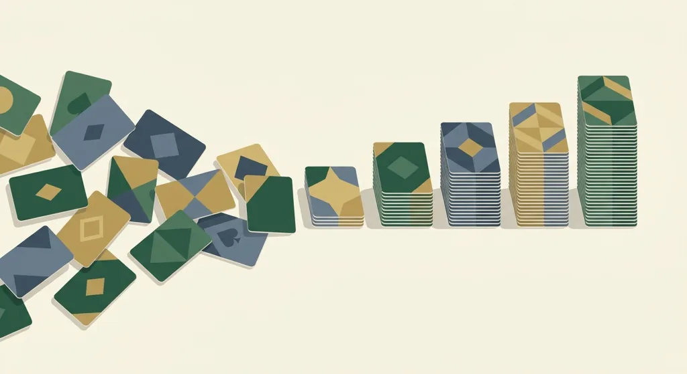
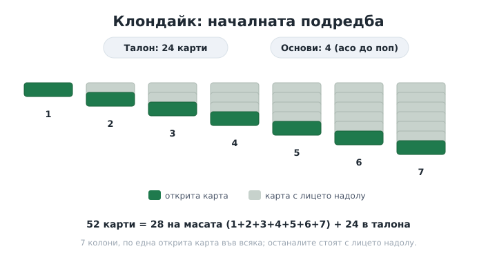
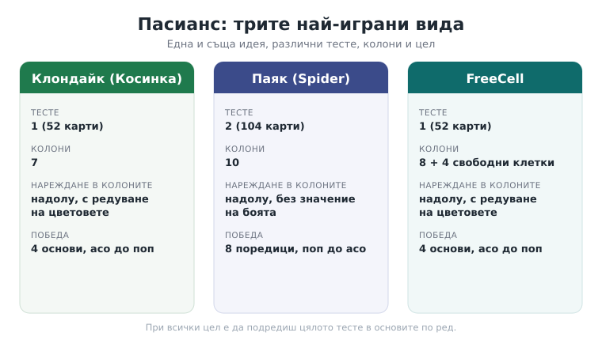

Title tag: Пасианс правила: Клондайк, Паяк и FreeCell
Meta description: Пасианс правила на ясен език: Клондайк (Косинка), Паяк и FreeCell, подредба, нареждане и как се печели. Кои правила са стандартни и кои са по вариант.

---

# Пасианс: правила и видове, как се играят Клондайк, Паяк и FreeCell

Пасиансът не е една игра. Това е цяло семейство игри на карти за един човек, при които сам подреждаш разбъркано тесте в определен ред. Когато някой на български каже „пасианс", почти винаги има предвид Клондайк, същата игра, която в руската традиция се нарича Косинка и която поколения знаят от иконката в стария Windows. Има десетки други версии, но три от тях събират по-голямата част от играчите, затова ще обясним общата механика веднъж, а после ще минем през Клондайк, Паяк и FreeCell поотделно.

## Четирите неща, от които е направен всеки пасианс

Почти всеки пасианс стъпва на едни и същи четири части, само пропорциите се менят. Играеш с едно или две тестета. Пред теб има колони карти (на английски tableau), в които подреждаш временно. Има основи (foundations), където накрая отива всичко, подредено до край по боя и по ред. И има талон, запасът карти, които още не са в игра и от които теглиш, когато в колоните заседнеш. Разликите между отделните пасианси идват почти изцяло от тези четири неща: с колко тестета играеш, как са подредени колоните в началото и по какво правило местиш картите.

## Клондайк (Косинка): това, което повечето хора наричат просто пасианс

Клондайк се играе с едно тесте от 52 карти. Раздаваш 7 колони: първата с една карта, втората с две, и така нагоре до седмата със седем, общо 28 карти на масата. Открита е само най-горната карта във всяка колона, останалите стоят с лицето надолу. Двайсет и четирите карти, които остават, са талонът.

*Началната подредба в Клондайк: 52 карти = 28 на масата + 24 в талона.*

Целта са четирите основи, по една за всяка боя. Те се пълнят нагоре, от асо до поп: асо, двойка, тройка и така до попа от същата боя. В колоните обаче нареждаш обратното, надолу и с редуване на цветовете, тоест под черна десетка слагаш червено вале, под него черна десетка не става, трябва червено. Празна колона е ценна, но я заема само поп или цяла поредица, водена от поп.

Когато всичко в колоните заседне, теглиш от талона. Тук започват дребните разлики между версиите: едни раздават по една карта, други по три наведнъж, а колко пъти можеш да преминеш през талона зависи от конкретната игра или приложение. Вариантът с теглене по една карта е забележимо по-лек от този по три. Печелиш в мига, в който и четирите основи са пълни от асо до поп.

## Паяк: защо е по-труден и как се сваля цяла боя

Паякът (Spider) играе с две тестета, 104 карти, и това веднага сменя мащаба. Колоните са 10. В началото се раздават 54 карти: първите четири колони получават по шест карти, останалите шест колони по пет, и пак само горната във всяка е открита. Петдесетте карти, които остават, са талонът.

Нареждането в колоните е по-свободно, отколкото изглежда. Подреждаш надолу по ранг независимо от боята, тоест под осмица можеш да сложиш коя да е седмица. Местенето обаче е по-строго от подреждането: наведнъж преместваш само поредица от една и съща боя. Щом в някоя колона събереш цяла стълба от поп надолу до асо в една боя, тринайсет карти, тя се сваля от масата. За да спечелиш, трябва да свалиш осем такива поредици. Свободата да редиш смесени бои е измамна: красивата дълга верига не помага, ако е сглобена от различни бои и не може да се мести като цяло.

Паякът има три нива на трудност според това с колко бои играеш: с една боя е най-достъпен и подходящ за начало, с две става сериозно по-костелив, а с четирите бои е истинското предизвикателство. От талона се раздава по една карта на всяка от десетте колони наведнъж, но има едно условие, което лесно се забравя: не можеш да раздадеш нови карти, докато на масата има празна колона. Първо я запълваш, после теглиш.

## FreeCell: пасиансът, в който всичко се вижда

FreeCell е устроен иначе и иска друг подход. Тестето пак е едно, 52 карти, разпределени в 8 колони: първите четири по седем карти, последните четири по шест. Всички карти са открити от самото начало. Нищо не е скрито, което прави играта по-скоро задача за планиране, отколкото залог на късмет.

Отстрани имаш четири свободни клетки (free cells). Всяка побира по една карта и служи за временно разтоварване, докато освободиш хода, който ти трябва. Четирите основи се пълнят нагоре по боя от асо до поп, както при Клондайк, а в колоните нареждаш надолу с редуване на цветовете. Празна колона тук е гъвкава, приема всяка карта.

Колко карти можеш да преместиш наведнъж не е произволно: зависи от това колко свободни клетки и колко празни колони имаш в момента. Сметката е (1 плюс броя свободни клетки), умножено по две на степен броя празни колони, което при пълни четири свободни клетки и нито една празна колона прави пет карти. Любопитното за FreeCell е, че почти всяко раздаване има решение, около 99.999 процента от разположенията се разплитат при добра игра, така че заседнеш ли, вината рядко е в картите.

*Клондайк, Паяк и FreeCell един до друг: тесте, колони, нареждане и цел.*

## Кои правила са „истинските"

Горните правила са стандартните, но дигиталните версии често добавят свои домашни настройки: колко карти се теглят, колко обиколки на талона са позволени, дали има подсказки или връщане на ход назад. Нито една от тези добавки не прави версията „грешна", просто е различна. Ако играеш конкретно приложение и нещо не съвпада с описанието тук, провери неговите настройки, преди да решиш, че правилата са сбъркани. А ако искаш да разшириш отвъд тези три, Пирамида, Юкон и Голф са добрата следваща крачка.

## А когато картите се играят на пари

Пасиансът е соло игра. Няма съперник и няма залог, печелиш или губиш сам срещу подредбата, и в това е цялата му прелест за един спокоен половин час. Игрите на карти изобщо са друго нещо: покер, блекджек и част от народните игри се играят и за пари в онлайн казина, а там единственото, което дава някаква защита на играча, е лиценз от НАП. Ако тръгнеш натам, важат вече съвсем други правила от тези на пасианса.

18+ Хазартът може да пристрасти. Играйте отговорно. Повече за лимитите, самоизключването и националния регистър на уязвимите лица към НАП четете на страницата ни за [отговорна игра](/otgovorna-igra/). За сродни игри с карти и зарове вижте правилата на [белот](/blog/belot-pravila/), [сантасе](/blog/santase-pravila/) и [табла](/blog/tabla-pravila/).

Пасиансът е една от малкото игри на карти, които преживяха прехода от кухненската маса до телефона, без да изгубят нищо. Същите 52 карти, същото тихо подреждане, само тестето вече е на екрана. Научиш ли Клондайк, другите два се хващат за вечер.

---

**Георги Тодоров**
Публикувано: 27.10.2026 · Последна редакция: 27.10.2026

*Георги Тодоров тества лицензирани в България казино сайтове от 2024 г. със собствен бюджет и проверява лиценза в публичния регистър на НАП преди регистрация. Пише за Всички Казина за реалната цена на бонусите, скоростта на тегленията и математиката зад игрите.*

**За Всички Казина:** Всички Казина е независим сайт за сравнение на онлайн казина с лиценз за българския пазар. Не сме оператор и не организираме игри. Сравняваме, проверяваме и обясняваме, за да избирате с отворени очи. Казината оценяваме по публична формула с шест претеглени критерия ([Как оценяваме](/kak-ocenyavame/)), а партньорските връзки, които финансират сайта, са обозначени. Тази статия не съдържа партньорски връзки.

**Отговорна игра.** 18+ Хазартът може да пристрасти. Играйте отговорно. Ако усетиш, че играта излиза извън контрол или искаш да я ограничиш, виж [инструментите за отговорна игра](/otgovorna-igra/) и възможността за самоизключване чрез националния регистър на уязвимите лица към НАП (подава се писмено само от засегнатото лице). Национална информационна линия за наркотиците, алкохола и хазарта („Солидарност") 0888 99 18 66, делнични дни 10:00-17:00.

**Разкриване на партньорства.** От 1 август 2026 г. дейността на афилиейт оператори в България се лицензира съгласно Закона за държавния бюджет за 2026 г. (ДВ, бр. 69 от 31.07.2026 г.). Всички Казина е подало заявление за лиценз пред Националната агенция по приходите и очаква издаването му.
