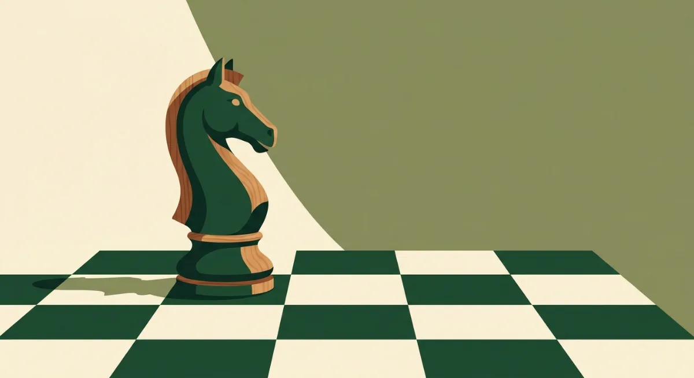
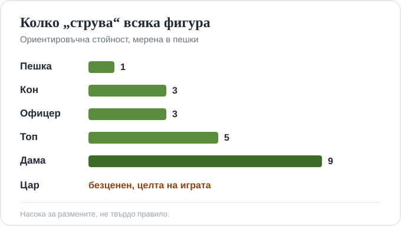

Title tag: Шах правила за начинаещи: фигури, ходове, шах и мат
Meta description: Шах правила за начинаещи на ясен език: подредбата на дъската, как се движат фигурите, рокада и ан пасан, шах, мат и пат, и къде да играете шах срещу компютър.

---

# Шах: правилата за начинаещи и как се играе една партия

Целта на шаха е една: да поставиш мат на царя на противника, тоест да го нападнеш така, че да няма накъде да избяга. Всичко останало е средство към тази цел. Играе се на дъска с 64 полета, редувани светли и тъмни, и винаги белите започват. Ако сте играли някога и сте спрели по средата, защото някой е казал „това не може така", тази страница е, за да сядате и играете спокойно.

## Дъската и началната подредба

Дъската е 8 на 8 полета. Завъртете я така, че всеки от двамата да има бяло поле в долния десен ъгъл; ако там е тъмно поле, дъската е обърната. Всеки играч разполага с 16 фигури: цар, дама, два топа, два офицера, два коня и осем пешки.

Пешките заемат целия втори ред пред вас. Зад тях, по краищата, застават двата топа, до тях конете, после офицерите. Остават две полета в средата за дамата и царя. Дамата винаги тръгва от поле със своя цвят, бялата дама на бяло, черната на черно, а царят застава до нея. Запомните това и никога няма да объркате коя от двете централни фигури къде е.

## Как се движат фигурите

Царят е бавен: по едно поле във всяка посока. Пази се цяла партия, защото със загубата му всичко свършва.

Дамата е най-силната фигура. Върви по права линия и по диагонал, на колкото полета иска, стига нищо да не ѝ препречва пътя. Топът се движи само по права, напред-назад и настрани, също на произволно разстояние. Офицерът е диагоналната фигура и има една особеност, която лесно се забравя: щом е тръгнал от бяло поле, той остава на белите полета до края на играта, а другият ви офицер държи черните.

Конят скача на буквата „Г", две полета в една посока и едно встрани, и е единствената фигура, която прескача други, свои и чужди. Заради това е особено неприятен в тясна позиция, където всичко друго е задръстено и останалите фигури се спъват една в друга.

Пешката върви само напред и само по едно поле, с едно изключение: от началната си позиция може да направи две наведнъж. Взема обаче различно от начина, по който се движи, по диагонал напред на едно поле. Назад пешка не се връща никога.

## Трите хода, които начинаещите бъркат

Повечето правила се схващат от първата партия. Три не се схващат, и точно за тях хората спорят на масата.

**Рокада.** Един ход, с който местите наведнъж царя и единия топ, за да приберете царя на сигурно в ъгъла. Царят отива две полета към топа, а топът го прескача и застава от другата му страна. Разрешена е само ако са налице всички условия:

- нито царят, нито точно този топ са мърдали дотук в партията;
- между тях няма други фигури;
- царят не е под шах в момента;
- царят не минава през поле, което е атакувано, и не застава под шах накрая.

Рокадата към топа до царя се казва къса, а към топа при дамата, дълга. Дългата отнема един ход повече подготовка, защото полетата между царя и далечния топ са повече.

**Ан пасан** (от френски, „в движение") е единственото правило, което заварва почти всеки неподготвен. Ако вашата пешка стои на петия си ред и съседна вражеска пешка направи своя двоен начален ход, минавайки точно покрай нея, вие може да я вземете така, все едно е спряла на едно поле. Но само веднага, със следващия ход. Пропуснете ли момента, правото изчезва.

**Произвеждане.** Пешка, която стигне последния ред на дъската, не спира там, а се превръща в друга фигура по ваш избор, почти винаги в дама. Няма значение дали дамата ви още е на дъската: напълно законно е да имате две, че и повече дами едновременно. Тази е причината една невзрачна пешка в края на играта често да решава всичко.

## Кога свършва партията: шах, мат, пат и реми

Когато една фигура напада царя, царят е под шах и това трябва да се реши незабавно, преди всеки друг ход. Изходите са три: да отместите царя, да прекъснете линията на нападението с друга фигура, или да вземете нападателя. Щом нито едно от трите не върши работа, царят е матиран и партията е свършила. Царят всъщност никога не се сваля от дъската; матът е просто положението, в което бягство няма.

Пат изглежда като мат, но не е. Патът е, когато сте на ход, царят ви не е под шах, но нямате нито един позволен ход с която и да е фигура. Резултатът е реми, равенство, дори да ви е останала само гола дама срещу цяла армия. Много новаци изпускат спечелена партия точно тук, задушавайки противниковия цар вместо да го матират.

Реми има и по други причини: когато двамата се съгласят; когато по дъската не е останал достатъчно материал за мат (например само цар и офицер срещу самотен цар); когато една и съща позиция се повтори три пъти; и когато изминат петдесет хода без ход на пешка и без нито едно вземане.

## Колко „струва" всяка фигура

За да решавате кога си струва една размяна, помага да знаете грубата стойност на фигурите. Пешката е единица мярка: пешка 1, кон 3, офицер 3, топ 5, дама 9. Царят няма стойност в тази сметка, защото е целта, а не разменна монета.

*Ориентировъчната стойност на фигурите, мерена в пешки. Това е насока за размените, не твърдо правило.*

Числата са ориентир, не закон. Два коня срещу топ и пешка е равностойна сделка на хартия, но коя страна е по-добра зависи от конкретната позиция. Отдолу стои простото житейско правило: не давайте по-скъпа фигура за по-евтина без ясна причина.

## Пет навика, с които спирате да губите фигури

Начинаещите губят партии не от хитри капани, а от дребни редовни грешки. Пет навика махат повечето от тях.

Борете се за центъра. Пешка на централно поле в началото отваря път на фигурите ви и стеснява противника. Извеждайте фигурите, вместо да разхождате една и съща напред-назад; конете и офицерите искат да излязат от първия ред рано, там те не вършат нищо. Рокирайте, докато е спокойно, а не когато вече ви нападат царя. Дръжте дамата малко по-дълго вкъщи: извадена рано, тя става мишена и губите темпо, гонена от по-дребни фигури. И преди всеки свой ход хвърляйте едно око на това какво напада противникът, защото половината подарени фигури си отиват просто защото никой не е погледнал.

## Къде да упражнявате: шах срещу компютър

Най-бързият начин да закрепите правилата е да изиграете няколко партии срещу компютър. Безплатните платформи като chess.com и Lichess ви пускат срещу бот с регулируема сила, от съвсем слаб до безмилостен, така че вдигате нивото постепенно. Програмата няма да ви съди за глупав ход и ще ви покаже веднага кога нещо е незаконно, което е най-доброто упражнение за рокадата и ан пасан.

Едно нещо отличава шаха от игрите, за които обикновено пиша тук: в него няма залог и няма късмет. Двамата виждат всичко на дъската, няма скрито тесте и няма зарове, а който спечели, го дължи на решенията си. Ако до шаха ви привличат и игри, в които късметът решава, струва си да ги гледате с други очи, а [инструментите за отговорна игра](/blog/responsible-gambling/) са мястото, където тази разлика е описана честно. За класика от друг тип, но със същата дълбочина, вижте и как се играе [табла](/blog/tabla-pravila/).

Правилата се учат за един следобед. Останалото е партии, грешки и желанието да видите защо противникът направи точно този ход. Седнете и играйте.

18+ Хазартът може да пристрасти. Играйте отговорно.

---

**Георги Тодоров**
Публикувано: 27.10.2026 · Последна редакция: 27.10.2026

*Георги Тодоров тества лицензирани в България казино сайтове от 2024 г. със собствен бюджет и проверява лиценза в публичния регистър на НАП преди регистрация. Пише за Всички Казина за реалната цена на бонусите, скоростта на тегленията и математиката зад игрите.*

**За Всички Казина:** Всички Казина е независим сайт за сравнение на онлайн казина с лиценз за българския пазар. Не сме оператор и не организираме игри. Сравняваме, проверяваме и обясняваме, за да избирате с отворени очи. Казината оценяваме по публична формула с шест претеглени критерия ([Как оценяваме](/kak-ocenyavame/)), а партньорските връзки, които финансират сайта, са обозначени. Тази статия не съдържа партньорски връзки.

**Отговорна игра.** 18+ Хазартът може да пристрасти. Играйте отговорно. Ако усетиш, че играта излиза извън контрол или искаш да я ограничиш, виж [инструментите за отговорна игра](/otgovorna-igra/) и възможността за самоизключване чрез националния регистър на уязвимите лица към НАП (подава се писмено само от засегнатото лице). Национална информационна линия за наркотиците, алкохола и хазарта („Солидарност") 0888 99 18 66, делнични дни 10:00-17:00.

**Разкриване на партньорства.** Всички Казина съдържа партньорски (афилиейт) връзки; когато отвориш оферта през такава връзка, това може да финансира сайта, без да променя цената за теб и без да влияе на оценките ни. От 1 август 2026 г. дейността на афилиейт оператори в България се лицензира съгласно Закона за държавния бюджет за 2026 г. (ДВ, бр. 69 от 31.07.2026 г.). Всички Казина е подало заявление за лиценз пред Националната агенция по приходите и очаква издаването му.
