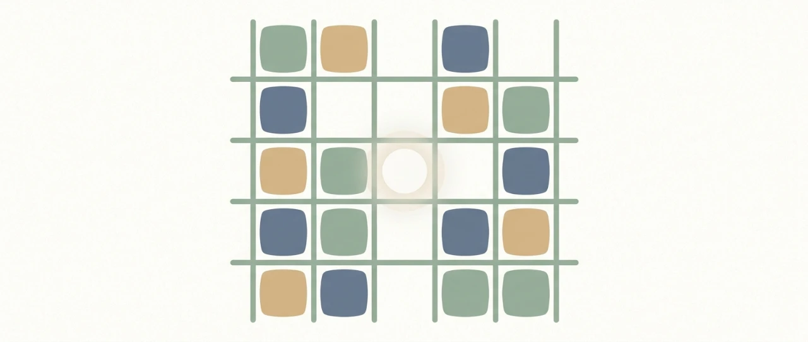
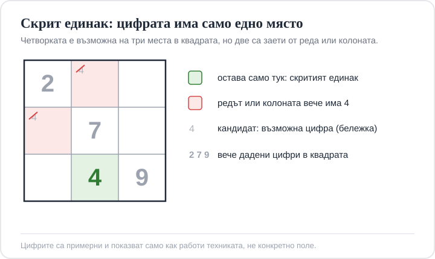

Title tag: Судоку правила: как се играе и стратегии за начинаещи
Meta description: Судоку за начинаещи на ясен език: как се попълва полето 1 до 9 по ред, колона и квадрат, техниките скрит и гол единак, голи двойки и къде да играете онлайн.

---

# Судоку: правилата и как се решава първото поле

Судоку се решава само с логика. Зарове не се хвърлят, противник със скрити карти няма, а късметът няма с какво да ви помогне: всичко, което ви трябва, за да довършите полето, вече стои пред очите ви. Правилото се казва в едно изречение, а после цял следобед може да отиде в това да се научите да виждате къде то вече е решило вместо вас. Тази страница е, за да сядате пред първото поле, без да го зарязвате на средата.

## Полето: девет на девет, в три посоки наведнъж

Играе се върху решетка от 9 на 9 клетки, общо 81. Тя се чете по три начина едновременно: като девет реда, като девет колони и като девет по-големи квадрата 3 на 3, очертани с по-дебели линии. Всяка клетка е част и от ред, и от колона, и от квадрат, и трите наведнъж, и точно това преплитане е цялата соля на играта.

В началото част от клетките вече са попълнени. Тези цифри се наричат дадени и не се местят до края; те са опорните точки, от които тръгва всичко останало. Останалите клетки са празни и чакат вас.

## Единственото правило, което трябва да запомните

Във всеки ред, във всяка колона и във всеки квадрат 3 на 3 трябва да застанат цифрите от 1 до 9, всяка точно по веднъж. Това е всичко. Никоя цифра не бива да се повтаря в един и същи ред, в една и съща колона или в един и същи квадрат, и когато запълните коректно цялото поле, деветте цифри ще стоят по веднъж във всяка от тези групи, без изключение.

Цифрите тук са само символи и не смятате нищо: няма събиране, няма изваждане, спокойно можете да замените 1 до 9 с девет различни цвята и играта е същата. Едно правилно съставено судоку при това има едно-единствено решение, до което се стига изцяло по логика. Щом в някой момент ви се струва, че трябва да налучквате, почти винаги сте пропуснали някъде ход, който е бил наличен.

## Колко цифри са дадени в началото

Фиксиран брой няма. Едно поле може да тръгне с трийсетина попълнени клетки, друго само с двайсетина, и по-малкото дадени не значи автоматично по-трудно. Трудността идва по-скоро от това какви техники ще трябва да извадите, отколкото от голата бройка. Долу има и теоретична граница: доказано е (екип математици, 2012 г.), че не съществува коректно судоку с по-малко от 17 дадени цифри, защото под този праг решението вече не е едно. На практика това е грижа на съставителите. За вас е достатъчно да знаете, че щом полето идва от сериозен източник, то има точно едно решение и не иска гадаене.

## Откъде се започва: търсите къде цифрата няма къде другаде да отиде

Не започвайте от празна клетка с въпроса „какво може да влезе тук". Тръгнете от обратното: вземете една цифра и вижте къде тя е принудена да отиде. Това се нарича сканиране или кръстосано изключване и е хлябът на решаването.

Да речем, че гледате един квадрат 3 на 3 и търсите къде в него отива седмицата. Ако в два от трите му реда вече има седмица някъде по дължината им, в тези два реда седмицата е забранена и остава третият ред на квадрата. Ако пък в него две от трите свободни клетки попадат в колони, които също вече имат седмица, свободна остава само една. Там отива седмицата, без да сте гадали нищо. Същият поглед работи и обратно, от ред или от колона към квадратите. Минавате цифра по цифра, група по група, и попълвате онова, което само се налага.

## Скрит единак и гол единак

Когато чистото сканиране спре да дава лесни попадения, идват кандидатите. Кандидат е цифра, която в момента още е допустима за дадена клетка. Повечето играчи ги пишат дребно в ъгъла на клетката, с молив или с функцията за бележки в приложението, и после ги отсяват. Това не е хитрина, а нормалният начин да се решават по-тежките полета.

С кандидатите пред очи две неща започват да изпъкват. Голият единак е клетка, в която след всички изключвания е останала една-единствена възможна цифра; тя просто се вписва. Скритият единак е по-коварен: в самата клетка ви изглеждат допустими няколко цифри, но щом погледнете целия ред (или колоната, или квадрата), се оказва, че някоя конкретна цифра няма друго място в цялата група освен точно тази клетка. Тогава останалите кандидати в нея са илюзия и цифрата е нейна.

*Примерен квадрат 3 на 3: макар няколко клетки да допускат четворка, свободно за нея е само едно поле. Цифрите са илюстративни.*

## Една крачка нагоре: голите двойки

Има един ход, който спестява много заяждане. Ако в някой ред, колона или квадрат две клетки имат за кандидати едни и същи точно две цифри и нищо друго (да речем и двете могат да бъдат само 4 или 6), тези 4 и 6 са запазени за тези две клетки, макар още да не знаете коя къде. Значи можете да ги махнете от кандидатите на всички останали клетки в групата. Често това отключва нов гол или скрит единак някъде наблизо. Нарича се гола двойка и е първата техника, която кара решаването да изглежда почти като фокус.

## Навиците, с които спирате да заяждате

Повечето заседнали полета не искат по-умна техника, а малко дисциплина. Пишете кандидатите с молив, не наум, защото паметта изпуска точно клетката, която ще отключи реда. Не гадайте: ако полето е коректно, налучкването никога не е нужно и само вкарва грешки, които гърмят петнайсет хода по-късно. Довършвайте група, щом ѝ останат две-три празни клетки, там изключването е най-кратко. Преди да впишете цифра, хвърляйте око и на трите посоки, не само на онази, която ви е грабнала вниманието. А когато съвсем заседнете, върнете се към простото сканиране по цифри; изненадващо често там чака ход, който окото е прескочило.

## Откъде дойде судоку

Играта изглежда японска, но модерната ѝ форма се ражда в САЩ. През май 1979 г. списанието Dell я печата под името Number Place, а авторството ѝ се приписва на архитекта Хауърд Гарнс. Японското издателство Nikoli я подхваща през 1984 г. и ѝ дава името, съкратено до „судоку", което идва от израз със смисъл „числото да е само, единствено". Световната мания пламва чак около 2004–2005 г., след като лондонският The Times започва да печата по едно поле на ден и оттам тръгва към вестниците навсякъде.

## Къде да играеш судоку онлайн безплатно

Най-бързият начин да закрепите тези техники е да изиграете няколко полета онлайн. Безплатните сайтове и приложения предлагат нива от съвсем лесно до такива, които ще ви държат будни, плюс вписване на кандидати, проверка за грешка и подсказка, когато наистина сте заседнали. За начинаещ това е по-добрият учебен терен от молива и гумата, защото програмата показва веднага щом нарушите правилото, а връщането назад е безболезнено.

Едно нещо отличава судоку от игрите, за които обикновено пиша тук: в него няма залог и няма късмет. Полето е цялото пред вас, нищо не е скрито, зарове не се хвърлят, а изходът зависи единствено от това колко внимателно гледате. Ако освен такива игри на чист ум ви привличат и игри, в които късметът решава, струва си да ги гледате с ясно съзнание за тази разлика, а [инструментите за отговорна игра](/otgovorna-igra/) описват честно къде минава тя. За друга класическа игра, която се учи за един следобед, вижте и как се играе [табла](/blog/tabla-pravila/).

Правилото се чете за минута. Останалото са полета, няколко задънени улици и навикът да се връщате една крачка назад, вместо да налучквате. Седнете и решете едно.

18+ Хазартът може да пристрасти. Играйте отговорно.

---

**Георги Тодоров**
Публикувано: 27.10.2026 · Последна редакция: 27.10.2026

*Георги Тодоров тества лицензирани в България казино сайтове от 2024 г. със собствен бюджет и проверява лиценза в публичния регистър на НАП преди регистрация. Пише за Всички Казина за реалната цена на бонусите, скоростта на тегленията и математиката зад игрите.*

**За Всички Казина:** Всички Казина е независим сайт за сравнение на онлайн казина с лиценз за българския пазар. Не сме оператор и не организираме игри. Сравняваме, проверяваме и обясняваме, за да избирате с отворени очи. Казината оценяваме по публична формула с шест претеглени критерия ([Как оценяваме](/kak-ocenyavame/)), а партньорските връзки, които финансират сайта, са обозначени. Тази статия не съдържа партньорски връзки.

**Отговорна игра.** 18+ Хазартът може да пристрасти. Играйте отговорно. Ако усетиш, че играта излиза извън контрол или искаш да я ограничиш, виж [инструментите за отговорна игра](/otgovorna-igra/) и възможността за самоизключване чрез националния регистър на уязвимите лица към НАП (подава се писмено само от засегнатото лице). Национална информационна линия за наркотиците, алкохола и хазарта („Солидарност") 0888 99 18 66, делнични дни 10:00-17:00.

**Разкриване на партньорства.** Всички Казина съдържа партньорски (афилиейт) връзки; когато отвориш оферта през такава връзка, това може да финансира сайта, без да променя цената за теб и без да влияе на оценките ни. От 1 август 2026 г. дейността на афилиейт оператори в България се лицензира съгласно Закона за държавния бюджет за 2026 г. (ДВ, бр. 69 от 31.07.2026 г.). Всички Казина е подало заявление за лиценз пред Националната агенция по приходите и очаква издаването му.
