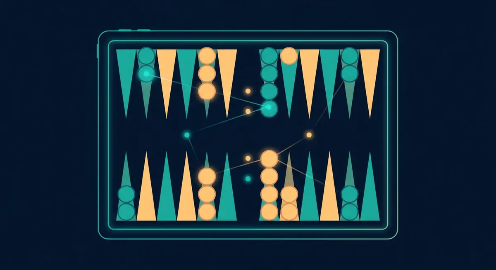
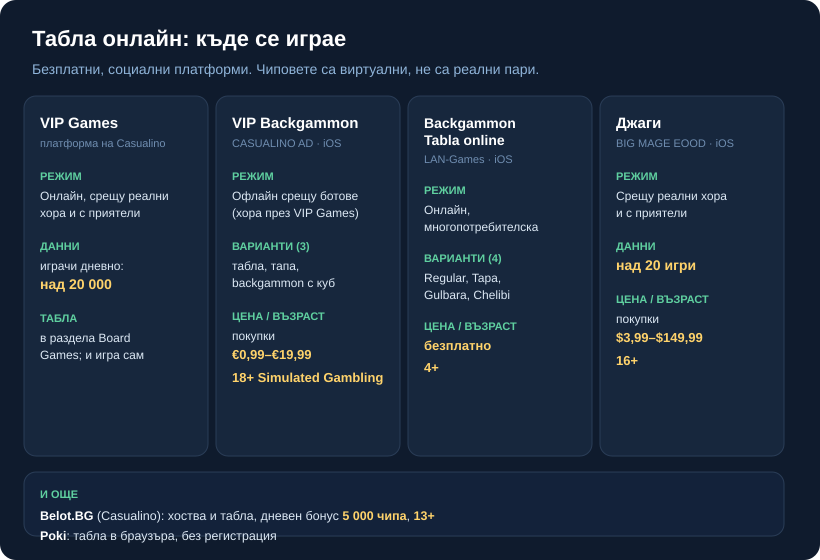

Byline: Editorial Team | Market: BG — where-to-play guide (navigational), neutral „ние" voice, signed Георги Тодоров

# Табла онлайн: къде се играе безплатно и как да започнете

Табла онлайн се играе безплатно, с виртуални чипове вместо пари, обикновено срещу реални хора от цялата страна или срещу приятел, когото каните на своя маса. Платформите са няколко и повечето вървят и в браузъра, и като приложение на телефона. Подреждането на пуловете, местенето със зара и разликите между вариантите няма да ги повтаряме тук; описали сме ги отделно в [ръководството за правилата на табла](/blog/tabla-pravila/).

## Безплатно, но с чипове

В онлайн таблата не залагате и не печелите пари. Масите работят с виртуални чипове, които получавате при регистрация и трупате с игра. VIP Games например открито се описва като безплатна платформа за карти и настолни игри; има магазин за чипове, но самите чипове са вътрешна валута на платформата, не се осребряват и нямат стойност извън играта. Спечелените купчини остават вътре.

Безплатно обаче не значи, че парите изобщо не влизат в картината. Чиповете и VIP абонаментите се купуват с истински пари в повечето приложения, а едно от тях го казва направо в рейтинга си: приложението VIP Backgammon за iOS носи възрастова граница 18+ с дескриптор „Simulated Gambling", тоест симулиран хазарт. Механиките на безплатната чип-игра понякога са близки до тези на хазарта, и затова го споменаваме открито, вместо да го подминем.

## Къде се играе: платформите накратко

Голямата платформа за игра срещу реални хора е **VIP Games** на Casualino. Описва се като безплатна, твърди над **20 000** активни играчи дневно и предлага мачове срещу реални противници в реално време, както и игра с приятели през покана във Facebook. Таблата е в раздела Board Games, има и безплатна опция за игра сам. Едно ограничение, което си струва да знаете предварително: гостите без регистрация не влизат в стаите за matchmaking и не могат да общуват с другите играчи.

Към VIP Games върви и отделното приложение **VIP Backgammon** за iOS (издател CASUALINO AD). То е безплатно, с покупки в приложението от **€0,99 до €19,99**, и само по себе си се играе офлайн срещу AI ботове; за игра срещу реални хора минавате през платформата VIP Games. Режимите са три: табла, тапа и backgammon с куб за удвояване. Тук е и въпросният рейтинг 18+.

За онлайн игра с повече варианти в едно приложение има **Backgammon Tabla online** на LAN-Games EOOD. Безплатно, с възрастова граница 4+, описано като многопотребителска онлайн игра с **четири** варианта: Regular, Tapa (Plakoto), Gulbara (Gjul Bara) и Chelibi. Приложението съветва да играете на WiFi вместо на мобилни данни, което подсказва, че играта е мрежова.

**Джаги** (издател BIG MAGE EOOD) не е само табла. Приложението събира над **20** различни игри, сред които и класическата табла за двама, и предлага игра в реално време срещу истински противници, както и система за приятели. Безплатно е, с покупки в приложението от **$3,99 до $149,99**, и носи рейтинг 16+.

Таблата я има и в **Belot.BG** на Casualino, голямата българска социална платформа за белот, която хоства и други настолни игри. Дневният бонус там е **5 000** чипа, стига да сте изиграли поне една игра с хора през деня, а рейтингът е 13+. Ако търсите нещо съвсем без инсталация, **Poki** пуска табла директно в браузъра, без регистрация, подходяща за игра срещу компютъра или срещу приятел на същото устройство.

*Данните са от публичните страници и app-store описанията на всяка платформа, проверени към 27.10.2026 г.*

## Срещу хора, ботове или компютър

Не всяка „онлайн" табла значи реален противник от другата страна. VIP Games и Джаги ви свързват с живи играчи в реално време. Приложението VIP Backgammon, напротив, по описание се играе офлайн срещу ботове, а живата игра минава през самата платформа VIP Games. Poki е за компютъра или за втори човек на същото устройство. При Backgammon Tabla online публичното описание говори за мрежова, многопотребителска игра, без да уточнява дали насреща е човек или програма, затова не твърдим брой играчи.

Разликата има значение за това какво упражнявате. Срещу ботове тренирате ходове и варианти на спокойствие; срещу хора идват блъфът на темпото, натискът на времето и човешките грешки, които нито един бот не имитира съвсем.

## Как да започнете

1. Решете срещу кого искате да играете: реални хора, конкретен приятел или компютър. Този избор ви насочва към платформата повече от всичко друго.
2. За игра срещу хора се регистрирайте с имейл или Facebook. За бърза игра в браузъра отворете Poki и започнете веднага, без акаунт.
3. Ако пробвате VIP Games като гост, имайте предвид ограничението: стаите за истински мачове и чатът се отключват след регистрация.
4. Вземете началните чипове, намерете маса с вашия вариант и изиграйте една-две игри сами или срещу бот, преди да седнете срещу жив противник.

## Коя платформа за вас

Ако искате най-много реални съперници и игра в реално време, започнете от VIP Games или Джаги. Ако държите на конкретни варианти като тапа, гюлбара или челеби в едно приложение, Backgammon Tabla online ги събира. За бърза партия без инсталация и без акаунт Poki върши работа. А ако вече имате профил в Belot.BG заради белота, таблата е на същото място, със същите чипове.

## Табла на пари онлайн?

Табла „за реални пари" е съвсем различна категория от всичко дотук. Хазартът с реален залог в България е под надзора на НАП и се предлага само от лицензирани оператори, а таблата масово не присъства в лицензираните казина. Платформите в това ръководство са социални и безплатни; не ги бъркайте с хазарт и не очаквайте теглене на пари от тях. Къде минава границата и кога нещо се брои за хазарт сме обяснили на страницата [законно ли е да се играе онлайн](/zakonno-li-e/).

## Преди да седнете на масата

Чиповете са безплатни, докато не свършат, и точно тогава идва изкушението да ги доплатите. Сложете си таван колко сте готови да харчите за чипове и VIP абонаменти, и го спазвайте; 18+ важи в момента, в който опре до пари под каквато и да е форма. Таблата онлайн е забавление и тренировка, не начин за печалба, и най-добре се играе точно така.

---

**Георги Тодоров**
Публикувано: 27.10.2026 · Последна редакция: 27.10.2026

**За Всички Казина.** Независим сайт за сравнение на онлайн казина, лицензирани за българския пазар. Оценяваме всяко казино по публична методика с шест претеглени критерия и проверяваме лиценза в регистъра на НАП, преди да дадем оценка. Не сме оператор и не продаваме съвети за печалба; сравняваме, проверяваме и обясняваме, за да избираш с отворени очи.

**Отговорна игра.** 18+ Хазартът може да пристрасти. Играйте отговорно. Ако усетиш, че играта излиза извън контрол или искаш да я ограничиш, виж [инструментите за отговорна игра](/otgovorna-igra/) и възможността за самоизключване чрез националния регистър на уязвимите лица към НАП (подава се писмено само от засегнатото лице). Национална информационна линия за наркотиците, алкохола и хазарта („Солидарност") 0888 99 18 66, делнични дни 10:00-17:00.

**Разкриване на партньорства.** Сайтът съдържа партньорски (афилиейт) връзки; когато отвориш оферта през такава връзка, това може да финансира сайта, без да променя цената за теб и без да влияе на оценките ни. От 1 август 2026 г. дейността на афилиейт оператори в България се лицензира съгласно Закона за държавния бюджет за 2026 г. (ДВ, бр. 69 от 31.07.2026 г.). Всички Казина е подало заявление за лиценз пред Националната агенция по приходите и очаква издаването му.

CANON ADDITIONS: none (editorial mode).
[DATA NEEDED]: none.
