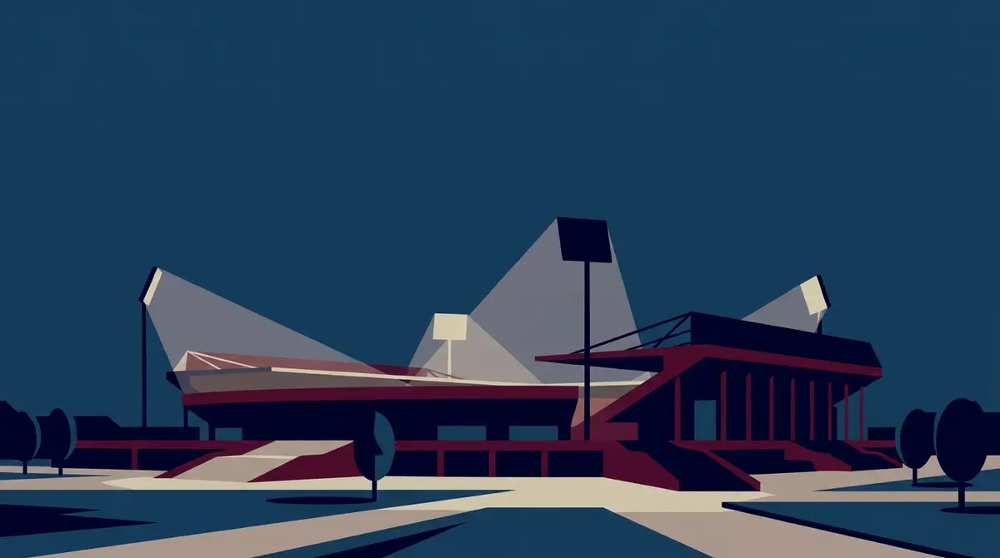
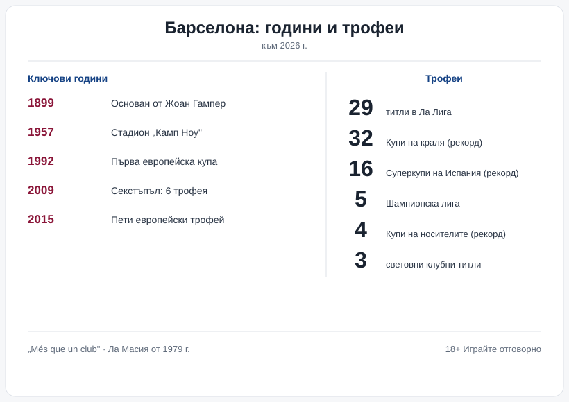

# Барселона: историята, трофеите, стадионът и легендите

„Повече от клуб". Фразата стои по трибуните от десетилетия и не е рекламен надпис, а начинът, по който Барселона обяснява сама себе си: почти век и четвърт история, един от най-пълните трофейни сейфове в света и цял град, който се разпознава в отбора.

## От Жоан Гампер до „Повече от клуб"

Клубът се ражда на 29 ноември 1899 г. по идея на швейцареца Жоан Гампер (Ханс Гампер), който пуска обява във вестник и събира група ентусиасти. Оттук тръгва Futbol Club Barcelona.

Една подробност го отличава и до днес: Барселона е собственост на членовете си, така наречените socis, а не на един собственик или фонд. Президентът се избира от тях. Мотото „Més que un club", „Повече от клуб", идва именно оттам, от усещането, че отборът носи и нещо извън терена.

## Витрината вкъщи

В Испания Барселона трупа титли с рекордна ръка. Към 2026 г. първенствата в Ла Лига са 29. Към тях вървят 32 Купи на краля, или Копа дел Рей, повече от всеки друг клуб, и 16 Суперкупи на Испания, също рекорд.

*Трофеите и ключовите години на Барселона. Всички числа следват текста на статията.*

## В Европа

Навън сметката е по-кратка, но тежи повече. 5 пъти клубът е печелил Купата на европейските шампиони и наследника ѝ, Шампионската лига: през 1992, 2006, 2009, 2011 и 2015 г. Първата дойде на „Уембли" срещу Сампдория и беше дълго чакана; следващите четири се събраха в рамките на едно поколение. Към тях се добавят 4 трофея от Купата на носителите на купи, стар турнир, в който Барселона държи рекорда, 5 Суперкупи на УЕФА и 3 световни клубни титли.

## Годината на секстъпъла

2009-а стои отделно в тази витрина. За една календарна година отборът на Хосеп Гуардиола спечели шест трофея: Ла Лига, Купата на краля, Шампионската лига, Суперкупата на Испания, Суперкупата на УЕФА и световната клубна титла. Дотогава никой клуб на планетата не беше събирал и шестте в един сезон. Този състав, с късото подаване и високия пресинг, се превърна в еталон, който дори съперниците тръгнаха да копират.

## Камп Ноу

Домът на клуба, Камп Ноу, е завършен през 1957 г. и дълго беше най-големият стадион в Европа, с около 99 354 места. От 2022 г. по спонсорски договор носи името „Спотифай Камп Ноу".

От 2023 г. съоръжението е в основен ремонт по проекта Espai Barça, който цели да вдигне капацитета към 105 000 места и да го задържи сред най-големите на континента. През по-голямата част от строежа отборът игра домакинските си мачове на Олимпийския стадион „Люис Компанис" на хълма Монжуик, а от 2025 г. започна поетапно да се връща на обновения стадион. Крайна дата още няма обявена, а точната текуща вместимост се мени според етапа на строежа, затова числата по време на ремонта е редно да се проверяват в момента на четене.

## Ла Масия и легендите

Голяма част от характера на Барселона идва от Ла Масия, младежката академия, която от 1979 г. възпитава играчи в собствен стил. Оттам излизат Лионел Меси, Хави, Андрес Иниеста, Жерард Пике и Карлес Пуйол, а по-рано и самият Гуардиола като футболист.

Легендите се редуват през епохите. Йохан Кройф първо блести на терена през 70-те, после се връща като треньор и изгражда „Дрийм Тийм" в началото на 90-те, който печели първата европейска купа на клуба. Роналдиньо връща усмивката на „Камп Ноу" в средата на 2000-те. Голмайстор номер едно в историята на Барселона пък остава Лионел Меси, възпитаник на същата тази академия.

## Ел Класико

Най-голямото съперничество на клуба е с Реал Мадрид. Мачовете между двата отбора имат собствено име, Ел Класико, и редовно са сред най-гледаните футболни срещи в света. В тях се пречупва и едно по-старо противопоставяне, това между Каталуния, на която Барселона е символ, и столицата Мадрид.

## На пари, отдалеч: футбол, залози и малко трезва математика

Ако гледаш мачовете и покрай това залагаш или играеш в казино, важи същото, което важи навсякъде в България: законно минава само през оператор с лиценз от НАП, вписан в публичния регистър, а какво точно е [законно](/zakonno-li-e/) е отделен и доста по-приземен въпрос от трофейната витрина.

Спортната част на сайта, включително бонусите за спорт, събираме в [раздела за спорт](/bonus-ruletka/sport/vsichki/). Там няма прогнози за мачове и няма да намериш съвет кого да заложиш. Хазартът не е доходоносна стратегия и залогът върху любимия отбор не променя тази аритметика. Бюджет, който можеш да загубиш докрай, и предварително зададени лимити пазят вечерта пред телевизора да си остане забавление, а не сметка. Кога играта започва да тежи и какво да се направи тогава е тема на [отговорната игра](/blog/responsible-gambling/).

Трийсет и двете Купи на краля са исторически факт. Сигурна печалба от залог върху каквото и да било няма, и това е може би единствената гаранция в цялата схема.

---

**Георги Тодоров**
Публикувано: 28.10.2026 · Последна редакция: 28.10.2026
