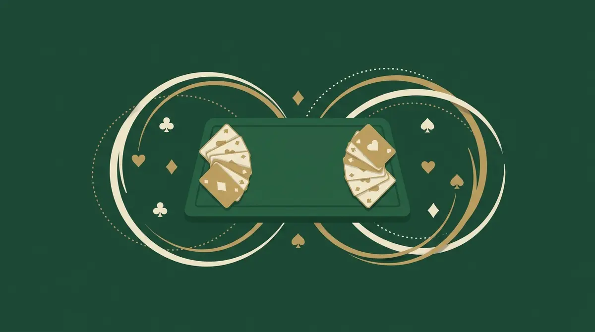
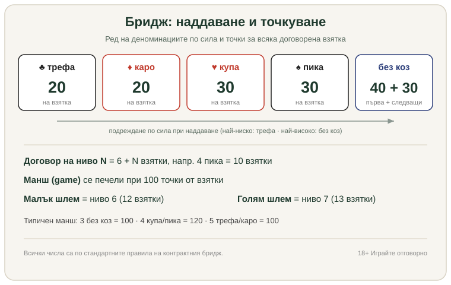

Title tag: Бридж правила: как се играе за начинаещи | Всички Казина
Meta description: Бридж правила за начинаещи: тесте 52 карти, раздаване, наддаване и избор на коз, разиграване на взятките и точкуване до манш. Вижте как се играе бридж стъпка по стъпка.

---

# Бридж правила за начинаещи: как се играе

Бридж се играе от четирима в два отбора по двама, със стандартно тесте от 52 карти, и една ръка минава през четири неща в този ред: раздаване, наддаване, разиграване на взятките и броене на точките. Партньорите сядат един срещу друг, обикновено обозначени като Север-Юг и Изток-Запад, и всяка двойка играе срещу другата.

Правилата на самото разиграване се учат за една вечер. Трудната и интересната част е наддаването, където двамата партньори, без да виждат картите си, трябва да се разберат какъв договор да поемат. Заради това общуване чрез обявите бриджът отдавна се води по-близо до шаха, отколкото до игрите на чист късмет, и е първата карта игра, призната за спорт.

## Тестето, масата и раздаването

Тестето е пълното, 52 карти в четири бои. Във всяка боя картите вървят по сила от Асо надолу: А, К (поп), Д (дама), В (вале), 10, 9, 8, 7, 6, 5, 4, 3, 2. Раздаващият дава картите една по една, с лице надолу, по часовниковата стрелка, докато всеки от четиримата държи по 13. Тези 13 карти са ръката на играча за цялата раздадка.

Кой раздава се сменя на всяка ръка, като редът пак върви наляво. След като картите са раздадени, всеки си подрежда ръката по бои и прави първата бърза преценка колко е силна, защото точно върху тази преценка стъпва наддаването.

## Наддаването: откъде идва договорът

Наддаването е наддаване в буквалния смисъл. Започва раздаващият и обявите вървят по часовниковата стрелка. Всяка обява е две неща заедно: ниво от 1 до 7 и деноминация, тоест коя боя да е коз или да се играе без коз. Деноминациите имат твърд ред по сила: трефа ♣, каро ♦, купа ♥, пика ♠ и най-отгоре без коз. По-високото ниво винаги бие по-ниското, а при еднакво ниво по-старшата деноминация бие по-младшата. Затова над „2 купа" може да се надгради с „2 пика" или „2 без коз", но „2 трефа" вече не върши работа.

Нивото не брои взятки от нулата. То се чете върху база от шест, така наречената книга. Договор на ниво 1 обещава 7 взятки, тоест 6 плюс 1; „4 пика" значи 10 взятки с коз пика; „6 без коз" значи 12 взятки без коз. Освен обява на свой ред играчът може да каже пас, когато няма какво да добави, контра върху обява на противника (която удвоява залога за тази ръка) или реконтра, ако противникът е контрирал (учетворяване).

Щом трима играчи пасуват един след друг, наддаването спира. Последната обява преди тези три паса става договор за ръката и определя коза. Ако и четиримата пасуват в самото начало, ръката се анулира и раздава следващият.

## Кой разиграва и кой гледа

В момента, в който наддаването приключи, двойката с договора си разпределя ролите сама. Разиграващ (декларант) е онзи от двамата партньори, който пръв е назовал деноминацията на окончателния договор, не непременно този, който го е обявил последен. Партньорът му става мор, а двамата противници са защитниците.

Морът е особеното на бриджа. След като падне първата карта, той обръща цялата си ръка с лице нагоре върху масата, подредена по бои, и спира да участва. Оттам нататък разиграващият играе за две ръце, своята и на мора, с пълна информация за 26-те карти от своята страна. Защитниците виждат мора, но не и ръката на партньора си, и трябва да се разберат само чрез картите, които свалят.

## Разиграването на взятките

Първата карта, атаката, идва от защитника вляво от разиграващия, още преди морът да се отвори. После всеки на свой ред слага по една карта по часовниковата стрелка и четирите карти правят една взятка.

Правилото за следването на боята командва всичко останало. Трябва да сложите карта от боята на атаката, ако имате такава. Нямате ли, може да играете каквото решите, включително коз. Взятката се печели от най-високия коз в нея; ако в нея няма изигран коз, печели най-високата карта от атакуваната боя. Който вземе взятката, атакува следващата. Така се изиграват всичките 13 взятки от ръката.

Целта на разиграващия е проста по формулировка и мъчна по изпълнение: да събере поне толкова взятки, колкото е поел договорът, тоест 6 плюс нивото. Събере ли ги, договорът е изкаран. Остане ли под тях, е вкаран и точките отиват у защитниците.

## Точкуването: от взятки към манш

Точките за изкаран договор се начисляват според деноминацията и броя на договорените взятки над книгата. Трефата и карото носят по 20 точки на взятка. Купата и пиката носят по 30. Без коз е най-ценно: 40 за първата договорена взятка и по 30 за всяка следваща.

*Редът на деноминациите, точките за взятка и прагът за манш. Всички числа са по стандартните правила на контрактния бридж.*

Границата, която движи цялата игра, е 100 точки от взятки за една ръка. Събере ли двойката 100 или повече от договорените си взятки, печели манш (game). Под 100 е частичен резултат, който се пази и се трупа към по-късна ръка. Оттук идват и „типичните" маншови договори, които всеки бриджор разпознава. Три без коз прави точно 100 (40 + 30 + 30). Четири купа или четири пика прави 120 (четири по 30). Пет трефа или пет каро също стига 100 (пет по 20), затова маншът в младшите бои иска цяло едно ниво повече. Разликата обяснява защо наддаването толкова често клони към купа, пика или без коз.

## Шлемовете

Високите договори имат отделно име и отделна тежест. Малък шлем е договор на ниво 6, обещание за 12 от 13 взятки. Голям шлем е ниво 7, и четиринайсетте карти на двойката трябва да приберат всичко, и 13-те взятки. Шлемовете носят едрите бонуси в бриджа, но и рискът е огромен: един пропуск и цялата амбициозна ръка пропада. Наддаването до шлем е върхът на партньорската преценка, където двамата сглобяват от обявите си дали между двете ръце се крият нужните високи карти.

## Защо бриджът минава за умение, не за късмет

Раздаването е случайно, но оттам нататък късметът отстъпва. Едни и същи 52 карти, раздадени на същите четирима, ще дадат различен резултат според това колко точно са се разбрали партньорите в наддаването и колко чисто са изиграли взятките. Информацията, която минава през обявите и през реда на свалените карти, е истинската валута на играта. Тази тежест на решенията сродява бриджа с други настолни игри на мислене повече, отколкото с ротативките. Ако търсите подобна игра на взятки и козове, но с българския привкус на анонсите, правилата на [белот](/blog/belot-pravila/) тръгват от същата идея за коз и взятка. А за бавната стратегическа игра на поле подобна логика стои зад [правилата на табла](/blog/tabla-pravila/).

## Бридж на пари - хазарт ли е?

Спортният бридж се играе за точки и класиране, не за пари, и турнирите по света се водят именно като умствен спорт. Приятелската игра у дома е социална, без залог. Щом обаче се появи залог на реални пари, важи общата линия в България: организирането на хазартни игри е под надзора на НАП и легалната игра на пари минава само през оператор, лицензиран от НАП и вписан в публичния регистър. Бриджът не е източник на доход и не бива да се мисли така. Ако изобщо ще има залог, важат същите граници, както при всяка игра за пари, а именно бюджет, който можете да загубите, и лимити, зададени предварително. Инструменти за самоконтрол и помощ ще намерите на страницата ни за [отговорна игра](/blog/responsible-gambling/).

Контрактният бридж в сегашния му вид е дело на Харолд Вандербилт от 1925 г. и днес се управлява в международен план от Световната бридж федерация (WBF), а у нас от Българската бридж федерация. Правилата на точкуването имат още пластове, контри, зони и бонуси за робер, които се добавят постепенно. За първата си вечер на масата обаче стигат четирите стъпки отгоре: раздай, наддавай, изиграй взятките, преброй до манша.

---

**Георги Тодоров**
Публикувано: 28.10.2026 · Последна редакция: 28.10.2026

**За Всички Казина.** Независим сайт за сравнение на онлайн казина, лицензирани за българския пазар. Оценяваме всяко казино по публична методика с шест претеглени критерия и проверяваме лиценза в регистъра на НАП, преди да дадем оценка. Не сме оператор и не продаваме съвети за печалба; сравняваме, проверяваме и обясняваме, за да избираш с отворени очи.

**Отговорна игра.** 18+ Хазартът може да пристрасти. Играйте отговорно. Ако усетиш, че играта излиза извън контрол или искаш да я ограничиш, виж [инструментите за отговорна игра](/otgovorna-igra/) и възможността за самоизключване чрез националния регистър на уязвимите лица към НАП (подава се писмено само от засегнатото лице). Национална информационна линия за наркотиците, алкохола и хазарта („Солидарност") 0888 99 18 66, делнични дни 10:00-17:00.

**Разкриване на партньорства.** Сайтът съдържа партньорски (афилиейт) връзки; когато отвориш оферта през такава връзка, това може да финансира сайта, без да променя цената за теб и без да влияе на оценките ни. От 1 август 2026 г. дейността на афилиейт оператори в България се лицензира съгласно Закона за държавния бюджет за 2026 г. (ДВ, бр. 69 от 31.07.2026 г.). Всички Казина е подало заявление за лиценз пред Националната агенция по приходите и очаква издаването му.
