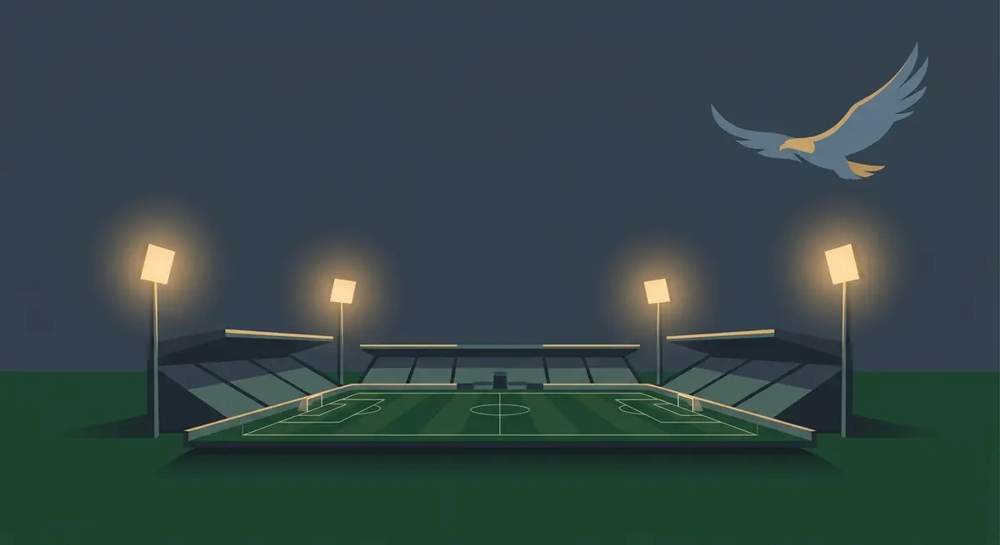

Title tag: Лудогорец: история, титли и Хювефарма Арена | Всички Казина
Meta description: Лудогорец от Разград: как клубът стигна до елита, 14 поредни титли, пътят до Шампионската лига и историята на Хювефарма Арена. Факти, не прогнози.

---

# Лудогорец: историята на клуба, титлите и Хювефарма Арена

За по-малко от десет години един клуб от Разград спечели повече шампионски титли подред, отколкото който и да е отбор в историята на българския футбол. Серията тръгна през 2011 г. и продължи сезон след сезон. Около нея се подреди всичко останало в историята на Лудогорец.

## Как един разградски клуб стигна до елита

Футболът в Разград не е от вчера; градската линия води началото си още от 1945 г. Модерният клуб обаче тръгва от друг момент. През септември 2010 г. бизнесменът Кирил Домусчиев купува отбора, а само няколко месеца по-късно, през май 2011 г., Лудогорец за първи път влиза в А група, с треньор Ивайло Петев. От отбор, който дотогава играе извън светлините на елита, за една година се нарежда сред първите.

Дебютът се подреди от онези, които се помнят дълго. В първия си сезон в елита, 2011/12, клубът направи требъл: шампионската титла, Купата на България през 2012 г. и Суперкупата през август същата година. Никой друг отбор не беше печелил требъл в дебютния си сезон в А група. Това, което за повечето новаци е сезон на оцеляване, при Лудогорец стана начало на цяла епоха.

## Серия, каквато българският футбол не беше виждал

Оттам нататък титлите спряха да бъдат изненада. Към лятото на 2025 г. клубът има 14 поредни шампионски титли, от 2011/12 до 2024/25, без нито едно прекъсване. Прибавят се четири Купи на България, спечелени през 2011/12, 2013/14, 2022/23 и 2024/25, и девет Суперкупи: 2012, 2014, 2018, 2019, 2021, 2022, 2023, 2024 и 2025 г. Деветте Суперкупи са рекорд за българския футбол.

Числата са сухи. Подредени едно до друго обаче описват десетилетие, в което първото място в страната рядко е било под въпрос преди края на пролетта.

*Ключовите години и трофеите на Лудогорец. Всички числа следват текста на статията.*

## Разград на европейската карта

Доминацията у дома отвори вратата към Европа. През сезон 2014/15 Лудогорец стана вторият български клуб след Левски София, който се класира в груповата фаза на Шампионската лига. В Лига Европа орлите имат четири участия в елиминационната фаза, повече от всеки друг български отбор.

За клуб от град с размерите на Разград това е необичайно дълго присъствие на сцена, запазена обикновено за имена с по-дълга история и по-голям бюджет. Този контраст, малкият град срещу големите вечери под прожекторите, държи интереса към отбора жив и извън България.

## Стадионът: от „Дянко Стефанов" до Хювефарма Арена

Успехът остави и съвсем материална следа. Стадионът в Разград е построен през 1954 г. като обикновена многофункционална градска спортна база и дълги години носи името „Дянко Стефанов". През 2011 г., заедно с влизането в елита, го преустрояват, за да покрива критериите за мачове от първо ниво, и за кратко се казва „Лудогорец Арена".

Следват разширения през 2013, 2015 и 2017 г. и обновяване през 2020 г., когато съоръжението получава сегашното си име „Хювефарма Арена", на фармацевтичната компания Хювефарма. Днес арената събира над 10 000 зрители. По европейските мерки е малка, но се оказа достатъчна, за да приеме вечери от Шампионската лига в град, който допреди едно поколение нямаше никаква причина да очаква такива гости.

## Трибуната с име на защитник

Една от трибуните носи име, което обяснява духа на клуба по-добре от всяка статистика. Сектор „Б", открит през 2015 г. с 2308 места, се казва трибуна „Моци". Носи името на Козмин Моци, който по позиция е защитник.

През 2014 г., в плейоф за влизане в групите на Шампионската лига срещу румънската Стяуа, при изпълнението на дузпите Моци застава на вратата и спасява две. Този момент прати Лудогорец в групите на турнира за първи път. Трибуна, кръстена на полеви играч, застанал между гредите в най-важната минута, е от онези подробности, които никой маркетинг отдел не би могъл да измисли.

## На пари, отдалеч: футбол, залози и малко трезва математика

Погледнат отстрани, Лудогорец е преди всичко футболна история: как един клуб използва едно десетилетие, за да се пренареди на върха и да остане там. Следенето на футбол е едно нещо. Ако някой гледа мачовете и покрай това залага или играе в казино, важи същото, което важи навсякъде в България: законно минава само през оператор с лиценз от НАП, вписан в публичния регистър, а какво точно е [законно](/zakonno-li-e/) е отделен и доста по-приземен въпрос от трофейната витрина.

Спортната част на сайта, включително бонусите за спорт, събираме в [раздела за спорт](/bonus-ruletka/sport/). Там няма прогнози за мачове и няма да намерите съвет кого да заложите. Хазартът не е доходоносна стратегия и залогът върху любимия отбор не променя тази аритметика. Бюджет, който можеш да загубиш докрай, и лимити, зададени предварително, пазят вечерта пред телевизора да си остане забавление, а не сметка. Кога играта започва да тежи и какво да се направи тогава е тема на [отговорната игра](/blog/responsible-gambling/).

Четиринайсет поредни титли са исторически факт. Сигурна печалба от залог върху каквото и да било няма, и това е може би единствената гаранция в цялата схема.

---

**Георги Тодоров**
Публикувано: 28.10.2026 · Последна редакция: 28.10.2026

**За Всички Казина.** Независим сайт за сравнение на онлайн казина, лицензирани за българския пазар. Оценяваме всяко казино по публична методика с шест претеглени критерия и проверяваме лиценза в регистъра на НАП, преди да дадем оценка. Не сме оператор и не продаваме съвети за печалба; сравняваме, проверяваме и обясняваме, за да избираш с отворени очи.

**Отговорна игра.** 18+ Хазартът може да пристрасти. Играйте отговорно. Ако усетиш, че играта излиза извън контрол или искаш да я ограничиш, виж [инструментите за отговорна игра](/otgovorna-igra/) и възможността за самоизключване чрез националния регистър на уязвимите лица към НАП (подава се писмено само от засегнатото лице). Национална информационна линия за наркотиците, алкохола и хазарта („Солидарност") 0888 99 18 66, делнични дни 10:00-17:00.

**Разкриване на партньорства.** Сайтът съдържа партньорски (афилиейт) връзки; когато отвориш оферта през такава връзка, това може да финансира сайта, без да променя цената за теб и без да влияе на оценките ни. От 1 август 2026 г. дейността на афилиейт оператори в България се лицензира съгласно Закона за държавния бюджет за 2026 г. (ДВ, бр. 69 от 31.07.2026 г.). Всички Казина е подало заявление за лиценз пред Националната агенция по приходите и очаква издаването му.
