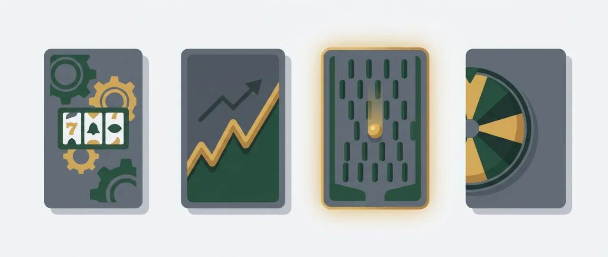
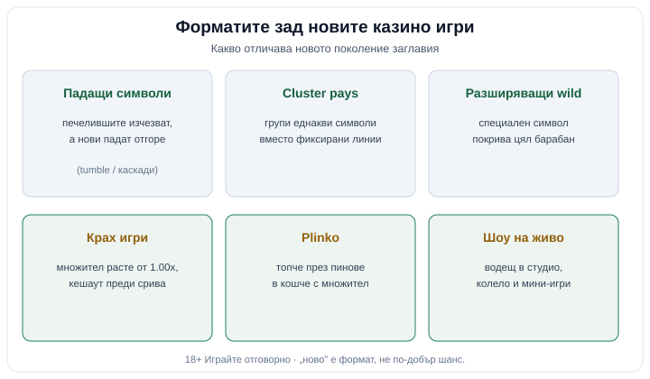

Title tag: Нови казино игри 2026
Meta description: Нови казино игри 2026: роундъп по тип. Ротативки, крах игри, plinko и шоу на живо, с ключовата механика на всяко заглавие и как да подходите към ново.

---

# Нови казино игри 2026: кои заглавия и формати си струва да познавате

Когато в лобито видите етикета „нови казино игри", „ново" значи различна механика или нов формат; самият шанс остава какъвто си беше. Заглавие от тази година и заглавие отпреди пет носят едно и също домашно предимство, вписано в математиката още преди иконата да получи надписа „ново". Затова списъкът отдолу не е подреден по това кое колко „плаща", а по тип: какво е всяко заглавие, коя механика го определя и къде при нас да четете повече.

Повечето от имената са от последните две-три години и не са буквално премиери за 2026. Събрахме ги, защото те оформят това, което ще срещате най-често в днешните лобита: решетъчни печалби, събиращи се множители, разширяващи се wild символи, крах и plinko. Познавате ли тези пет механики, познавате почти всичко, което едно лоби ще ви предложи като „ново" тази година. Една и съща механика впрочем се появява при няколко студиа, тъй че по-важно е как се държи играта, отколкото чия емблема стои върху нея.

*Петте-шест механики, които определят новото поколение казино игри. „Ново" е формат, не по-добър шанс.*

## Нови казино игри: ротативки от новото поколение

Фиксираните линии почти изчезнаха от новите ротативки. Сега повечето броят „начини за печалба" (ways / Megaways), трупат печалба от групи допиращи се символи (cluster), пренареждат структурата на решетката при всяко завъртане или заключват специални символи и ги въртят повторно (задръж и завърти). Повече начини за печалба обикновено значат по-чести, но по-дребни попадения, а същинската тежест на играта се измества към бонус функцията.

- **Gates of Olympus 1000: Pragmatic Play.** „Pays anywhere" / scatter-pays: символите плащат където и да паднат по решетката, без линии. Печелившите падат (tumble), на тяхно място идват нови в същото завъртане, а множителите се събират, докато серията върви. „1000" в името сочи по-висок таван на множителите спрямо оригинала; точната стойност е изписана в инфо-панела на играта. Подробно: [Gates of Olympus 1000](/blog/gates-of-olympus-1000/).
- **Sugar Rush 1000: Pragmatic Play.** Cluster pays: печалбата идва от група допиращи се еднакви символи. Върху определени клетки сядат лепкави множители, които остават и се надграждат с всяка каскада. „1000" пак сочи по-висок множителен таван, чиято точна стойност е изписана в инфо-панела на играта. Подробно: [Sugar Rush 1000](/blog/sugar-rush-1000/).
- **Le Bandit: Hacksaw Gaming.** Cluster pays с каскади (Super Cascade): печелившите символи изчезват, падат нови и една серия може да продължи в рамките на едно завъртане. Тематика обир и Дивия запад. Подробно: [Le Bandit](/blog/le-bandit/).
- **Tombstone RIP: Nolimit City.** Дивия запад с висока волатилност: разширяващи се и „xNudge" wild символи, които се изместват, за да покрият повече от барабана, плюс няколко бонус функции. Заглавие за търпелив банкрол, не за кратка сесия. Подробно: [Tombstone RIP](/blog/tombstone-rip/).
- **Olympus Glory: EGT (Amusnet).** Гръцка митология на 5 барабана с разширяващи се wild символи, които се разтягат върху целия барабан. Структурата е по-класическа спрямо решетъчните заглавия по-горе, по-близо до това, което мнозина познават от наземните зали. Подробно: [Olympus Glory](/blog/olympus-glory/).
- **Eye of Horus: класически египетски слот.** Разширяващи се символи върху барабаните и семпла структура без решетъчни трикове. Разпространява се и в лицензирани версии, затова точният доставчик зависи от конкретното издание. Подробно: [Eye of Horus](/blog/eye-of-horus/).

Това е извадка. Пълния слот-листинг на новите заглавия държим на една страница: [всички нови слотове](/slot-igri/novi/).

## Крах игри и plinko

Два формата, които почти нямат общо с ротативката и дърпат публика тъкмо с бързото темпо. Много от тях рекламират „provably fair": начин сами да проверите, че конкретният кръг не е подправен. Проверката върши работа, но не замества лицензираната сертификация на генератора на случайни числа, тъй че не я приемайте като гаранция за цялата платформа.

- **Aviator: Spribe.** Крах игра: множител тръгва от 1.00x и расте, а вие решавате кога да кешаутнете, преди кръгът да „се срине" в момент, определен на случаен принцип. Един кръг трае секунди. Темпото е част от риска: кръг, който свършва за секунди, кани към бърз следващ залог, а бързите залози изпразват бюджета по-незабелязано от бавните. Подробно: [Aviator](/blog/krash-igri-aviator/).
- **Plinko: plinko / arcade формат.** Топче пада през поле от пинове и каца в кошче с определен множител; колкото по-крайно е кошчето, толкова по-рядък и по-едър е резултатът. Обикновено сами избирате ниво на риск, което разтяга или свива разликата между кошчетата. Форматът се предлага от различни студиа, затова конкретните стойности зависят от версията. Подробно: [Plinko](/blog/plinko/).

## Шоу на живо

**Шоу игри на живо.** Водещ в истинско студио върти колело или „money wheel", с bonus-разходки и мини-игри на екрана. Накъдето спре колелото, такава е печалбата, а най-тлъстите множители седят на най-редките сектори, точно както при всяка игра срещу домашно предимство. Нещо между ротативка и телевизионно шоу. Водещият и чатът обаче задържат вниманието по-дълго от една самотна ротативка, та е лесно да се заседите на масата над планираното. Подробно: [шоу игрите на живо](/blog/live-game-shows/).

## Как да подходите към ново заглавие

Три неща решават дали едно ново име заслужава вашия залог, и нито едно от тях не е графиката.

RTP (return to player) е дългосрочна статистика върху милиони завъртания на всички играчи, взети заедно. За вашата вечер не казва нищо. При ротативките обикновено стои около 96%, а останалото е домашното предимство. Една отделна сесия спокойно приключва далеч над или далеч под тази граница. И ако заглавие крие своя RTP, това само по себе си е причина за повече предпазливост. Повече по термините има в [речника ни](/blog/rechnik-kazino-termini/).

Волатилността е темпераментът на играта. При ниска печалбите са дребни, но идват често; високата ви държи в дълги сухи серии заради онзи рядък голям удар. Висок RTP се среща и в двата лагера, затова волатилността и RTP се четат заедно, спрямо бюджета и времето, което смятате да отделите.

Демо режимът е честният тест. Нови казино игри безплатно, без депозит, в които усещате темпото и волатилността, четете таблицата с изплащания и гледате как работят функциите, без нито едно евро на масата. Няколко десетки завъртания обикновено стигат, за да усетите дали дългите паузи без печалба ще ви изнервят. Демото обаче показва ритъма на основната игра и почти не подсказва колко често реално пада скъпата бонус функция, тъй че приятната безплатна сесия не е обещание какъв ще е реалният баланс. Къде да намерите демо версии: [безплатни казино игри](/blog/bezplatni-kazino-igri/).

Една честна линия важи за всяко заглавие в списъка: ново ≠ по-голям шанс. 18+ Хазартът може да пристрасти. Играйте отговорно. Залагайте само пари, които можете да загубите изцяло, и задайте лимити за депозит и загуба преди първия депозит, не след него.

## Форматът се сменя, математиката остава

„Ново" е маркетингов етикет. Свежата графика и усещането, че изпускате нещо, са сложени там нарочно, за да ви накарат да залагате по-бързо и да забравите бюджета. Механиките се менят, имената се менят, домашното предимство остава вписано в числата. Целия каталог и логиката, по която подреждаме [казино игрите](/kazino-igri/), можете да разгледате при нас.

**Георги Тодоров**
Публикувано: 28.10.2026 · Последна редакция: 28.10.2026

[About Всички Казина boilerplate]

**Отговорна игра.** 18+ Хазартът може да пристрасти. Играйте отговорно. Ако усетиш, че играта излиза извън контрол или искаш да я ограничиш, виж [инструментите за отговорна игра](/otgovorna-igra/) и възможността за самоизключване чрез националния регистър на уязвимите лица към НАП (подава се писмено само от засегнатото лице). Национална информационна линия за наркотиците, алкохола и хазарта („Солидарност") 0888 99 18 66, делнични дни 10:00–17:00.

**Разкриване на партньорства.** Всички Казина съдържа партньорски (афилиейт) връзки; когато отвориш оферта през такава връзка, това може да финансира сайта, без да променя цената за теб и без да влияе на оценките ни. От 1 август 2026 г. дейността на афилиейт оператори в България се лицензира съгласно Закона за държавния бюджет за 2026 г. (ДВ, бр. 69 от 31.07.2026 г.). Всички Казина е подало заявление за лиценз пред Националната агенция по приходите и очаква издаването му.
