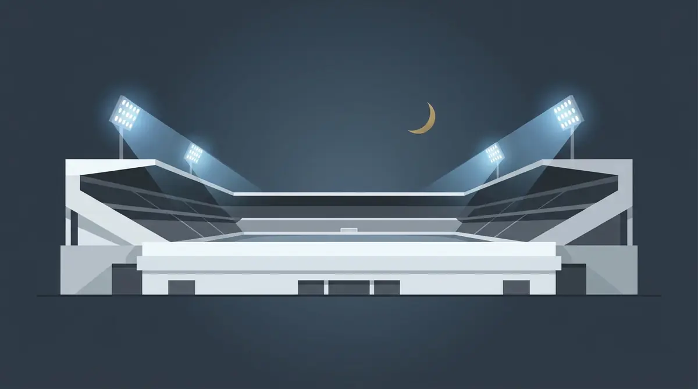

Title tag: Реал Мадрид: история, трофеи, стадион и легенди | Всички Казина
Meta description: Реал Мадрид: как клубът се ражда през 1902 г., трофеите в Ла Лига и Европа, стадионът Сантяго Бернабеу и легендите на „белите". Факти, не прогнози.

---

# Реал Мадрид: историята, трофеите, стадионът и легендите

Петнайсет пъти Реал Мадрид е вдигал най-големия европейски клубен трофей. Никой друг отбор на континента не се е доближил до тази цифра, и тъкмо тя, повече от всичко друго, обяснява защо клубът носи прякора „кралете на Европа".

## От „Мадрид Футбол Клуб" до „Реал"

Всичко започва на 6 март 1902 г., когато е основан Madrid Football Club. „Реал", тоест „кралски", се появява чак през 1920 г.: крал Алфонсо XIII дава на клуба кралската титла и короната, която и до днес стои в герба. Така се стига до пълното име Real Madrid Club de Fútbol.

Прякорите идват направо от екипа. Белите фланелки превръщат отбора в „Лос Бланкос", белите, и в „Лос Меренгес". Самите привърженици се наричат мадридисти.

## Витрината: какво е спечелил клубът

Вкъщи, в Испания, Реал Мадрид държи първенството по титли. Към лятото на 2025 г. те са 36 в Ла Лига, повече от всеки друг испански клуб. Към тях вървят 20 Купи на краля, или Копа дел Рей, и 13 Суперкупи на Испания.

*Трофеите и ключовите години на Реал Мадрид. Всички числа следват текста на статията.*

## Кралете на Европа

Истинската разлика обаче клубът прави навън. 15 пъти е печелил Купата на европейските шампиони и наследника ѝ, Шампионската лига, рекорд, който никой не е стигал. Петнайсетият трофей дойде през 2024 г., но коренът на репутацията е в началото: първите пет издания на турнира, между 1956 и 1960 г., отиват поред в Мадрид. Към европейската сметка се добавят 2 трофея от Купата на УЕФА, днешната Лига Европа, и 9 световни титли от Междуконтиненталната купа и Световното клубно първенство, пак рекорд. Не е случайно, че през 2000 г. ФИФА обяви Реал Мадрид за най-добрия клуб на XX век.

## Сантяго Бернабеу

Домът на клуба се казва „Сантяго Бернабеу" и приема мачове от 1947 г. Между 2019 и 2024 г. стадионът беше преустроен почти изцяло, с нов прибиращ се покрив и обновена фасада. Колко точно събира след ремонта, клубът така и не обяви официално, но числото е над 80 000. За сравнение, рекордът му на посещаемост е 129 690 зрители на мач срещу Милан през 1956 г., когато правостоящите места още бяха разрешени.

Името е на Сантяго Бернабеу, човекът, който ръководи клуба от 1943 до 1978 г. Първите европейски купи идват именно при него.

## Легендите

Списъкът с имена, минали през клуба, е дълъг и познат дори на хора, които не следят футбол. Алфредо ди Стефано, Ференц Пушкаш и Пако Хенто носят ранните европейски успехи. По-късно идват Раул, вратарят и капитан Икер Касияс, Зинедин Зидан, който след кариерата си се връща като треньор, и защитникът Серхио Рамос. Голмайстор номер едно в историята на Реал Мадрид пък остава Кристиано Роналдо.

## Ел Класико

Най-острото съперничество на клуба е с Барселона. Срещите между двата отбора носят собствено име, Ел Класико, и редовно са сред най-гледаните футболни мачове на планетата. Зад тях стои не само спортът, а и дълга история между двата града.

## На пари, отдалеч: футбол, залози и малко трезва математика

Ако гледаш мачовете и покрай това залагаш или играеш в казино, важи същото, което важи навсякъде в България: законно минава само през оператор с лиценз от НАП, вписан в публичния регистър, а какво точно е [законно](/zakonno-li-e/) е отделен и доста по-приземен въпрос от трофейната витрина.

Спортната част на сайта, включително бонусите за спорт, събираме в [раздела за спорт](/bonus-ruletka/sport/vsichki/). Там няма прогнози за мачове и няма да намериш съвет кого да заложиш. Хазартът не е доходоносна стратегия и залогът върху любимия отбор не променя тази аритметика. Бюджет, който можеш да загубиш докрай, и лимити, зададени предварително, пазят вечерта пред телевизора да си остане забавление, а не сметка. Кога играта започва да тежи и какво да се направи тогава е тема на [отговорната игра](/blog/responsible-gambling/).

Петнайсет европейски купи са исторически факт. Сигурна печалба от залог върху каквото и да било няма, и това е може би единствената гаранция в цялата схема.

---

**Георги Тодоров**
Публикувано: 28.10.2026 · Последна редакция: 28.10.2026

**За Всички Казина.** Независим сайт за сравнение на онлайн казина, лицензирани за българския пазар. Оценяваме всяко казино по публична методика с шест претеглени критерия и проверяваме лиценза в регистъра на НАП, преди да дадем оценка. Не сме оператор и не продаваме съвети за печалба; сравняваме, проверяваме и обясняваме, за да избираш с отворени очи.

**Отговорна игра.** 18+ Хазартът може да пристрасти. Играйте отговорно. Ако усетиш, че играта излиза извън контрол или искаш да я ограничиш, виж [инструментите за отговорна игра](/otgovorna-igra/) и възможността за самоизключване чрез националния регистър на уязвимите лица към НАП (подава се писмено само от засегнатото лице). Национална информационна линия за наркотиците, алкохола и хазарта („Солидарност") 0888 99 18 66, делнични дни 10:00-17:00.

**Разкриване на партньорства.** Сайтът съдържа партньорски (афилиейт) връзки; когато отвориш оферта през такава връзка, това може да финансира сайта, без да променя цената за теб и без да влияе на оценките ни. От 1 август 2026 г. дейността на афилиейт оператори в България се лицензира съгласно Закона за държавния бюджет за 2026 г. (ДВ, бр. 69 от 31.07.2026 г.). Всички Казина е подало заявление за лиценз пред Националната агенция по приходите и очаква издаването му.
