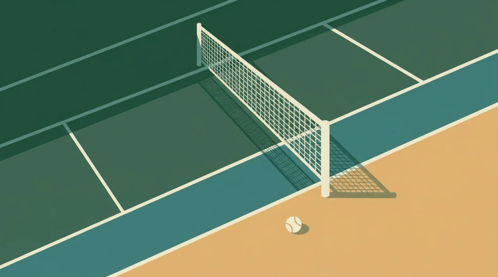

Title tag: Тенис правила и точкуване: гейм, сет и тайбрек | Всички Казина
Meta description: Как се играе и точкува тенис: защо точките са 15-30-40, какво е деус и предимство, кога идва тайбрек и колко сета печелят мача. Ясно обяснение на правилата.

---

# Тенис: правила и точкуване от гейм до мач

В тениса точките не вървят 1, 2, 3, а 15, 30, 40. Звучи странно, докато не схванеш стълбицата; щом тя ти е ясна, цялата система се нарежда сама, от първата топка до последния сет.

## Как се брои един гейм

Първата спечелена точка в гейма се отбелязва като 15, втората като 30, третата като 40, а четвъртата, ако дойде навреме, печели гейма. Нулата се казва „нула" (в английския „love"). Дотук е просто броене с необичайни имена. Усложнението идва при 40-40, което се нарича равенство, или с думата от тенис речника, деус. От равенство никой не печели гейма само с една точка: трябват две поредни. Първата дава предимство на водещия, втората затваря гейма. Ако обаче водещият загуби следващата точка, резултатът се връща на равенство и броенето започва отново. Така един гейм при равностойни играчи може да се проточи доста, докато единият не откъсне два пъти един след друг.

## Сервисът: две топки и диагонал

Всяка точка започва с подаване, а подаващият има право на два опита. Пропусне ли и двата, това е двойна грешка и точката отива директно при съперника, без да е ударена нито една топка в игра. Подаването трябва да прелети диагонално и да падне в отсрещното поле за сервис; подаващият сменя дясната и лявата страна на всяка следваща точка. Ако топката при сервис закачи горния ръб на мрежата, но въпреки това падне правилно, се обявява „лет" и подаването се повтаря, без да се брои за грешка. Геймовете на подаване се редуват между двамата, а играчите сменят страните на корта след нечетните геймове, тоест след първия, третия, петия и така нататък, за да изравнят ефекта от слънцето и вятъра.

## От геймове към сет

Сет се печели от първия, който стигне 6 гейма, но с преднина от поне 2. Затова 6-4 затваря сета, а при 5-5 се играе до 7-5. Проблемът е, когато двамата стигнат 6-6 и никой не може да откъсне нужните два гейма. Тогава идва тайбрекът.

## Тайбрекът

В тайбрека броенето най-сетне става нормално: 1, 2, 3 и нагоре. Печели първият до 7 точки, пак с преднина от 2, така че при 6-6 вътре в тайбрека се продължава, докато някой не поведе с две. Подаването се върти по собствено правило: следващият на ред сервира само една точка, след което двамата си редуват по две, а страните се сменят на всеки 6 точки. Решаващият сет дълго време се играеше различно на различните турнири. От 2022 г. четирите турнира от Големия шлем въведоха общо правило: при 6-6 в последния сет се играе тайбрек до 10 точки, отново с преднина от две.

## Колко сета печелят мача

Броят сетове зависи от турнира. Повечето мачове, включително почти целият женски календар, са до два спечелени сета, тоест който пръв вземе два сета, печели срещата. На турнирите от Големия шлем при мъжете форматът е до три спечелени сета, което прави срещите по-дълги и по-тежки физически, понякога над четири часа.

*Стълбицата на точкуването: от точка до мач. Всички числа следват текста на статията.*

## Корт, настилки и единична срещу двойна игра

На сингъл, тоест един срещу един, се играе в по-тясното поле; при игра на двойки влизат в употреба и страничните коридори, затова кортът става по-широк. Настилката също променя играта: твърдият корт (хард), клеят и тревата дават различна скорост на топката и различен отскок, което обяснява защо един и същ играч изглежда различно през сезона. Остава странната стълбица 15-30-40. Най-разпространеното обяснение я свързва с циферблат на часовник, където 45 с времето се съкратило на 40. Приятно предание, но точният произход не е документиран със сигурност.

## На пари, отдалеч: тенисът, залозите и трезвата сметка

Ако гледаш тенис и покрай това залагаш, важи същото както навсякъде в България: законно минава само през оператор с лиценз от НАП, вписан в публичния регистър, а какво точно е [законно](/zakonno-li-e/) е отделен и доста по-приземен въпрос от самата игра. Спортната част на сайта събираме в [раздела за спорт](/blog/sport/), а офертите за спорт са в [спортните бонуси](/bonus-ruletka/sport/vsichki/). Там няма прогнози за мачове и няма да намериш съвет кого да заложиш. Хазартът не е доходоносна стратегия и залогът върху фаворита не променя тази аритметика. Бюджет, който можеш да загубиш докрай, и предварително зададени лимити пазят вечерта пред телевизора да си остане забавление, а не сметка. Кога играта започва да тежи и какво да се направи тогава е тема на [отговорната игра](/blog/responsible-gambling/).

Правилата на тениса са фиксирани и няма да се променят, докато гледаш мача. Сигурна печалба от залог върху когото и да било няма, и точно това е единствената гаранция в цялата схема.

---

**Георги Тодоров**
Публикувано: 28.10.2026 · Последна редакция: 28.10.2026

**За Всички Казина.** Независим сайт за сравнение на онлайн казина, лицензирани за българския пазар. Оценяваме всяко казино по публична методика с шест претеглени критерия и проверяваме лиценза в регистъра на НАП, преди да дадем оценка. Не сме оператор и не продаваме съвети за печалба; сравняваме, проверяваме и обясняваме, за да избираш с отворени очи.

**Отговорна игра.** 18+ Хазартът може да пристрасти. Играйте отговорно. Ако усетиш, че играта излиза извън контрол или искаш да я ограничиш, виж [инструментите за отговорна игра](/otgovorna-igra/) и възможността за самоизключване чрез националния регистър на уязвимите лица към НАП (подава се писмено само от засегнатото лице). Национална информационна линия за наркотиците, алкохола и хазарта („Солидарност") 0888 99 18 66, делнични дни 10:00-17:00.

**Разкриване на партньорства.** Сайтът съдържа партньорски (афилиейт) връзки; когато отвориш оферта през такава връзка, това може да финансира сайта, без да променя цената за теб и без да влияе на оценките ни. От 1 август 2026 г. дейността на афилиейт оператори в България се лицензира съгласно Закона за държавния бюджет за 2026 г. (ДВ, бр. 69 от 31.07.2026 г.). Всички Казина е подало заявление за лиценз пред Националната агенция по приходите и очаква издаването му.
