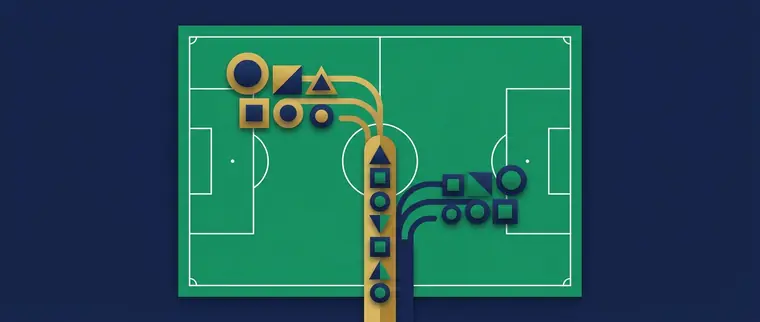

Title tag: Какво е efbet Лига: формат, отбори и класиране | Всички Казина
Meta description: efbet Лига (Първа лига): как е устроен сезонът, групите, промоцията и изпадането, местата за Европа и рекордьорите. Обяснение на формата, не прогнози.

---

# Какво е efbet Лига и как работи форматът на българското първенство

„Ефбет лига", Първа лига и Първа професионална футболна лига са едно и също: най-горното ниво на клубния футбол в България. Официалното име е Първа професионална футболна лига, прието на 7 юни 2016 г., а търговското „efbet Лига" идва от спонсора, чиято марка първенството носи от 2019 г. Като организирано състезание българският футбол се играе от 1924 г., а във формат на лига, с таблица и точки, от 1948 г. Управляват го Българският футболен съюз и Професионалната футболна лига, които приемат регламента и календара за всеки сезон.

## Как е устроен един сезон

Всеки сезон тръгва по един и същи начин: всеки срещу всеки, по два мача на разменено гостуване. Това е редовният сезон и от него излиза първата подредба в таблицата.

След редовния сезон първенството не приключва направо с лидера на върха. Таблицата се разделя на групи и отборите продължават да играят помежду си, вече в по-тесен кръг. Горната група спори за титлата и за местата за Европа, а в долната върви друга битка, за оставане. Шампион на България става победителят в горната група, а не непременно първият след редовния сезон, защото точките в плейофната фаза продължават да се трупат.

Броят отбори и начинът, по който се чертае разделянето, се менят през годините. През сезон 2025/26 например в efbet Лига играят 16 отбора: 30 кръга редовен сезон, след което първите четири образуват шампионска група, отборите от пето до осмо място играят за бараж за Лига на конференциите, а тези от девето до шестнайсето влизат в група за оставане. От сезон 2026/27 съставът се връща към 14 отбора, което отново сменя броя на кръговете и чертежа на групите. Точната схема за всеки сезон БФС и ПФЛ обявяват в регламента преди старта.

*Как се подрежда един сезон в efbet Лига. Всички числа следват текста на статията.*

## Класиране, промоция и изпадане

Подредбата се прави по точки, а при равенство тежат головата разлика, резултатите в преките срещи и другите помощни показатели от правилника. Актуалната таблица се води на сайта на лигата и на БФС, заедно с резултатите от всеки кръг.

Последните отбори в групата за оставане изпадат във Втора професионална футболна лига, а най-добрите от Втора лига се изкачват на тяхно място. Между тези две зони стои баражът: отбор от долната част на Първа лига играе срещу по-предно класирал се тим от Втора лига за едно място горе. Директните изпадащи и тези, които минават през бараж, се менят според броя отбори в сезона.

## Местата за Европа

Най-предните места в класирането дават участие в европейските клубни турнири. Шампионът влиза в квалификациите за Шампионската лига. Следващите в класирането, заедно с носителя на Купата на България, тръгват по квалификациите на Лига Европа и Лига на конференциите. Броят места за България и това в кой турнир влиза всеки отбор идват от коефициента на страната в УЕФА и от това кой печели купата, така че не са фиксирани завинаги.

## Клубовете и рекордите

Историята на първенството е предимно столична. ЦСКА е рекордьорът по титли с 31, следван от Левски с 27; Левски е и шампионът от сезон 2025/26. Само двата софийски гранда са вдигали купата около седемдесет пъти заедно. Модерният период обаче има друго лице: Лудогорец спечели 14 поредни титли между сезоните 2011/12 и 2024/25, което е рекорд за последователни шампионства в България. През годините първенството са печелили и клубове като Берое, Славия, Локомотив (Пловдив и София) и Литекс, така че върхът невинаги е бил заключен за два отбора. Данните за трофеите са към 2026 г.

## Къде да гледате мачовете

Телевизионните и стрийминг правата върху efbet Лига се продават на цикли и сменят собственика си през няколко години. Кой държи правата сега е публикувано на каналите на лигата и на БФС. Част от срещите традиционно вървят по платени спортни канали, а други по безплатни или онлайн платформи според договора за сезона.

## Футбол, залози и трезва сметка

Ако гледаш efbet Лига и покрай това залагаш на спорт или играеш в казино, правилото е същото навсякъде в България: законно минава само през оператор с лиценз от НАП, вписан в публичния регистър. Какво точно е [законно](/zakonno-li-e/) е отделна тема от това кой води в таблицата.

Спортните бонуси събираме в [раздела за спорт](/bonus-ruletka/sport/vsichki/), без прогнози за мачове и без съвет кого да заложиш; повече за клубовете и имената от българския и световния футбол четеш в [блога за футбол](/blog/futbol/). Залогът върху фаворита в едно дерби не е по-сигурен от всеки друг залог, а хазартът не е доходоносна стратегия. Бюджет, който можеш да загубиш докрай, плюс предварително зададени лимити за депозит и загуба държат мача да си остане мач. Кога играта започва да тежи и какво се прави тогава е тема на [отговорната игра](/blog/responsible-gambling/).

---

**Георги Тодоров**
Публикувано: 29.10.2026 · Последна редакция: 29.10.2026

**За Всички Казина.** Независим сайт за сравнение на онлайн казина, лицензирани за българския пазар. Оценяваме всяко казино по публична методика с шест претеглени критерия и проверяваме лиценза в регистъра на НАП, преди да дадем оценка. Не сме оператор и не продаваме съвети за печалба; сравняваме, проверяваме и обясняваме, за да избираш с отворени очи.

**Отговорна игра.** 18+ Хазартът може да пристрасти. Играйте отговорно. Ако усетиш, че играта излиза извън контрол или искаш да я ограничиш, виж [инструментите за отговорна игра](/otgovorna-igra/) и възможността за самоизключване чрез националния регистър на уязвимите лица към НАП (подава се писмено само от засегнатото лице). Национална информационна линия за наркотиците, алкохола и хазарта („Солидарност") 0888 99 18 66, делнични дни 10:00-17:00.

**Разкриване на партньорства.** Сайтът съдържа партньорски (афилиейт) връзки; когато отвориш оферта през такава връзка, това може да финансира сайта, без да променя цената за теб и без да влияе на оценките ни. От 1 август 2026 г. дейността на афилиейт оператори в България се лицензира съгласно Закона за държавния бюджет за 2026 г. (ДВ, бр. 69 от 31.07.2026 г.). Всички Казина е подало заявление за лиценз пред Националната агенция по приходите и очаква издаването му.
