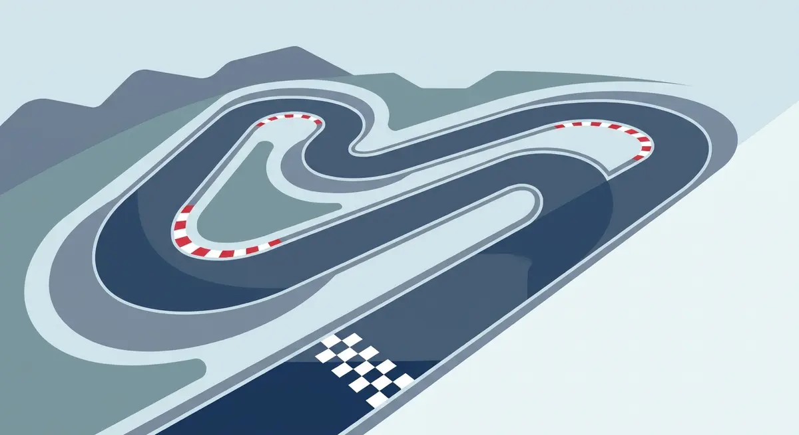

Title tag: Формула 1: как работи — точкуване, отбори и състезателният уикенд | Всички Казина
Meta description: Как работи Формула 1: двете титли, точкуване 25-18-15…, спринтът, нокаут квалификацията, дистанцията от 305 км и рекордите. Факти, не прогнози.

---

# Формула 1: как работи състезанието

Всяко състезание във Формула 1 раздава точки едновременно за две световни титли: една за пилота зад волана и една за отбора, който е построил болида. Зрителят гледа дуела на пистата, но голяма част от сезона всъщност се води за втората, доста по-рядко показвана класация.

## Какво е Формула 1

Формула 1 е най-горното ниво на едноместните болиди с открити колела. Състезанието се санкционира от FIA, Международната автомобилна федерация, а търговската му страна се управлява от Formula One Group. Световното първенство тръгва през 1950 г., с първа писта на „Силвърстоун" в Англия на 13 май. „Формулата" в името е самият набор технически правила, на които трябва да отговаря всеки болид, за да бъде допуснат.

## Двете титли

В края на сезона се връчват две световни титли. Едната е при пилотите и отива при този, който е събрал най-много точки сам. Другата е при конструкторите, тоест отборите, и се смята от сбора на точките на двата болида на отбора. Титлата при пилотите е от първия сезон, а тази при конструкторите се добавя през 1958 г. Отборите държат особено много на втората, защото от нея зависи голяма част от разпределението на приходите в спорта.

## Как се точкува

Точки взимат първите десет в състезанието: 25 за победителя, след него 18, 15, 12, 10, 8, 6, 4, 2 и 1 за десетия. Тази система е в сила от 2010 г. За да получи точки изобщо, пилотът трябва да е завършил поне 90 на сто от дистанцията. Между 2019 и 2024 г. имаше и допълнителна точка за най-бързата обиколка, но от сезон 2025 г. тя отпадна, така че най-бързото време в състезанието вече не носи нищо в класирането.

*Форматът и ключовите числа на Формула 1. Всички стойности следват текста на статията.*

## Спринтът

На част от уикендите програмата включва и спринт, късо състезание в събота от около 100 километра, без задължително влизане в бокса. Там точки взимат първите осем: 8 за победителя и надолу до 1 за осмия. Резултатът от спринта не подрежда стартовата решетка за неделя, това отпадна през 2023 г.; двете състезания се карат самостоятелно.

## Отборите и болидите

Всеки отбор излиза с два болида, тоест двама пилоти. Към сезон 2026 г. на решетката има 11 отбора, или 22 болида, след като Cadillac се включва като единайсети, а тимът от Хинвил минава към Audi. Дълги години нормата бяха десет отбора и двайсет болида. Съставите и броят им се менят, затова за актуалната решетка на даден сезон е по-сигурно да се погледне официалният сайт, вместо да се помни наизуст.

## Състезателният уикенд

Класическият уикенд върви на етапи. В петък има две свободни тренировки, в събота трета, след нея квалификацията, а самото състезание е в неделя. Квалификацията работи на нокаут принцип от 2006 г. и минава през три части. В Q1 и Q2 отпадат най-бавните, а десетте най-бързи продължават към Q3, където се решава кой тръгва пръв, от така наречения пол-позишън. Колко точно коли отпадат във всяка част зависи от това колко са на решетката през сезона.

## Колко дълго е състезанието

Дистанцията на една Голяма награда се определя като най-малкия брой пълни обиколки, който надхвърля 305 километра; Монако е изключението с около 260. Има и таван от два часа чисто състезателно време, а при прекъсвания, например заради дъжд или тежка катастрофа, целият прозорец може да се разтегне до три. Преди старта болидите карат обиколка за подреждане, а по правило всеки трябва да спре поне веднъж в бокса и да е използвал поне два различни сухи състава гуми. Състезанието приключва, когато водачът пресече линията след предвидените обиколки.

## Рекордите

Към есента на 2026 г. най-много титли при пилотите имат Михаел Шумахер и Люис Хамилтън, по седем. При конструкторите пред всички е „Ферари" с шестнайсет. Това са числа, които се трупат с години и рядко мръдват в рамките на един сезон. Текущите позиции в двете класации обаче се менят от състезание на състезание, затова не ги изписвам тук; за тях официалният сайт винаги е по-точен от която и да е статия.

## На пари, отдалеч: Формула 1 и залозите

Около всеки голям спорт има и залагания, и за тях в България важи същото, което важи навсякъде: минава законно само през оператор с лиценз от НАП, вписан в публичния регистър. Какво точно е [законно](/zakonno-li-e/) е отделен и доста по-приземен въпрос от това кой ще спечели в неделя. Спортните оферти и бонуси събираме в [раздела за спорт](/bonus-ruletka/sport/vsichki/), а темите около отделните спортове стоят в [спортния раздел на блога](/blog/sport/). Прогнози за състезания там няма и няма да намериш съвет на кого да заложиш.

Залогът върху фаворита не е източник на доход и не прави резултата по-предвидим. Бюджет, който можеш да загубиш докрай, и предварително зададени лимити държат гледането в неделя там, където му е мястото: забавление. Кога играта започва да тежи и какво се прави тогава е тема на [отговорната игра](/blog/responsible-gambling/).

Миналите титли и рекордите във Формула 1 носят точни числа. Изходът от следващото състезание не се знае предварително и никой залог не го гарантира.

---

**Георги Тодоров**
Публикувано: 29.10.2026 · Последна редакция: 29.10.2026

**За Всички Казина.** Независим сайт за сравнение на онлайн казина, лицензирани за българския пазар. Оценяваме всяко казино по публична методика с шест претеглени критерия и проверяваме лиценза в регистъра на НАП, преди да дадем оценка. Не сме оператор и не продаваме съвети за печалба; сравняваме, проверяваме и обясняваме, за да избираш с отворени очи.

**Отговорна игра.** 18+ Хазартът може да пристрасти. Играйте отговорно. Ако усетиш, че играта излиза извън контрол или искаш да я ограничиш, виж [инструментите за отговорна игра](/otgovorna-igra/) и възможността за самоизключване чрез националния регистър на уязвимите лица към НАП (подава се писмено само от засегнатото лице). Национална информационна линия за наркотиците, алкохола и хазарта („Солидарност") 0888 99 18 66, делнични дни 10:00-17:00.

**Разкриване на партньорства.** Сайтът съдържа партньорски (афилиейт) връзки; когато отвориш оферта през такава връзка, това може да финансира сайта, без да променя цената за теб и без да влияе на оценките ни. От 1 август 2026 г. дейността на афилиейт оператори в България се лицензира съгласно Закона за държавния бюджет за 2026 г. (ДВ, бр. 69 от 31.07.2026 г.). Всички Казина е подало заявление за лиценз пред Националната агенция по приходите и очаква издаването му.
