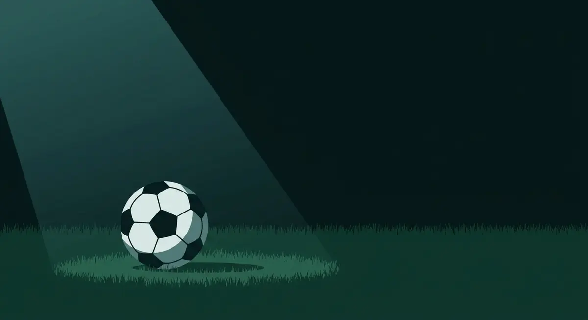

Title tag: Кристиано Роналдо: кариера, рекорди и трофеи | Всички Казина
Meta description: Кристиано Роналдо: от Мадейра и „Спортинг" до 5 Златни топки, трофеите с Юнайтед и Реал Мадрид и стилът му на игра. Факти и рекорди, не прогнози.

---

# Кристиано Роналдо: кариерата, рекордите и трофеите

Пет пъти Кристиано Роналдо печели „Златната топка" за футболист на годината и пет пъти вдига купата на Шампионската лига, повече от всеки друг в историята на турнира. Тази витрина той събира в четири различни държави, преди да продължи кариерата си в Саудитска Арабия.

## От Мадейра до „Манчестър Юнайтед"

Роналдо е роден на 5 февруари 1985 г. във Фуншал, на португалския остров Мадейра. Като дете тренира в местните отбори, а едва на дванайсет се мести сам в Лисабон, в академията на „Спортинг". За мъжкия отбор на клуба дебютира през 2002 г. Година по-късно, в контролна среща срещу „Манчестър Юнайтед", играта на младия крилен футболист прави такова впечатление, че трансферът към Англия се урежда почти веднага.

## Годините в Англия

В „Манчестър Юнайтед" Роналдо остава от 2003 до 2009 г. и за това време се превръща от техничар по фланга в истински голаджия. С клуба печели три поредни титли в Премиер лигата, Купата на Англия през 2004 г. и първата си Шампионска лига през 2008 г. В края на същата година получава и първата от петте си „Златни топки". Там, на „Олд Трафорд", талантът за пръв път се превръща в постоянни резултати.

## Рекордите с „Реал Мадрид"

През лятото на 2009 г. Роналдо преминава в „Реал Мадрид" срещу тогавашна световна рекордна сума.

*Ключовите години и рекорди на Кристиано Роналдо. Всички числа следват текста на статията.*

Девет сезона по-късно той напуска клуба като негов голмайстор номер едно за всички времена, с 450 гола, повече от който и да е футболист в историята на мадридчани. С „белия балет" печели Шампионската лига четири пъти, през 2014, 2016, 2017 и 2018 г., плюс две титли в Ла Лига и още четири „Златни топки" (2013, 2014, 2016 и 2017). Петте му трофея от Шампионската лига общо, един с „Юнайтед" и четири с „Реал", го правят първия футболист, стигнал тази граница. По вкарани голове в турнира също никой друг не го е надминавал.

## „Златната топка" пет пъти

Петте награди „Златна топка" идват през 2008, 2013, 2014, 2016 и 2017 г. През по-голямата част от онези години призът се връщаше все между двама души, него и Лионел Меси, а това съперничество белязва цяло футболно десетилетие и вдигна летвата за всички около тях.

## Стилът: атлетизъм, глава и свободни удари

Роналдо играе предимно с десния крак и залага на скорост, физика и впечатляващ отскок. Висок и атлетичен, той е сред най-опасните футболисти в играта с глава. Засилката му преди пряк свободен удар, с топка, която пропада рязко в последния момент, се превърна в разпознаваема картина от едно цяло поколение. Започва като крило, което финтира по линията, но с годините се мести все по-близо до вратата и се налага като чист завършител.

## „Ювентус", кратко завръщане и Саудитска Арабия

През 2018 г. Роналдо се премества в „Ювентус" и за три сезона в Торино печели две титли в Серия А. През 2021 г. се връща за малко в „Манчестър Юнайтед", а от началото на 2023 г. играе за „Ал-Насър" в Саудитска Арабия, където продължава да бележи и в напреднала за футболист възраст.

## Португалия и големите финали

С националния отбор големият трофей се забави, но дойде: на Европейското първенство през 2016 г. във Франция Португалия стана шампион, макар самият Роналдо да получи контузия още в началото на финала срещу домакините и да доиграе мача от резервната скамейка, помагайки с думи. През 2019 г. поведе отбора и до първата Лига на нациите, а през 2025 г. тимът спечели турнира повторно. Роналдо държи и рекорда за най-много мачове и най-много голове за мъжки национален отбор в историята на футбола, а е и първият, вкарал на пет различни световни първенства.

## На пари, отдалеч: футбол, залози и трезва сметка

Ако гледаш футбол и покрай това залагаш или пускаш по нещо в казино, правилото в България е простичко: законно минава само през оператор с лиценз от НАП, вписан в публичния регистър. Какво точно е [законно](/zakonno-li-e/) е отделна и доста по-приземена тема от която и да е колекция трофеи.

Спортната част и бонусите за спорт събираме в [раздела за спорт](/bonus-ruletka/sport/vsichki/). Там няма прогнози за мачове и няма да намериш съвет кого да заложиш. Повече за клубовете и имената от футбола четеш в [блога за футбол](/blog/futbol/). Хазартът не е доходоносна стратегия, а залогът върху кой да е голям футболист не променя тази сметка. Бюджет, който можеш да загубиш докрай, и предварително зададени лимити държат вечерта пред телевизора да си остане забавление, а не сметка за после. Кога играта започва да тежи и какво да се прави тогава е тема на [отговорната игра](/blog/responsible-gambling/).

Петте „Златни топки" са факт. Сигурна печалба от залог върху каквото и да било няма, и това е по-скоро цялата истина, отколкото половината.

---

**Георги Тодоров**
Публикувано: 29.10.2026 · Последна редакция: 29.10.2026

**За Всички Казина.** Независим сайт за сравнение на онлайн казина, лицензирани за българския пазар. Оценяваме всяко казино по публична методика с шест претеглени критерия и проверяваме лиценза в регистъра на НАП, преди да дадем оценка. Не сме оператор и не продаваме съвети за печалба; сравняваме, проверяваме и обясняваме, за да избираш с отворени очи.

**Отговорна игра.** 18+ Хазартът може да пристрасти. Играйте отговорно. Ако усетиш, че играта излиза извън контрол или искаш да я ограничиш, виж [инструментите за отговорна игра](/otgovorna-igra/) и възможността за самоизключване чрез националния регистър на уязвимите лица към НАП (подава се писмено само от засегнатото лице). Национална информационна линия за наркотиците, алкохола и хазарта („Солидарност") 0888 99 18 66, делнични дни 10:00-17:00.

**Разкриване на партньорства.** Сайтът съдържа партньорски (афилиейт) връзки; когато отвориш оферта през такава връзка, това може да финансира сайта, без да променя цената за теб и без да влияе на оценките ни. От 1 август 2026 г. дейността на афилиейт оператори в България се лицензира съгласно Закона за държавния бюджет за 2026 г. (ДВ, бр. 69 от 31.07.2026 г.). Всички Казина е подало заявление за лиценз пред Националната агенция по приходите и очаква издаването му.
