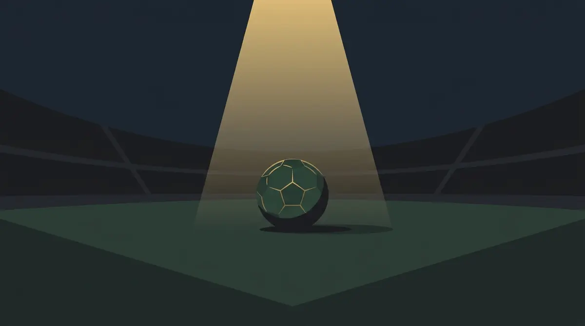

Title tag: Лионел Меси: кариера, рекорди и трофеи | Всички Казина
Meta description: Лионел Меси: пътят от Ла Масия до световната титла, 8 Златни топки, трофеите с Барселона и стилът на игра. Факти и рекорди, не прогнози.

---

# Лионел Меси: кариерата, рекордите и трофеите

Осем пъти Лионел Меси печели „Златната топка" за футболист на годината, рекорд, който никой друг не е доближавал. Тази цифра сама обяснява защо разговорът за най-добрия футболист на всички времена почти винаги минава през неговото име.

## От салфетката до първия отбор на „Барселона"

Меси е роден в Росарио, Аржентина, на 24 юни 1987 г. Още като дете е диагностициран с недостиг на хормон на растежа, а лечението е скъпо. „Барселона" го гледа на проби през 2000 г., когато е на тринайсет, и готовността на клуба да поеме това лечение на практика решава трансфера. Договорът е нахвърлян върху хартиена салфетка от спортния директор Карлес Рехач, защото под ръка няма друго. В началото на 2001 г. семейството се мести в Каталуния и момчето влиза в прочутата академия „Ла Масия".

За мъжкия отбор дебютира през 2003 г. в контролна среща. Първият му официален мач в Ла Лига идва през 2004 г., на седемнайсет години.

## Рекордите с „Барселона"

В „Барселона" Меси играе до 2021 г. и напуска клуба като негов голмайстор номер едно за всички времена с 672 гола, повече от всеки друг футболист за един-единствен клуб. Само в испанското първенство вкарва 474 попадения, също рекорд за Ла Лига.

*Ключовите години и рекорди на Лионел Меси. Всички числа следват текста на статията.*

Витрината му в Каталуния е също толкова тежка: рекордните за клуба 34 трофея. Сред тях са 10 титли в Ла Лига и 4 трофея от Шампионската лига, печелени през 2006, 2009, 2011 и 2015 г., плюс седем Купи на краля. През 2012 г. поставя и рекорд, който оттогава стои непокътнат: 91 гола за клуба и за националния отбор в рамките на една календарна година.

## „Златната топка" осем пъти

Осемте награди „Златна топка" идват през 2009, 2010, 2011, 2012, 2015, 2019, 2021 и последната през 2023 г. Преди Меси никой не беше печелил приза повече от три пъти, така че осем е по-скоро отделна категория, отколкото рекорд с близък преследвач.

## Стилът: ляв крак и нисък център на тежестта

Меси играе с левия крак и с нисък център на тежестта, който му позволява да сменя посока по-рязко от защитниците пред него. Освен на класическата позиция на нападател, при треньора Пеп Гуардиола той често излиза като „фалшива деветка", дърпа се назад между линиите и създава положения, вместо само да ги завършва. Дрибъл на тясно пространство, точен последен пас и изпълнение на преки свободни удари са запазената му марка.

## След „Барселона": Париж и Маями

През 2021 г. Меси преминава в „Пари Сен Жермен", където печели две титли в Лига 1, през 2022 и 2023 г. През 2023 г. се премества в „Интер Маями" в Съединените щати и още в първите си месеци там извежда клуба до първия трофей в историята му, Купата на лигите.

## Аржентина и дългоочакваната титла

С националния отбор Меси печели почти всичко още преди голямата награда. Златният олимпийски медал идва през 2008 г. в Пекин, а световната титла за юноши до 20 години, пак с негов съществен принос, още през 2005 г. Голямото признание на ниво мъже се забавя до зрялата му възраст: Копа Америка през 2021 г., Финалисима срещу Италия и накрая Световното първенство в Катар, двете през 2022 г. През 2024 г. защитава и титлата си на Копа Америка. Меси държи рекорда за Аржентина и по изиграни мачове, и по вкарани голове.

## На пари, отдалеч: футбол, залози и малко трезва сметка

Ако гледаш футбол и покрай това залагаш или играеш в казино, важи същото, което важи навсякъде в България: законно минава само през оператор с лиценз от НАП, вписан в публичния регистър, а какво точно е [законно](/zakonno-li-e/) е отделна и доста по-приземена тема от колекцията трофеи.

Спортната част на сайта, заедно с бонусите за спорт, събираме в [раздела за спорт](/bonus-ruletka/sport/vsichki/). Там няма прогнози за мачове и няма да намериш съвет кого да заложиш. Повече за клубовете и имената от футбола четеш в [блога за футбол](/blog/futbol/). Хазартът не е доходоносна стратегия и залогът върху кой да е звезден футболист не променя тази аритметика. Бюджет, който можеш да загубиш докрай, и предварително зададени лимити пазят вечерта пред телевизора да си остане забавление, а не сметка. Кога играта започва да тежи и какво да се прави тогава е тема на [отговорната игра](/blog/responsible-gambling/).

Осем „Златни топки" са факт. Сигурна печалба от залог върху каквото и да било няма, и това е горе-долу единствената гаранция в цялата схема.

---

**Георги Тодоров**
Публикувано: 29.10.2026 · Последна редакция: 29.10.2026

**За Всички Казина.** Независим сайт за сравнение на онлайн казина, лицензирани за българския пазар. Оценяваме всяко казино по публична методика с шест претеглени критерия и проверяваме лиценза в регистъра на НАП, преди да дадем оценка. Не сме оператор и не продаваме съвети за печалба; сравняваме, проверяваме и обясняваме, за да избираш с отворени очи.

**Отговорна игра.** 18+ Хазартът може да пристрасти. Играйте отговорно. Ако усетиш, че играта излиза извън контрол или искаш да я ограничиш, виж [инструментите за отговорна игра](/otgovorna-igra/) и възможността за самоизключване чрез националния регистър на уязвимите лица към НАП (подава се писмено само от засегнатото лице). Национална информационна линия за наркотиците, алкохола и хазарта („Солидарност") 0888 99 18 66, делнични дни 10:00-17:00.

**Разкриване на партньорства.** Сайтът съдържа партньорски (афилиейт) връзки; когато отвориш оферта през такава връзка, това може да финансира сайта, без да променя цената за теб и без да влияе на оценките ни. От 1 август 2026 г. дейността на афилиейт оператори в България се лицензира съгласно Закона за държавния бюджет за 2026 г. (ДВ, бр. 69 от 31.07.2026 г.). Всички Казина е подало заявление за лиценз пред Националната агенция по приходите и очаква издаването му.
