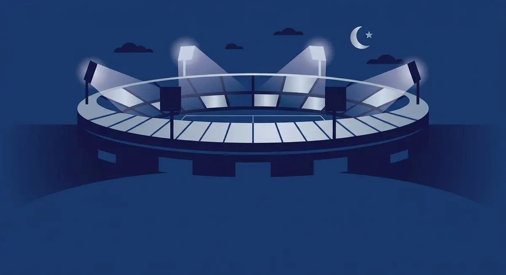

Title tag: Лига Европа: формат и как работи турнирът | Всички Казина
Meta description: Как работи Лига Европа: 36 отбора в обща класация по швейцарски модел, 8 мача, кой продължава и кой отпада, какво печели победителят и рекордите по титли.

---

# Лига Европа: как работи вторият клубен турнир на Европа

Лига Европа има едно правило, рядко за големите турнири: клубът, който вдигне трофея, не го защитава на следващата година. От сезон 2024/25 насам победителят печели нещо по-ценно, място направо в Шампионската лига.

## Какво е Лига Европа

Лига Европа е второто по сила клубно състезание на УЕФА, точно под Шампионската лига и над Лигата на конференциите. Корените му стигат до Купата на панаира, играна между 1955 и 1971 г. От 1971 г. я наследява Купата на УЕФА, а днешното име турнирът носи от сезон 2009/10, когато в него се влива и старата Купа Интертото.

## Форматът: една таблица вместо групи

От сезон 2024/25 груповата фаза е заменена от така наречения швейцарски модел, при който всички 36 отбора стоят в една обща класация, а не са разделени на малки групи. Всеки клуб изиграва по осем мача срещу осем различни съперника, четири у дома и четири на чужд терен. Жребият подрежда отборите в четири урни по девет според коефициента им в УЕФА и тегли на всеки точно кои ще са тези осем противника.

*Форматът и ключовите числа на Лига Европа. Всички стойности следват текста на статията.*

## Кой продължава и кой отпада

След като осемте кръга приключат, таблицата се разделя на три части. Първите осем прескачат направо на 1/8-финал и си спестяват един допълнителен двубой. Отборите от девето до двадесет и четвърто място влизат в двоен плейоф, две срещи на разменено гостуване, и победителите от тях се присъединяват към осмината на 1/8-финал. За последните, от двадесет и пето до тридесет и шесто, сезонът в Европа свършва дотук; с тях отпадат и губещите в плейофа. Оттам нататък се продължава по позната елиминационна схема до финала.

## Какво печели победителят

Победителят на финала си осигурява място в основната фаза на следващата Шампионска лига, а също и мач за Суперкупата на УЕФА срещу носителя на голямата купа. Така шампионът на турнира се качва едно ниво нагоре, вместо да остава да го защитава.

## Как отборите влизат в турнира

В турнира се влиза по няколко начина: през носителите на националните купи, през класирането във вътрешните първенства и „отгоре", когато клуб отпадне в квалификациите или плейофа на Шампионската лига и продължи сезона едно ниво по-долу. Колко места получава всяка държава зависи от коефициента ѝ в УЕФА и се мени от година на година; актуалната разбивка стои на официалния сайт на УЕФА.

## Най-титулуваните

Към есента на 2026 г. рекордьорът по титли е Севиля. Испанският клуб има седем трофея от турнира, спечелени през 2006, 2007, 2014, 2015, 2016, 2020 и 2023 г. Зад него се подрежда цяла група с по три титли: Интер, Тотнъм, Ливърпул, Ювентус и Атлетико Мадрид. За цялата история шампиони са ставали тридесет и един различни клуба, а четиринадесет от тях са вдигали купата повече от веднъж. По държави най-отпред е Испания с четиринадесет трофея.

## На пари, отдалеч: футбол, залози и малко трезва сметка

Ако гледаш европейските вечери и покрай тях залагаш или играеш в казино, важи същото, което важи навсякъде в България. Законно минава само през оператор с лиценз от НАП, вписан в публичния регистър; какво точно е [законно](/zakonno-li-e/) е съвсем отделен въпрос от това кой колко трофея има. Спортната част на сайта и бонусите за спорт сме събрали в [раздела за спорт](/bonus-ruletka/sport/vsichki/), а профилите на клубовете и турнирите стоят във [футболния раздел](/blog/futbol/). Прогнози за мачове там няма и няма да намериш съвет кого да заложиш.

Хазартът не е доходоносна стратегия и залогът върху фаворита не променя тази сметка. Бюджет, който можеш да загубиш докрай, и предварително зададени лимити са това, което пази вечерта пред телевизора да си остане забавление. Кога играта започва да тежи и какво да се направи тогава е тема на [отговорната игра](/blog/responsible-gambling/).

Миналите трофеи в Лига Европа носят точни дати и точни имена. Изходът от следващия мач не се знае предварително и никой залог не го гарантира.

---

**Георги Тодоров**
Публикувано: 30.10.2026 · Последна редакция: 30.10.2026

**За Всички Казина.** Независим сайт за сравнение на онлайн казина, лицензирани за българския пазар. Оценяваме всяко казино по публична методика с шест претеглени критерия и проверяваме лиценза в регистъра на НАП, преди да дадем оценка. Не сме оператор и не продаваме съвети за печалба; сравняваме, проверяваме и обясняваме, за да избираш с отворени очи.

**Отговорна игра.** 18+ Хазартът може да пристрасти. Играйте отговорно. Ако усетиш, че играта излиза извън контрол или искаш да я ограничиш, виж [инструментите за отговорна игра](/otgovorna-igra/) и възможността за самоизключване чрез националния регистър на уязвимите лица към НАП (подава се писмено само от засегнатото лице). Национална информационна линия за наркотиците, алкохола и хазарта („Солидарност") 0888 99 18 66, делнични дни 10:00-17:00.

**Разкриване на партньорства.** Сайтът съдържа партньорски (афилиейт) връзки; когато отвориш оферта през такава връзка, това може да финансира сайта, без да променя цената за теб и без да влияе на оценките ни. От 1 август 2026 г. дейността на афилиейт оператори в България се лицензира съгласно Закона за държавния бюджет за 2026 г. (ДВ, бр. 69 от 31.07.2026 г.). Всички Казина е подало заявление за лиценз пред Националната агенция по приходите и очаква издаването му.
