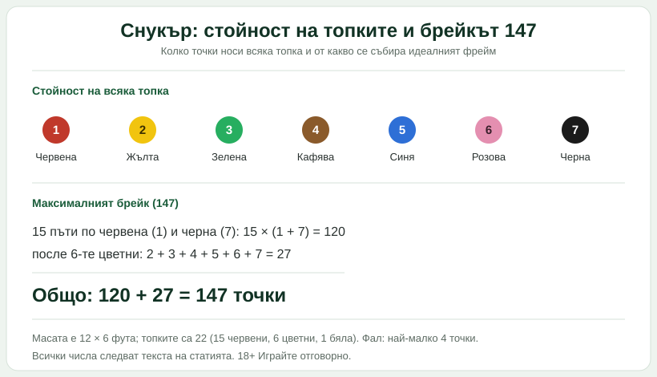

Title tag: Снукър: правила и точкуване за начинаещи | Всички Казина
Meta description: Правилата на снукъра просто: масата и 22-те топки, колко точки носи всяка, как се печели фрейм, какво е брейк и максималният 147, и кога се свирка фал.

---

# Снукър: правилата и точкуването, обяснени просто

Снукърът изглежда бавен, докато не схванеш, че всеки удар е сметка. Играчът не гони просто топки в джобовете, а събира точки в правилния ред и същевременно гледа къде ще остане бялата топка за следващия удар. Веднъж щом разбереш стойностите и реда, цялата тази тишина около масата започва да има смисъл.

## Масата и топките

Турнирната маса е голяма: 12 на 6 фута, тоест игрално поле около 3,57 на 1,78 метра, с шест джоба, по един във всеки ъгъл и по един в средата на двете дълги страни. В единия край има начертана линия на дома, на 74 сантиметра от борда, а зад нея малък полукръг с радиус 29 сантиметра, наречен „D". От него започва всеки първи удар.

Топките са 22 на брой. Петнайсет са червени, шест са цветни, а една е бялата, с която се удря, и само нея допира щеката. Нея често я наричат битка. Целта не е да напълниш джобовете както дойде, а да вкарваш в определена последователност, защото точно тя носи точките.

## Колко точки носи всяка топка

Всяка топка има своя стойност и тя е постоянна. Червената носи 1 точка. Цветните вървят нагоре: жълтата 2, зелената 3, кафявата 4, синята 5, розовата 6 и черната 7. Оттук идва и цялата тактика, защото черната в единия ъгъл струва колкото седем червени.

*Стойностите на топките и от какво се събира максималният брейк. Всички числа следват текста на статията.*

## Как върви един фрейм

Една партия се нарича фрейм. Докато на масата има червени, всеки сеанс започва с удар по червена. Вкараш ли червена, печелиш точка и веднага след нея се прицелваш в коя да е цветна по избор. Вкараната цветна носи стойността си, но се връща обратно на масата, за да е в игра пак. После пак червена, пак цветна, и така, редувайки едната с другата, докато вкарваш.

Щом всички червени изчезнат от масата, идва ред на цветните, този път подредено по стойност: първо жълтата, после зелената, кафявата, синята, розовата и накрая черната. Тези последните вече не се връщат. Когато и черната падне или някой се предаде, фреймът свършва и го печели този с повече точки. Цял мач пък се играе до предварително уговорен нечетен брой фреймове, за да няма равен; в мач от 19 фрейма например първият стигнал 10 печели.

## Брейк, сенчъри и прочутият 147

Брейк е сборът от точки, който направиш в един непрекъснат сеанс на масата, преди да отстъпиш реда. Събереш ли 100 или повече наведнъж, това е сенчъри брейк и е сериозна заявка за клас.

Таванът е 147 и зад това число стои чиста аритметика. След всяка от петнайсетте червени вкарваш черната: петнайсет пъти по 1 плюс 7 прави 120 точки. Накрая остава да минеш шестте цветни по ред, а те дават още 2 плюс 3 плюс 4 плюс 5 плюс 6 плюс 7, тоест 27. Сбери двете и получаваш 147, идеалният фрейм. Само след т. нар. свободна топка теоретично може да се прескочи и този таван, но това е рядкост, за която повечето зрители четат, а не я гледат на живо.

## Фал и какво всъщност значи „снукър"

Нарушение, или фал, се свирка например когато удариш първо грешна топка, пропуснеш всичко или изпратиш бялата в джоб. Тогава съперникът получава точки, без да играе: най-малко 4, но ако топката „на ред" струва повече, се броят нейните, до 7 за черната. Затова и дребна грешка в неподходящ момент излиза скъпо.

А самата дума „снукър" освен името на играта е и положение. Да снукираш съперника значи да оставиш бялата така, че той да няма пряка линия до топката, която трябва да удари. Налага му се да я заобикаля през борда и всеки такъв принуден удар лесно ражда нов фал. Точно тази борба за позиция, а не самото вкарване, отличава добрия играч.

## На пари, отдалеч: снукър, залози и трезва сметка

Ако гледаш снукър и покрай него залагаш или се въртиш в казино, важи същото, което важи за всичко останало у нас. Законно минава единствено през оператор с лиценз от НАП, вписан в публичния регистър; какво точно е [законно](/zakonno-li-e/) е отделен въпрос от това колко добре някой върти щеката. Спортните теми държим в [спортния блог](/blog/sport/), а бонусите за спорт сме събрали в [раздела за спорт](/bonus-ruletka/sport/vsichki/). Прогнози за мачове тук няма и няма да намериш съвет на кого да заложиш.

Хазартът не е начин да изкараш пари, колкото и подредена да изглежда играта на масата. Бюджет, който можеш да загубиш докрай, и лимити, зададени преди да започнеш, са това, което пази вечерта пред снукъра да си остане просто вечер пред снукъра. Кога играта започва да тежи и какво се прави тогава стои в [отговорната игра](/blog/responsible-gambling/).

Правилата на снукъра са едни и същи от десетилетия и точно затова си заслужава да ги научиш веднъж като хората. Следващият удар на масата обаче никой не го знае предварително, и никакъв залог няма да ти го подскаже.

---

**Георги Тодоров**
Публикувано: 31.10.2026 · Последна редакция: 31.10.2026

**За Всички Казина.** Независим сайт за сравнение на онлайн казина, лицензирани за българския пазар. Оценяваме всяко казино по публична методика с шест претеглени критерия и проверяваме лиценза в регистъра на НАП, преди да дадем оценка. Не сме оператор и не продаваме съвети за печалба; сравняваме, проверяваме и обясняваме, за да избираш с отворени очи.

**Отговорна игра.** 18+ Хазартът може да пристрасти. Играйте отговорно. Ако усетиш, че играта излиза извън контрол или искаш да я ограничиш, виж [инструментите за отговорна игра](/otgovorna-igra/) и възможността за самоизключване чрез националния регистър на уязвимите лица към НАП (подава се писмено само от засегнатото лице). Национална информационна линия за наркотиците, алкохола и хазарта („Солидарност") 0888 99 18 66, делнични дни 10:00-17:00.

**Разкриване на партньорства.** Сайтът съдържа партньорски (афилиейт) връзки; когато отвориш оферта през такава връзка, това може да финансира сайта, без да променя цената за теб и без да влияе на оценките ни. От 1 август 2026 г. дейността на афилиейт оператори в България се лицензира съгласно Закона за държавния бюджет за 2026 г. (ДВ, бр. 69 от 31.07.2026 г.). Всички Казина е подало заявление за лиценз пред Националната агенция по приходите и очаква издаването му.
