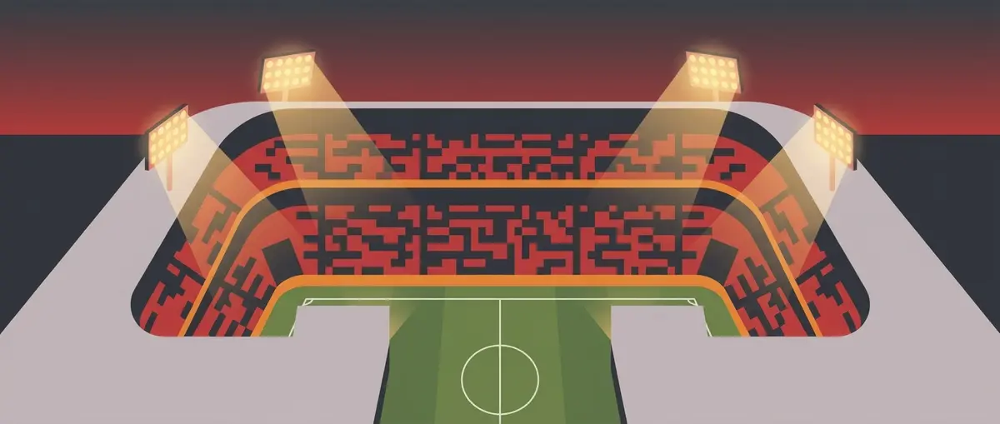
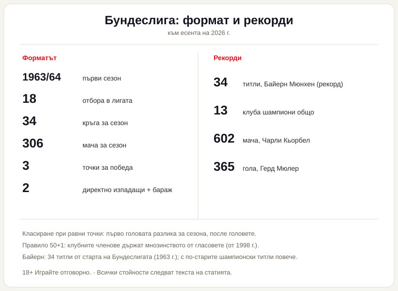

Title tag: Бундеслига: формат, отбори и как работи първенството | Всички Казина
Meta description: Как работи Бундеслигата: 18 отбора, 34 кръга, точкуване, класиране по голова разлика, изпадане и бараж, европейски квоти, правилото 50+1 и рекордите. Факти, не прогнози.

---

# Бундеслига: как работи германското първенство

Когато два отбора в Бундеслигата завършат сезона с еднакъв брой точки, пръв се гледа головата разлика за целия сезон, а не какво са направили един срещу друг. Тази подробност нарежда германската лига малко по-различно от повечето големи първенства и неведнъж е тежала при разпределянето на титлата.

## Какво е Бундеслигата

Бундеслигата е най-горното ниво на германския клубен футбол. Германският футболен съюз взема решението за единна професионална лига през 1962 г. в Дортмунд, а първите мачове се играят на 24 август 1963 г. Първият шампион е Кьолн от сезон 1963/64. Преди това първенството в Германия се е решавало на регионален принцип; днес състезанието се води от Германската футболна лига под шапката на съюза.

## Форматът накратко

В лигата играят 18 отбора. Всеки се среща с всеки друг два пъти, веднъж у дома и веднъж на гости, което прави 34 кръга и 306 мача за сезон. Победата носи 3 точки, равенството 1, а загубата нула, и тази система важи от сезон 1995/96 насам. Шампион става отборът с най-много точки след последния кръг.

*Форматът и ключовите числа на Бундеслигата. Всички стойности следват текста на статията.*

## Когато точките се изравнят

Изравнят ли се два отбора по точки, пръв се гледа головата разлика за целия сезон, след нея общо отбелязаните голове, и чак тогава идват преките срещи помежду им. Испанската Ла Лига например тръгва направо от преките мачове, така че един и същ сбор от резултати понякога подрежда отборите по различен начин в двете държави. Ако всичко се изравни докрай, правилникът предвижда допълнителен мач на неутрален терен, но дотам на практика не се е стигало.

## Нагоре и надолу

Последните два отбора в класирането, 17-и и 18-и, слизат директно във Втора Бундеслига. Шестнадесетият не изпада веднага: той играе двоен бараж, у дома и на гости, срещу третия от Втора Бундеслига, и който спечели, остава горе за следващия сезон. Нагоре се качват първите двама от втория ешелон директно, а третото място се решава от същия бараж. Горе-долу по три клуба се сменят всяко лято.

## Билети за Европа

Първите четири отбора продължават в основната фаза на Шампионската лига. Петият влиза в Лига Европа, а шестият поема към плейофа на Лигата на конференциите. Отделно носителят на Купата на Германия си осигурява място в Лига Европа независимо от класирането си; ако вече се е класирал през първенството, мястото минава към следващия по ред. Тези квоти се менят според коефициента на страната в УЕФА и не са заковани веднъж завинаги, затова за актуалната подредба е по-разумно да се погледне официалният източник.

## Правилото 50+1

Тук е и най-характерната разлика на германския футбол. От 1998 г. насам клубните членове трябва да държат мнозинството от гласовете в професионалния отбор, поне 50% плюс един глас, което на практика пречи на външен инвеститор да придобие контрол над клуба. Няколко отбора правят изключение заради дълга корпоративна история отпреди правилото, сред тях Байер Леверкузен, Хофенхайм и Волфсбург. Привържениците на модела смятат, че именно той държи билетите достъпни и трибуните пълни, защото думата остава в ръцете на хората, които ходят на стадиона.

## Пълни стадиони, салатиера и зимна пауза

Германското първенство традиционно е сред първенствата с най-висока средна посещаемост в света, често с по над 38 000 зрители на мач (към сезон 2024/25) и почти пълни стадиони; стадионът на Дортмунд е най-известният пример. Трофеят, който вдига шампионът, е сребърната „салатиера". Между средата на декември и края на януари сезонът спира за около шест седмици зимна пауза, а отборът, повел класирането преди нея, по традиция получава неофициалното звание „есенен шампион". Голмайсторът на сезона пък си тръгва с наградата „Оръдието на голмайстора".

## Най-титулуваните

Рекордьорът е ясен. Към есента на 2026 г. Байерн Мюнхен води с голяма преднина, с 34 титли от старта на Бундеслигата през 1963 г.; ако се броят и шампионските титли отпреди лигата, общият сбор е още по-голям. След мюнхенци идват Борусия Дортмунд и Борусия Мьонхенгладбах, а за цялата история на турнира шампиони са ставали общо 13 клуба. От индивидуалните рекорди се открояват 602-та мача на Чарли Кьорбел и 365-те гола на Герд Мюлер (към есента на 2026 г.).

## На пари, отдалеч: футбол, залози и малко трезва сметка

Ако гледаш германския футбол и покрай това залагаш или играеш в казино, важи същото, което важи навсякъде в България. Законно минава само през оператор с лиценз от НАП, вписан в публичния регистър; какво точно е [законно](/zakonno-li-e/) е отделен и доста по-приземен въпрос от таблицата с титлите. Спортната част, заедно с бонусите за спорт, събираме в [раздела за спорт](/bonus-ruletka/sport/vsichki/), а профилите на клубовете и турнирите стоят във [футболния раздел](/blog/futbol/). Прогнози за мачове там няма и няма да намериш съвет кого да заложиш.

Хазартът не е доходоносна стратегия и залогът върху любимия отбор не променя тази сметка. Бюджет, който можеш да загубиш докрай, и предварително зададени лимити пазят вечерта пред телевизора да си остане забавление; кога играта започва да тежи и какво да се направи тогава е тема на [отговорната игра](/blog/responsible-gambling/).

Миналите титли в Бундеслигата носят точни дати и точни числа. Изходът от следващия мач не се знае предварително и никой залог не го гарантира.

---

**Георги Тодоров**
Публикувано: 01.11.2026 · Последна редакция: 01.11.2026

**За Всички Казина.** Независим сайт за сравнение на онлайн казина, лицензирани за българския пазар. Оценяваме всяко казино по публична методика с шест претеглени критерия и проверяваме лиценза в регистъра на НАП, преди да дадем оценка. Не сме оператор и не продаваме съвети за печалба; сравняваме, проверяваме и обясняваме, за да избираш с отворени очи.

**Отговорна игра.** 18+ Хазартът може да пристрасти. Играйте отговорно. Ако усетиш, че играта излиза извън контрол или искаш да я ограничиш, виж [инструментите за отговорна игра](/otgovorna-igra/) и възможността за самоизключване чрез националния регистър на уязвимите лица към НАП (подава се писмено само от засегнатото лице). Национална информационна линия за наркотиците, алкохола и хазарта („Солидарност") 0888 99 18 66, делнични дни 10:00-17:00.

**Разкриване на партньорства.** Сайтът съдържа партньорски (афилиейт) връзки; когато отвориш оферта през такава връзка, това може да финансира сайта, без да променя цената за теб и без да влияе на оценките ни. От 1 август 2026 г. дейността на афилиейт оператори в България се лицензира съгласно Закона за държавния бюджет за 2026 г. (ДВ, бр. 69 от 31.07.2026 г.). Всички Казина е подало заявление за лиценз пред Националната агенция по приходите и очаква издаването му.
