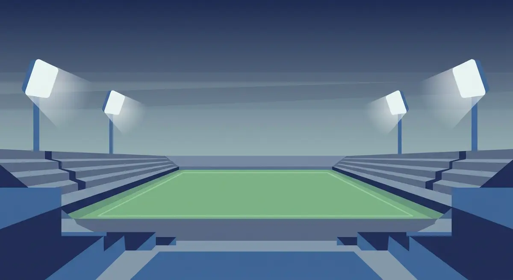

Title tag: Лига на конференциите: какво е и как работи турнирът | Всички Казина
Meta description: Лига на конференциите на УЕФА: третото клубно ниво, лиговата фаза с 36 отбора, кой продължава и кой отпада, какво печели победителят и носителите досега.

---

# Лига на конференциите: третият европейски турнир и как работи

Лигата на конференциите е вратата към Европа за клубове, които иначе рядко биха стигнали дотам. Тя е най-младото от трите клубни състезания на УЕФА и единственото, чийто победител се качва едно ниво нагоре още на следващата година.

## Какво е Лига на конференциите

Лигата на конференциите е третото по сила клубно състезание на УЕФА, под Шампионската лига и Лига Европа. Първият сезон е 2021/22, а първият носител е Рома, която печели финала в Тирана на 25 май 2022 г. с 1:0 срещу Фейеноорд. В началото турнирът се казва „Европа Лига на конференциите"; от сезон 2024/25 УЕФА маха „Европа" от името и оставя само Лига на конференциите.

## Форматът: 36 отбора в една класация

От сезон 2024/25 старата групова фаза отстъпва място на лигова фаза по така наречения швейцарски модел. Всички 36 отбора стоят в една обща класация, без малки групи. Всеки клуб играе само шест мача, три у дома и три на чужд терен, срещу шест различни съперника. Жребият подрежда отборите в шест урни по шест според коефициента им в УЕФА и тегли по един противник от всяка урна; клубове от една и съща държава не се падат в лиговата фаза. Шест мача е по-малко от осемте в Шампионската лига и Лига Европа, което е и едно от нещата, които отличават третото ниво.

## Кой продължава и кой отпада

Когато шестте кръга приключат, класацията се разделя на три. Първите осем прескачат направо на 1/8-финал и си спестяват допълнителна двойка. Отборите от девето до двадесет и четвърто място влизат в двоен плейоф на разменено гостуване и победителите се присъединяват към осмината. За последните дванадесет, от двадесет и пето до тридесет и шесто, сезонът в Европа свършва дотук; с тях отпадат и губещите в плейофа. Оттам нататък се върви по класическа елиминационна схема, а финалът е единичен мач на предварително избран неутрален стадион.

## Какво печели победителят

Тук Лигата на конференциите е щедра по свой начин: победителят си осигурява място в лиговата фаза на следващата Лига Европа, тоест се качва едно ниво нагоре. Ако същият клуб вече се е класирал за Шампионската лига през първенството си, може да избере. Едно обаче липсва и е добре да се знае: носителят на тази купа не играе за Суперкупата на УЕФА. Този мач остава само между шампионите на Шампионската лига и на Лига Европа.

## Как отборите влизат

Пътят дотук минава през квалификации: три кръга плюс плейофен кръг, разделени на шампионски и основен път. Колко места получава всяка футболна асоциация зависи от коефициента ѝ в УЕФА и се мени от година на година, затова актуалната разбивка по държави стои на официалния сайт на УЕФА, а не в статия, която бързо остарява. Към лиговата фаза се добавят и клубовете, отпаднали в плейофа на Лига Европа, които продължават сезона едно ниво по-долу.

## Носителите досега

За краткия си живот турнирът вече има пет имена на трофея. Рома го вдига първа през 2022 г., следват Уест Хям Юнайтед през 2023 г., Олимпиакос през 2024 г., Челси през 2025 г. и Кристъл Палас през 2026 г. По държави най-напред е Англия с три титли, а любопитното е, че досега нито един клуб не е печелил турнира два пъти.

## На пари, отдалеч: футбол, залози и трезва сметка

Ако гледаш европейските вечери и покрай тях залагаш или играеш в казино, важи едно и също навсякъде в България. Законно минава само през оператор с лиценз от НАП, вписан в публичния регистър; какво точно е [законно](/zakonno-li-e/) е отделен въпрос от това кой клуб колко купи има. Спортната част и бонусите за спорт сме събрали в [раздела за спорт](/bonus-ruletka/sport/vsichki/), а профилите на турнирите и клубовете стоят във [футболния раздел](/blog/futbol/). Прогнози кой ще спечели мача там няма.

Хазартът не е начин да изкараш пари и залогът върху фаворита не променя тази сметка. Бюджет, който можеш да загубиш докрай, и лимити, зададени предварително, са това, което държи вечерта пред телевизора да си остане забавление. Кога играта започва да тежи и какво се прави тогава е темата на [отговорната игра](/blog/responsible-gambling/).

Трофеите в Лигата на конференциите вече носят точни имена и точни години. Следващият мач не носи такава сигурност и никой залог не му я дава.

---

**Георги Тодоров**
Публикувано: 02.11.2026 · Последна редакция: 02.11.2026

**За Всички Казина.** Независим сайт за сравнение на онлайн казина, лицензирани за българския пазар. Оценяваме всяко казино по публична методика с шест претеглени критерия и проверяваме лиценза в регистъра на НАП, преди да дадем оценка. Не сме оператор и не продаваме съвети за печалба; сравняваме, проверяваме и обясняваме, за да избираш с отворени очи.

**Отговорна игра.** 18+ Хазартът може да пристрасти. Играйте отговорно. Ако усетиш, че играта излиза извън контрол или искаш да я ограничиш, виж [инструментите за отговорна игра](/otgovorna-igra/) и възможността за самоизключване чрез националния регистър на уязвимите лица към НАП (подава се писмено само от засегнатото лице). Национална информационна линия за наркотиците, алкохола и хазарта („Солидарност") 0888 99 18 66, делнични дни 10:00-17:00.

**Разкриване на партньорства.** Сайтът съдържа партньорски (афилиейт) връзки; когато отвориш оферта през такава връзка, това може да финансира сайта, без да променя цената за теб и без да влияе на оценките ни. От 1 август 2026 г. дейността на афилиейт оператори в България се лицензира съгласно Закона за държавния бюджет за 2026 г. (ДВ, бр. 69 от 31.07.2026 г.). Всички Казина е подало заявление за лиценз пред Националната агенция по приходите и очаква издаването му.
