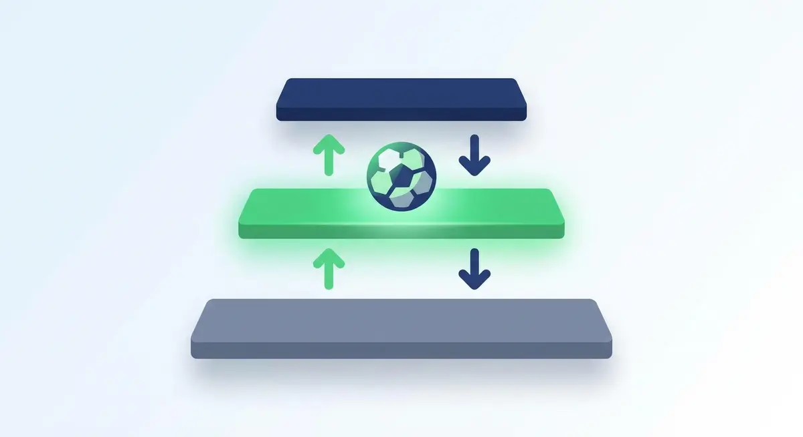

Title tag: Втора лига: формат, промоция и изпадане | Всички Казина
Meta description: Как работи Втора лига, второто ниво на българския футбол: една група, двукръгов формат, кой се качва и кой пада. Факти за механиката, не прогнози.

---

# Втора лига: как работи второто ниво на българския футбол

Втора лига е второто ниво на българския клубен футбол, стъпалото между елита в Първа лига и аматьорската Трета лига. Кой се качва и кой пада оттук върви по една и съща схема от сезон на сезон, а конкретните числа живеят в официалния регламент.

## Какво е Втора лига и кой я управлява

Над нея стои Първа лига, тоест efbet Лига, или Първа професионална футболна лига по пълното ѝ име; под нея е Трета лига, вече на аматьорско ниво. Самото официално название на второто стъпало днес е Втора професионална футболна лига. Турнирът е на Българския футболен съюз (БФС), който е носителят на първенството, докато текущото му администриране върши Професионалната футболна лига (ПФЛ).

## Форматът: една група, двукръгов „всеки с всеки"

Отборите са събрани в една обща група и всеки играе срещу всеки по два пъти, веднъж като домакин и веднъж като гост, предимно през уикенда. Точкуването е стандартното, 3 за победа, 1 за равен и 0 за загуба, а колко точно отбора влизат в групата зависи от регламента за конкретния сезон.

## Нагоре и надолу: промоция и изпадане

Шампионът на Втора лига се изкачва директно в Първа лига. Следващите в класирането не се качват автоматично; те играят бараж за промоция срещу отбор от долната част на Първа лига, който защитава мястото си в елита. В обратната посока най-слабо класиралите се напускат Втора лига и слизат в Трета, като част от тях решават съдбата си също през бараж. Кои места дават директна промоция и кои водят до бараж, кой е съперникът от Първа лига и колко отбора изпадат директно се определят в регламента за всеки сезон и се менят с него.

*Втора лига в българската футболна пирамида. Всички числа следват текста на статията.*

## Оттук няма пряк път към Европа

От това ниво не се раздават европейски квоти, за разлика от Първа лига. Клуб от Втора лига стига до Европа само ако първо спечели промоция в елита и там се пребори за място в някой от турнирите на УЕФА.

## Накратко от историята

Второто ниво съществува от 1950 г. Тогава то е „Б" група, разделена на Север и Юг с по десет отбора, и през десетилетията минава през различни формати: единна група, регионални групи, „Б" професионална група. Сегашното име „Втора професионална футболна лига" е прието през 2016 г., а рекордьорът по титли във второто ниво към 2026 г. е Берое (Стара Загора) с девет на брой; последен шампион, за сезон 2025/26, е Дунав (Русе).

## Кое се мени всеки сезон (и къде да го провериш)

Част от нещата около Втора лига не са заковани и се уреждат по регламента за всеки сезон, а за актуалните им стойности най-надеждният източник са официалните канали на БФС и ПФЛ. Най-подвижна е самата бройка отбори: през годините групата е била с 14, 16, 17, 18 и дори 20 тима. Менят се и точните места за бараж и за директно изпадане, заедно със съперника по промоционен бараж от Първа лига. През циклите се сменят още спонсорското (търговско) име на лигата, което се обявява от самата лига, и телевизионните и стрийминг правата - те се продават на цикли и минават от един собственик към друг, така че кой излъчва мачовете също се проверява в официалните канали.

## На пари, но трезво: футбол, залози и закон

Ако гледаш Втора лига и покрай това залагаш или играеш в казино, законно това минава единствено през оператор с лиценз от НАП, вписан в публичния регистър; какво точно значи [законно](/zakonno-li-e/) е отделен и доста по-приземен въпрос от формата на лигата. Спортната част на сайта и бонусите за спорт събираме в [раздела за спорт](/bonus-ruletka/sport/vsichki/), а профилите на клубовете и първенствата стоят във [футболния раздел](/blog/futbol/), където при публикуване ще се появи и профилът на Първа лига. Прогнози за мачове тук няма и няма да намериш съвет кого да заложиш.

Хазартът не е начин за изкарване на пари и залогът върху когото и да било не променя тази сметка. Бюджет, който можеш да загубиш докрай, и предварително зададени лимити пазят вечерта пред телевизора да си остане забавление. Кога играта започва да тежи и какво да се направи тогава е тема на [отговорната игра](/blog/responsible-gambling/).

---

**Георги Тодоров**
Публикувано: 03.11.2026 · Последна редакция: 03.11.2026

**За Всички Казина.** Независим сайт за сравнение на онлайн казина, лицензирани за българския пазар. Оценяваме всяко казино по публична методика с шест претеглени критерия и проверяваме лиценза в регистъра на НАП, преди да дадем оценка. Не сме оператор и не продаваме съвети за печалба; сравняваме, проверяваме и обясняваме, за да избираш с отворени очи.

**Отговорна игра.** 18+ Хазартът може да пристрасти. Играйте отговорно. Ако усетиш, че играта излиза извън контрол или искаш да я ограничиш, виж [инструментите за отговорна игра](/otgovorna-igra/) и възможността за самоизключване чрез националния регистър на уязвимите лица към НАП (подава се писмено само от засегнатото лице). Национална информационна линия за наркотиците, алкохола и хазарта („Солидарност") 0888 99 18 66, делнични дни 10:00-17:00.

**Разкриване на партньорства.** Сайтът съдържа партньорски (афилиейт) връзки; когато отвориш оферта през такава връзка, това може да финансира сайта, без да променя цената за теб и без да влияе на оценките ни. От 1 август 2026 г. дейността на афилиейт оператори в България се лицензира съгласно Закона за държавния бюджет за 2026 г. (ДВ, бр. 69 от 31.07.2026 г.). Всички Казина е подало заявление за лиценз пред Националната агенция по приходите и очаква издаването му.
