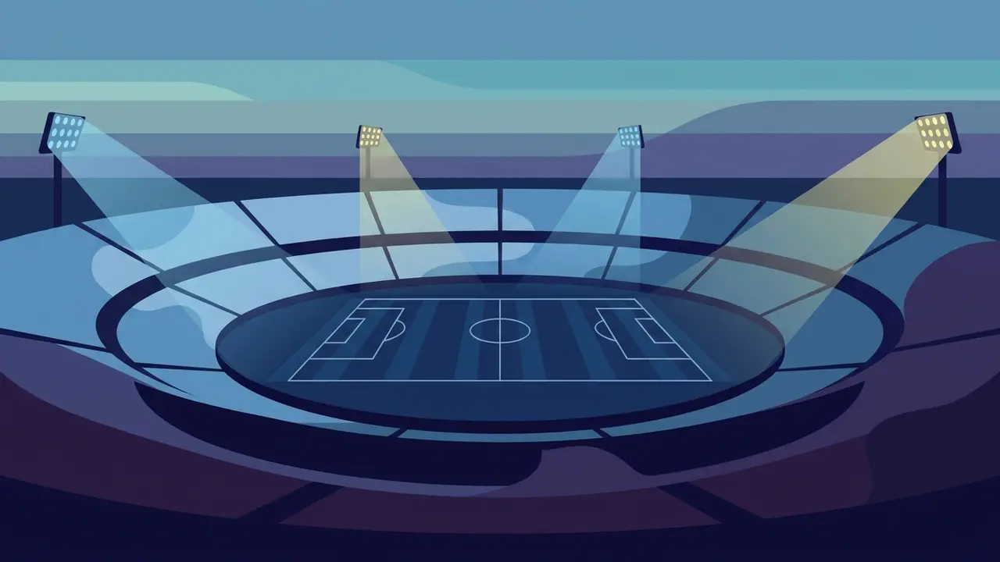
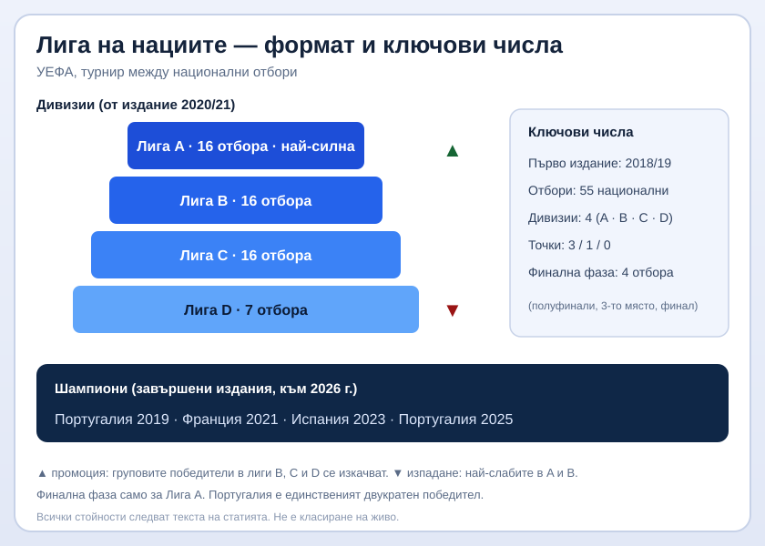

Title tag: Лига на нациите: формат и как влияе на квалификациите | Всички Казина
Meta description: Как работи Лигата на нациите на УЕФА: 55 отбора в 4 дивизии, промоция и изпадане, финалната фаза, шампионите и защо турнирът отваря втора врата към Евро и Световното. Факти, не прогнози.

---

# Лига на нациите: как работи и защо тежи на квалификациите

Един национален отбор може да изиграе цяла есен, да не финишира в топ две на квалификационната си група и въпреки това да запази жив шанса за голям турнир. Точно това прави Лигата на нациите по-интересна, отколкото изглежда на пръв поглед: тя превърна старите контроли в нещо, което носи последствия.

## Какво е Лигата на нациите

Лигата на нациите е състезание на УЕФА между национални отбори. Членовете на съюза го приемат единодушно на конгреса в Астана през март 2014 г., а първото издание се играе през сезон 2018/19, с първи мачове през септември 2018 г. Вместо товарни приятелски срещи без залог, отборите играят състезателни мачове срещу съперници от своето ниво, подредени така, че всеки двубой да значи нещо за таблицата.

## Как са подредени отборите

Петдесет и петте национални отбора на УЕФА са разделени на четири дивизии по сила, означени с буквите от A до D, където Лига A събира най-силните. Разпределението следва ранкинг от последните резултати, а не постоянна таблица, затова съставът на всяка дивизия се променя от издание на издание.

От изданието 2020/21 насам Лиги A, B и C включват по 16 отбора всяка, а Лига D е най-малката със 7. Вътре всяка дивизия е нарязана на групи, предимно по четири отбора, които играят двукръгово, у дома и на гости.

*Форматът и ключовите числа на Лигата на нациите. Всички стойности следват текста на статията.*

## Точки, нагоре и надолу

Точкуването е стандартното: 3 точки за победа, 1 за равен, 0 за загуба. Разликата спрямо едно обикновено първенство е, че резултатите в групата местят отбора между дивизиите за следващото издание.

Победителите в групите на лиги B, C и D се изкачват едно ниво нагоре, а най-слабите в групите на лиги A и B слизат едно надолу. От изданието 2024/25 към тази схема са добавени и баражи между съседни дивизии, в които трети по сила от по-горната лига мери сили с втори от по-долната за едно място. Така върхът и дъното на всяка дивизия се разместват всяко издание, без турнирът да замръзва в едни и същи имена.

## Финалната фаза и шампионът

Само Лига A стига до трофей. От изданието 2024/25 груповите победители и вторите в групите играят двумачови четвъртфинали, а четиримата победители продължават към Финалната фаза: два полуфинала, мач за трето място и финал. Който спечели финала, е шампион на Лигата на нациите за това издание. Останалите дивизии нямат своя финална фаза; за тях наградата е изкачването нагоре.

## Втората врата към Евро и Световното

Турнирът не свършва с вдигането на трофея. Лигата на нациите отваря допълнителен път към големите финали за отбори, които не са се справили по редовния квалификационен ред.

За Европейското първенство механизмът работи през плейофи: групови победители от Лигата на нациите, които не са се класирали директно, получават място в тези плейофи и така играят за последните билети за финалите. Самото спечелване на финалната фаза обаче не носи автоматично участие на Евро, а от Евро 2024 най-слабата дивизия, Лига D, вече няма гарантиран собствен път нагоре.

Световното първенство ползва турнира по сходен начин. Класирането и груповите победители от Лигата на нациите подсилват плейофите, в които се решават оставащите европейски места. За цикъла към Световното 2026 например към плейофите се добавят най-добре класираните групови победители от Лигата на нациите, които не са влезли там по редовния път.

Точните бройки места се менят за всеки квалификационен цикъл, затова за актуалното разпределение винаги е по-разумно да се погледне официалният регламент на УЕФА и ФИФА, вместо да се разчита на миналогодишните числа.

## Шампионите досега

Португалия печели първото издание през 2019 г., Франция взема следващото през 2021 г., Испания се налага през 2023 г., а през 2025 г. Португалия вдига трофея за втори път и към 2026 г. остава единственият двукратен победител в турнира.

## На пари, отдалеч: турнирът, залозите и една трезва сметка

Ако следиш Лигата на нациите и покрай нея залагаш или играеш в казино, важи същото, което важи навсякъде в България. Законно минава само през оператор с лиценз от НАП, вписан в публичния регистър; какво точно е [законно](/zakonno-li-e/) е отделен и доста по-приземен въпрос от таблицата с шампионите. Спортната част, заедно с бонусите за спорт, събираме в [раздела за спорт](/bonus-ruletka/sport/vsichki/), а профилите на турнирите и клубовете стоят във [футболния раздел](/blog/futbol/). Прогнози за мачове там няма и няма да намериш съвет кого да заложиш.

Хазартът не е доходоносна стратегия и залогът върху любимия национален отбор не променя тази сметка. Бюджет, който можеш да загубиш докрай, и предварително зададени лимити пазят вечерта пред телевизора да си остане забавление; кога играта започва да тежи и какво да се направи тогава е тема на [отговорната игра](/blog/responsible-gambling/).

Миналите резултати в Лигата на нациите вече са факт, но не ти казват нищо сигурно за следващия мач, и никой залог не го прави сигурен.

---

**Георги Тодоров**
Публикувано: 04.11.2026 · Последна редакция: 04.11.2026

**За Всички Казина.** Независим сайт за сравнение на онлайн казина, лицензирани за българския пазар. Оценяваме всяко казино по публична методика с шест претеглени критерия и проверяваме лиценза в регистъра на НАП, преди да дадем оценка. Не сме оператор и не продаваме съвети за печалба; сравняваме, проверяваме и обясняваме, за да избираш с отворени очи.

**Отговорна игра.** 18+ Хазартът може да пристрасти. Играйте отговорно. Ако усетиш, че играта излиза извън контрол или искаш да я ограничиш, виж [инструментите за отговорна игра](/otgovorna-igra/) и възможността за самоизключване чрез националния регистър на уязвимите лица към НАП (подава се писмено само от засегнатото лице). Национална информационна линия за наркотиците, алкохола и хазарта („Солидарност") 0888 99 18 66, делнични дни 10:00-17:00.

**Разкриване на партньорства.** Сайтът съдържа партньорски (афилиейт) връзки; когато отвориш оферта през такава връзка, това може да финансира сайта, без да променя цената за теб и без да влияе на оценките ни. От 1 август 2026 г. дейността на афилиейт оператори в България се лицензира съгласно Закона за държавния бюджет за 2026 г. (ДВ, бр. 69 от 31.07.2026 г.). Всички Казина е подало заявление за лиценз пред Националната агенция по приходите и очаква издаването му.
