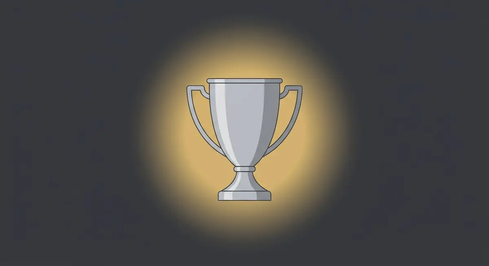

Title tag: Купа на България: формат, история и рекорди | Всички Казина
Meta description: Как работи Купата на България: директни елиминации, полуфинали в две срещи, финал на един мач, кой участва и за какво се класира носителят, плюс рекордите по купи. Факти, не прогнози.

---

# Купа на България: как работи турнирът

Една слаба вечер в купата струва целия сезон. Отбор, който в първенството никога не би стигнал до гранд, тук го изважда с един-единствен мач и си тръгва като героят на кръга. Тъкмо това отличава Купата на България от шампионата, където една лоша вечер се разтваря в трийсетина кръга и до пролетта почти се забравя.

## Какво е Купата на България

Купата е националният елиминационен турнир по футбол, който се провежда под егидата на Българския футболен съюз. Върви успоредно с първенството и има собствена логика. Титлата се печели с постоянство през цял сезон, а купата иска друго: да минеш невредим през поредица единични мачове, в които всяка грешка може да е последна.

## Форматът накратко

Турнирът е на директни елиминации. Почти всички двубои са по един мач, като изключение правят полуфиналите, които се играят в две срещи с размяна на домакинството. Финалът пък е единичен мач на предварително определен стадион, обикновено на неутрален терен.

*Форматът и ключовите дати на Купата на България. Всички стойности следват текста на статията.*

В елиминационните кръгове домакин е по-нископоставеният отбор, което дава на по-малките клубове мача на техния терен. Срещнат ли се два отбора от едно и също ниво, домакинството се тегли с жребий. Ако редовното време свърши наравно, идват продължения, а при нужда и дузпи. Ремита, които остават за преиграване, няма.

## Кой участва

Силата на купата е, че събира на едно място целия български футбол. Заявка подават клубове от всички нива, от професионалните дивизии до по-малки и аматьорски отбори от долните групи, които са се класирали през предварителните кръгове. Броят участници и двойки се мени от сезон на сезон според това колко тима влизат от долните дивизии. Точно те после домакинстват на някой фаворит и от време на време го изхвърлят.

## Какво печели носителят

Освен самия трофей победителят обикновено получава място в европейските клубни турнири. Коя точно е вратата се е менило през годините: до сезон 1998/99 носителят влизаше в Купата на носителите на купи, след това в Купата на УЕФА и в наследилата я Лига Европа от сезон 2009/10, а от 2021 г. насам пътят води към Лигата на конференциите. Ако носителят на купата вече се е класирал за Европа през първенството, мястото от купата се предава на следващия в класирането. Точната врата и броят европейски места зависят от коефициента на България в УЕФА и се обявяват в регламента за съответния сезон.

## Малко история

Турнирът в сегашния си вид тръгва от сезон 1980/81, а от 1982/83 Българският футболен съюз признава носителите за официални. До 1990 г. състезанието носи името „Купа на Народна република България", след което остава просто Купата на България, с различни заглавни спонсори през годините. Преди него страната е имала и други купи, сред които „Царската купа" от 20-те и 30-те години и „Купата на Съветската армия" от средата на 40-те, но те се водят отделни турнири за своето време.

## Рекордите

Начело във вечната подредба е Левски с най-много спечелени купи в историята на турнира, следван от ЦСКА. Точните бройки зависят от това кои ранни и спорни издания се зачитат, например анулираният финал от 1985 г., затова справочниците се разминават: към есента на 2026 г. за Левски се посочват [VERIFY: 27] купи, а за ЦСКА [VERIFY: 22]. Столичните клубове, сред които и Славия, са печелили над половината издания, така че купата дълго остава предимно софийска история. ЦСКА пък е единственият клуб, вдигал купата без да е в елита: направи го през 2016 г. от по-долна дивизия.

## На пари, отдалеч: купа, залози и трезва сметка

Ако гледаш българския футбол и покрай това залагаш или играеш в казино, важи същото, което важи навсякъде у нас. Законно минава само през оператор с лиценз от НАП, вписан в публичния регистър; какво точно е [законно](/zakonno-li-e/) е отделен и доста по-приземен въпрос от това кой държи рекорда по купи. Спортната част заедно с бонусите за спорт събираме в [раздела за спорт](/bonus-ruletka/sport/vsichki/), а профилите на клубовете и турнирите стоят във [футболния раздел](/blog/futbol/). Прогнози за мачове там няма и няма да намериш съвет кого да заложиш.

Точно заради елиминациите и честите изненади изходът от един купен мач трудно се чете предварително, а залогът върху фаворита не променя това. Хазартът не е доходоносна стратегия. Бюджет, който можеш да загубиш докрай, и лимит, зададен преди да започнеш, пазят вечерта пред телевизора да си остане забавление. Кога играта започва да тежи и какво да се направи тогава е тема на [отговорната игра](/blog/responsible-gambling/).

Кой срещу кого играе в следващото издание се тегли на жребия за сезона. Какъвто и да излезе фаворитът, залогът върху него не купува резултата.

---

**Георги Тодоров**
Публикувано: 05.11.2026 · Последна редакция: 05.11.2026

**За Всички Казина.** Независим сайт за сравнение на онлайн казина, лицензирани за българския пазар. Оценяваме всяко казино по публична методика с шест претеглени критерия и проверяваме лиценза в регистъра на НАП, преди да дадем оценка. Не сме оператор и не продаваме съвети за печалба; сравняваме, проверяваме и обясняваме, за да избираш с отворени очи.

**Отговорна игра.** 18+ Хазартът може да пристрасти. Играйте отговорно. Ако усетиш, че играта излиза извън контрол или искаш да я ограничиш, виж [инструментите за отговорна игра](/otgovorna-igra/) и възможността за самоизключване чрез националния регистър на уязвимите лица към НАП (подава се писмено само от засегнатото лице). Национална информационна линия за наркотиците, алкохола и хазарта („Солидарност") 0888 99 18 66, делнични дни 10:00-17:00.

**Разкриване на партньорства.** Сайтът съдържа партньорски (афилиейт) връзки; когато отвориш оферта през такава връзка, това може да финансира сайта, без да променя цената за теб и без да влияе на оценките ни. От 1 август 2026 г. дейността на афилиейт оператори в България се лицензира съгласно Закона за държавния бюджет за 2026 г. (ДВ, бр. 69 от 31.07.2026 г.). Всички Казина е подало заявление за лиценз пред Националната агенция по приходите и очаква издаването му.
