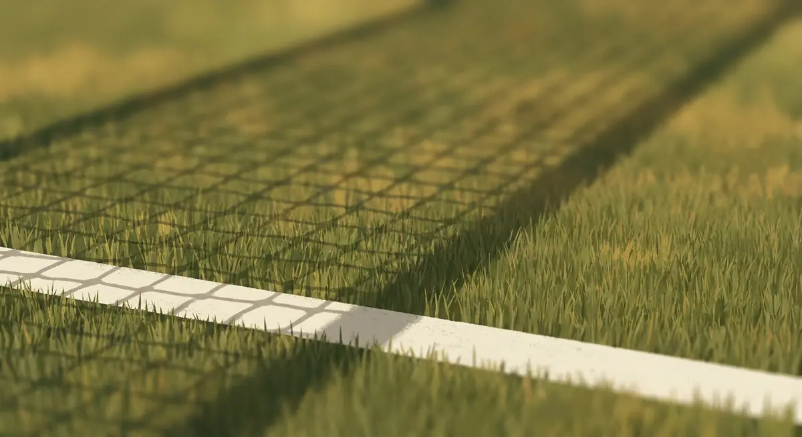

Title tag: Уимбълдън: история, трева и правила на турнира | Всички Казина
Meta description: Уимбълдън е най-старият тенис турнир и единственият от Големия шлем на трева. История от 1877 г., формат, покривите на кортовете и традициите с бялото и ягодите.

---

# Уимбълдън: най-старият тенис турнир и какво го прави различен

Докато другите три турнира от Големия шлем отдавна минаха на твърда настилка или шлака, Уимбълдън продължава да се играе на трева в южен Лондон, почти както през деветнайсети век. Това е най-старото тенис състезание в света и единственото от четирите големи, което все още изглежда като тениса отпреди сто години.

## Откъде тръгва всичко

Първото първенство се провежда през 1877 г. в клуб, който дотогава се занимава основно с крокет. Има само една дисциплина, мъжки сингъл, и един победител, Спенсър Гор. Самият клуб е по-стар от турнира: основан е през 1868 г. като Всеанглийски крокетен клуб, а тенисът идва по-късно и постепенно избутва крокета от тревните игрища. Организатор и до днес е Всеанглийският клуб по лаун тенис и крокет (AELTC). До 1921 г. турнирът се играе на Уорпъл Роуд, а от 1922 г. се мести на Чърч Роуд, където е и сега.

## Тревата и мястото сред Големия шлем

В календара Уимбълдън е третият от четирите турнира на Големия шлем за годината, след Australian Open и Roland Garros и преди US Open. Отличава го настилката. След като Australian Open напуска тревата през 1988 г., Уимбълдън остава единственият голям турнир, който се играе върху нея. От 2001 г. кортовете се засяват със стопроцентов многогодишен райграс, по-издръжлив от старите смески. Тревата дава нисък отскок и бърза топка, възнаграждава подаването и излизането на мрежата, и прави сезона на трева различен на вкус от дългите разигравания на шлака.

## Как е устроено състезанието

Дисциплините се прибавят постепенно. Дамският сингъл влиза в програмата през 1884 г., а двойките и смесените двойки през 1913 г. Мъжкият сингъл се играе до три спечелени сета, тоест пет възможни; останалите дисциплини са до два спечелени сета. При двойките мъже този дълъг формат отпадна с решение от 2023 г.

Правилото за решаващия сет се менеше няколко пъти и обърква мнозина. Дълги години последният сет на Уимбълдън нямаше тайбрек и се играеше до преднина от два гейма, затова някои мачове стигаха абсурдно дълги резултати. През 2019 г. турнирът въведе тайбрек, но чак при 12-12. От 2022 г. четирите турнира от Големия шлем приеха общо правило и сега при 6-6 в последния сет се играе тайбрек до 10 точки с преднина от две. Как точно се броят точките, геймовете и сетовете е отделна тема, която разглеждаме в [правилата на тениса](/blog/tenis-pravila-tochkuvane/).

## Централният корт и дъждът

Централният корт събира близо 14 979 зрители и е сцената за финалите. Британското лято е ненадеждно и дъждът често е спирал играта с часове. През 2009 г. кортът получи подвижен покрив, който се затваря за минути и позволява мачът да продължи на закрито. Корт №1, вторият по големина, построен през 1997 г., също получи свой покрив за изданието през 2019 г. Оттогава два от главните кортове са предпазени от времето, което прави програмата по-предвидима за зрители и телевизии.

## Традициите

Малко турнири пазят ритуалите си толкова строго. Играчите излизат в почти изцяло бяло; изискването за бяло облекло е записано изрично през 1963 г. и важи за цялата екипировка, не само за фланелката. Ягодите със сметана са другата запазена марка, продавани с тонове през двете седмици. Разказът, че навикът идвал още от времето на Хенри VIII, е по-скоро приятна легенда, отколкото документиран факт. В южния край на Централния корт е Кралската ложа, където сядат гости на клуба и често членове на кралското семейство.

## Няколко факта за финал

Поставянето на фаворитите (seeding) се появява през 1924 г., а от 2001 г. в сингъл се поставят 32-ма тенисисти. Рекордите по титли се цитират внимателно, защото източниците понякога смесват цялата история на турнира с т.нар. Оупън ера. Към есента на 2026 г. за рекордьор при мъжете в Оупън ерата се сочи Роджър Федерер с осем титли на сингъл [VERIFY], а при жените Мартина Навратилова с девет [VERIFY]. И двамата отдавна не са активни, така че тези числа едва ли ще мръднат скоро.

*Ключовите факти за турнира. Всички числа следват текста на статията.*

## На пари, отдалеч: тенисът, залозите и трезвата сметка

Ако гледаш Уимбълдън и покрай това залагаш, в България важи същото както навсякъде: законно минава само през оператор с лиценз от НАП, вписан в публичния регистър, а какво точно е [законно](/zakonno-li-e/) е отделен и доста по-приземен въпрос от романтиката на тревата. Спортните теми държим в [раздела за спорт](/blog/sport/), а офертите за спорт са в [спортните бонуси](/bonus-ruletka/sport/vsichki/). Прогнози за мачове там няма и няма да намериш съвет на кого да заложиш. Залог върху фаворит на трева не е по-сигурен от всеки друг залог, а хазартът не изкарва пари. Бюджет, който можеш да загубиш докрай, и лимити, зададени преди първия залог, пазят турнирът да си остане зрелище. Кога играта започва да тежи и какво се прави тогава е темата на [отговорната игра](/blog/responsible-gambling/).

Уимбълдън устоя на изкушението да мине на бързи синтетични настилки и остана верен на тревата, на бялото и на ягодите. Затова и след почти век и половина е турнирът, който мнозина искат да спечелят повече от всеки друг. Какво няма да намериш покрай него е сигурен залог: такъв на тенис корт просто не съществува.

---

**Георги Тодоров**
Публикувано: 06.11.2026 · Последна редакция: 06.11.2026

**За Всички Казина.** Независим сайт за сравнение на онлайн казина, лицензирани за българския пазар. Оценяваме всяко казино по публична методика с шест претеглени критерия и проверяваме лиценза в регистъра на НАП, преди да дадем оценка. Не сме оператор и не продаваме съвети за печалба; сравняваме, проверяваме и обясняваме, за да избираш с отворени очи.

**Отговорна игра.** 18+ Хазартът може да пристрасти. Играйте отговорно. Ако усетиш, че играта излиза извън контрол или искаш да я ограничиш, виж [инструментите за отговорна игра](/otgovorna-igra/) и възможността за самоизключване чрез националния регистър на уязвимите лица към НАП (подава се писмено само от засегнатото лице). Национална информационна линия за наркотиците, алкохола и хазарта („Солидарност") 0888 99 18 66, делнични дни 10:00-17:00.

**Разкриване на партньорства.** Сайтът съдържа партньорски (афилиейт) връзки; когато отвориш оферта през такава връзка, това може да финансира сайта, без да променя цената за теб и без да влияе на оценките ни. От 1 август 2026 г. дейността на афилиейт оператори в България се лицензира съгласно Закона за държавния бюджет за 2026 г. (ДВ, бр. 69 от 31.07.2026 г.). Всички Казина е подало заявление за лиценз пред Националната агенция по приходите и очаква издаването му.
