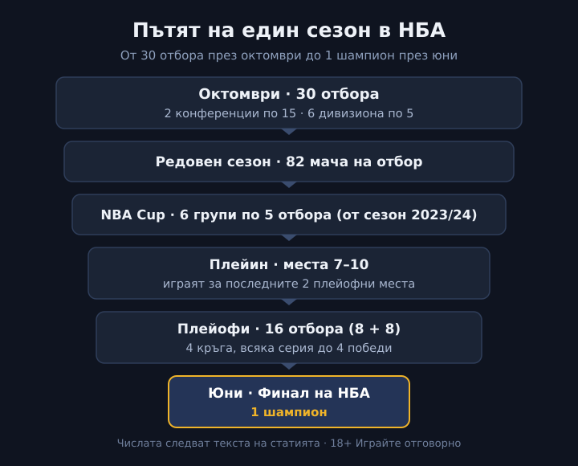

Title tag: НБА: как работи сезонът, конференциите и плейофите | Всички Казина
Meta description: Как е устроена НБА просто: 30 отбора в две конференции, 82 мача редовен сезон, NBA Cup, плейин турнира и плейофите до четири победи, плюс финала и купата „Лари О'Брайън".

---

# НБА: как работи сезонът от първия мач до финала

Един сезон в НБА започва с трийсет отбора през октомври и свършва с един шампион чак към средата на юни. Между двете стоят редовен сезон, един отделен турнир вътре в графика, мини-плейоф за последните места и четири кръга серии.

*Пътят на сезона от октомври до юни. Всички числа следват текста на статията.*

## Трийсет отбора, две конференции, шест дивизиона

Лигата се казва Национална баскетболна асоциация и води началото си от 1946 г., когато е основана под името BAA. Днешното съкращение НБА идва от 1949 г., след сливане с конкурентната по онова време NBL. Отборите са трийсет: двайсет и девет в Съединените щати и един в Канада, „Торонто Раптърс".

Географски всичко е разделено на две половини. Източната и Западната конференция имат по петнайсет клуба, а всяка конференция се дели на по три дивизиона от по пет отбора. На изток това са Атлантическата, Централната и Югоизточната дивизия; на запад са Северозападната, Тихоокеанската и Югозападната. Дивизионите тежат най-вече за календара и за някои дребни предимства при подреждането, но класирането, което решава кой продължава напред, се води в рамките на цялата конференция, не по дивизиони.

## Редовният сезон: 82 мача за всеки

Редовният сезон върви от октомври до април и всеки отбор изиграва по осемдесет и два мача, половината у дома и половината като гост. Срещу съперниците от собствената конференция се играе повече, срещу другата по-малко, но всеки се среща с всеки поне веднъж.

От тези осемдесет и два мача излиза подреждането в двете конференции, от първо до петнайсето място по съотношение победи и загуби. То е единственото, което носи тежест нататък. Няма точки за головата разлика, няма бонуси за стил; брои се кой колко мача е спечелил.

## NBA Cup: турнир вътре в редовния сезон

От сезон 2023/24 насам в календара има и отделен трофей, NBA Cup, който отначало се казваше просто „турнир в сезона". Играе се наесен, вътре в редовния график, без да го прекъсва.

Устроен е на групи. Отборите на всяка конференция се разпределят в по три групи от по пет, тоест шест групи общо. Всеки изиграва четири групови мача, които влизат едновременно в класирането за NBA Cup и в редовния сезон, тоест не са отделни допълнителни срещи. Победителите в групите, плюс по един отбор с най-добро класиране извън тях, продължават към елиминации на един мач до финал за купата. Само финалът остава извън статистиката на редовния сезон.

## Плейинът: мачовете за седмото и осмото място

Преди същинските плейофи има едно сравнително ново стъпало, пробвано за първи път през 2020 г. и уталожено като формат от 2021 г. Нарича се плейин турнир и засяга отборите, завършили между седмо и десето място във всяка конференция.

Смисълът му е да държи интригата жива за повече клубове до самия край на редовния сезон. Седмият играе срещу осмия, деветият срещу десетия, и от тези мачове излизат двата отбора, които заемат седмото и осмото място за плейофите. Деветото и десетото място вече не стигат за директно класиране, но дават още един шанс, какъвто по-рано нямаше.

## Плейофите: четири серии до четири победи

В плейофите влизат по осем отбора от всяка конференция, шестнайсет общо. Местата от първо до шесто се класират директно от редовния сезон, а последните две идват от плейина.

Всяка двойка играе серия до четири победи, тоест най-много седем мача. Пътят минава през четири кръга: Първи кръг, Полуфинали на конференцията, Финал на конференцията и накрая Финал на НБА. По-добре класиралият се домакинства в повече мачове от серията, и това е наградата за силен редовен сезон. Схемата се тегли в началото и после не се пипа; няма преподреждане между кръговете според това кой как е изглеждал дотам.

## Финалът и купата „Лари О'Брайън"

Финалът на НБА събира шампиона на Източната срещу шампиона на Западната конференция, пак в серия до четири победи, обикновено през юни. Победителят вдига купата „Лари О'Брайън", която носи това име от 1984 г. на бившия комисар на лигата Лари О'Брайън.

По брой титли най-отпред стоят два клуба с дълга история. Към есента на 2026 г. „Бостън Селтикс" водят с осемнайсет шампионски пръстена, последният от 2024 г., а „Лос Анджелис Лейкърс" ги следват със седемнайсет.

## На пари, отдалеч: НБА, залозите и трезвата сметка

Ако гледаш НБА и покрай това залагаш или се въртиш в онлайн казино, важи същото, което важи за всеки спорт у нас. Законно минава единствено през оператор с лиценз от НАП, вписан в публичния регистър; колко добре познаваш формата на лигата няма общо с това дали сайтът, на който играеш, е [редовен и законен](/zakonno-li-e/). Баскетболните и другите спортни теми държим в [спортния блог](/blog/sport/), а събраните спортни бонуси са в [раздела за спорт](/bonus-ruletka/sport/vsichki/). Прогнози за мачове и съвети на кого да заложиш тук няма.

Хазартът не е начин да изкараш пари. Бюджет, който можеш да загубиш докрай, и лимити, зададени преди да започнеш, пазят вечерта пред баскетбола да си остане просто вечер пред баскетбола. Кога играта започва да тежи и какво се прави тогава стои описано в [отговорната игра](/blog/responsible-gambling/).

Форматът на НБА се надгражда от десетилетия, а новите парчета като плейина и NBA Cup просто добавят мачове с тежест към един и без това дълъг сезон. Кой ще вдигне купата обаче никой не го знае предварително, и никакъв залог няма да ти го подскаже.

---

**Георги Тодоров**
Публикувано: 07.11.2026 · Последна редакция: 07.11.2026

**За Всички Казина.** Независим сайт за сравнение на онлайн казина, лицензирани за българския пазар. Оценяваме всяко казино по публична методика с шест претеглени критерия и проверяваме лиценза в регистъра на НАП, преди да дадем оценка. Не сме оператор и не продаваме съвети за печалба; сравняваме, проверяваме и обясняваме, за да избираш с отворени очи.

**Отговорна игра.** 18+ Хазартът може да пристрасти. Играйте отговорно. Ако усетиш, че играта излиза извън контрол или искаш да я ограничиш, виж [инструментите за отговорна игра](/otgovorna-igra/) и възможността за самоизключване чрез националния регистър на уязвимите лица към НАП (подава се писмено само от засегнатото лице). Национална информационна линия за наркотиците, алкохола и хазарта („Солидарност") 0888 99 18 66, делнични дни 10:00-17:00.

**Разкриване на партньорства.** Сайтът съдържа партньорски (афилиейт) връзки; когато отвориш оферта през такава връзка, това може да финансира сайта, без да променя цената за теб и без да влияе на оценките ни. От 1 август 2026 г. дейността на афилиейт оператори в България се лицензира съгласно Закона за държавния бюджет за 2026 г. (ДВ, бр. 69 от 31.07.2026 г.). Всички Казина е подало заявление за лиценз пред Националната агенция по приходите и очаква издаването му.
