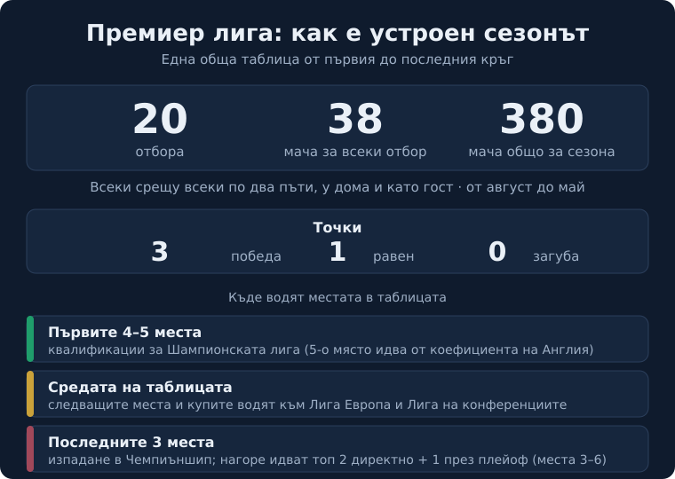

Title tag: Премиер лига: формат, отбори и как работи английското първенство | Всички Казина
Meta description: Английската Висша лига (Premier League): колко отбора, 38 кръга, промоция и изпадане, местата за Европа и рекордьорите. Обяснение на формата, не прогнози.

---

# Какво е Премиер лига и как работи форматът на английското първенство

Премиер лига, или Висшата лига, е най-горното ниво на клубния футбол в Англия. „Премиер лига", „английската Висша лига" и Premier League са едно и също първенство. Управлява го самата лига като компания, чиито акционери са двайсетте клуба в нея за съответния сезон; те приемат правилата и календара заедно с Футболната асоциация. Като отделно състезание Висшата лига съществува от 1992 г., но английският елит се играе в този формат, с таблица и точки, от много по-рано. Днес мачовете се гледат в над 180 държави, което прави първенството едно от най-разпознаваемите в света.

## Как е устроен един сезон

Сезонът върви по проста схема: всеки отбор играе срещу всеки друг по два пъти, веднъж у дома и веднъж като гост. При двайсет отбора това прави 38 мача за всеки и 380 за цялата лига, разпределени в 38 кръга от август до май.

Точките се събират по обичайния начин. Победата носи три точки, равенството една, загубата нула. Няма групова фаза и няма плейофи за титлата: който събере най-много точки след 38-те кръга, става шампион. Това е и разликата с първенства като българското, където след редовния сезон таблицата се разделя на групи; в Англия подредбата тече в една обща таблица от първия до последния кръг.

*Как е устроен един сезон във Висшата лига. Всички числа следват текста на статията.*

## Класиране, промоция и изпадане

Отборите се подреждат по точки. При равен брой точки първо тежи головата разлика, после отбелязаните голове. Ако два тима са изравнени и мястото решава титла, изпадане или участие в Европа, се гледат преките срещи помежду им, а ако и това не раздели, правилникът предвижда плейоф на неутрален терен. Такъв мач за едно място не се е играл в историята на лигата, но остава записан като последна възможност.

Долу в таблицата битката е за оставане. Последните три отбора изпадат в Чемпиъншип, второто ниво на английския футбол. На тяхно място се качват три тима оттам: първите два директно, а третото място се решава през плейоф между отборите от трето до шесто в Чемпиъншип. Така всяка година долната третина на таблицата играе под напрежение до последния кръг, защото една точка често дели оставането от изпадането.

## Местата за Европа

Предните места дават участие в европейските клубни турнири, а Англия има едни от най-многото места заради силата си в последните години. Първите четири влизат в груповата фаза на Шампионската лига, а в някои сезони и петото място отива там. Този пети пропуск идва от коефициента на страната в УЕФА: когато английските клубове се представят най-добре в Европа през предходната година, лигата получава още едно място за Шампионската лига. За сезоните 2024/25 и 2025/26 Англия изкара точно такова пето място.

Следващите в класирането, заедно с носителя на ФА Къп, тръгват по Лига Европа, а победителят в Купата на лигата (търговското ѝ име се сменя със спонсора) влиза в квалификациите на Лига на конференциите. Точният брой места и кой в кой турнир попада зависят от коефициента и от това дали отбор, спечелил купа, вече се е класирал по място в таблицата, затова сметката се мести от сезон на сезон. Актуалното разпределение се публикува на сайта на лигата и на УЕФА.

## Клубовете и рекордите

Историята на Висшата лига има един отбор начело по титли: Манчестър Юнайтед с 13 шампионски титли от 1992 г. насам. Най-плътната серия обаче е по-нова. Манчестър Сити спечели четири поредни титли между сезоните 2020/21 и 2023/24 и стана първият английски отбор, който взема четири шампионства едно след друго в елита. Последните две завършени първенства отидоха при Ливърпул през сезон 2024/25 и при Арсенал през сезон 2025/26.

Ако се брои цялата история на английския елит, не само годините след 1992 г., начело стоят двама: Манчестър Юнайтед и Ливърпул, с по 20 титли на Англия всеки. Данните за трофеите са към 2026 г. Върхът на таблицата рядко стои празен дълго, но и рядко се заключва за един клуб, както показаха последните няколко сезона с три различни шампиона.

## Откъде идва и защо е толкова голяма

Висшата лига се отделя от старата система на 20 февруари 1992 г. под името FA Premier League. Първият ѝ сезон, 1992/93, се играе с 22 отбора, а от сезон 1995/96 съставът е намален на 20, какъвто е и до днес. Преди това върхът на английския футбол се казваше Първа дивизия и беше елитът още от 1888 г., така че лигата не започва футбола в Англия, а поема готово първенство с дълга история и го превръща в отделен търговски и телевизионен продукт. Точно този телевизионен обхват, с мачове по екрани в над 180 държави, обяснява защо имената на английските клубове са познати и у нас, независимо дали човек следи редовно английски футбол.

## Футбол, залози и трезва сметка

Ако гледаш Висшата лига и покрай това залагаш на спорт или играеш в казино, правилото в България е едно и също навсякъде: законно минава само през оператор с лиценз от НАП, вписан в публичния регистър. Какво точно е [законно](/zakonno-li-e/) е отделна тема от това кой води в таблицата, а повече за клубовете и имената от световния футбол четеш в [блога за футбол](/blog/futbol/), където са и сестринските гайдове за [испанската Ла Лига](/blog/la-liga/) и [българската efbet Лига](/blog/efbet-liga-format-otbori/).

Спортните бонуси събираме в [раздела за спорт](/bonus-ruletka/sport/vsichki/), без прогнози за мачове и без съвет кого да заложиш. Залогът върху фаворита в голямо дерби не е по-сигурен от всеки друг залог, а хазартът не е начин да се печелят пари. Бюджет, който можеш да загубиш докрай, плюс предварително зададени лимити за депозит и загуба държат мача да си остане мач. Кога играта започва да тежи и какво се прави тогава е тема на [отговорната игра](/blog/responsible-gambling/).

---

**Георги Тодоров**
Публикувано: 09.11.2026 · Последна редакция: 09.11.2026

**За Всички Казина.** Независим сайт за сравнение на онлайн казина, лицензирани за българския пазар. Оценяваме всяко казино по публична методика с шест претеглени критерия и проверяваме лиценза в регистъра на НАП, преди да дадем оценка. Не сме оператор и не продаваме съвети за печалба; сравняваме, проверяваме и обясняваме, за да избираш с отворени очи.

**Отговорна игра.** 18+ Хазартът може да пристрасти. Играйте отговорно. Ако усетиш, че играта излиза извън контрол или искаш да я ограничиш, виж [инструментите за отговорна игра](/otgovorna-igra/) и възможността за самоизключване чрез националния регистър на уязвимите лица към НАП (подава се писмено само от засегнатото лице). Национална информационна линия за наркотиците, алкохола и хазарта („Солидарност") 0888 99 18 66, делнични дни 10:00-17:00.

**Разкриване на партньорства.** Сайтът съдържа партньорски (афилиейт) връзки; когато отвориш оферта през такава връзка, това може да финансира сайта, без да променя цената за теб и без да влияе на оценките ни. От 1 август 2026 г. дейността на афилиейт оператори в България се лицензира съгласно Закона за държавния бюджет за 2026 г. (ДВ, бр. 69 от 31.07.2026 г.). Всички Казина е подало заявление за лиценз пред Националната агенция по приходите и очаква издаването му.
