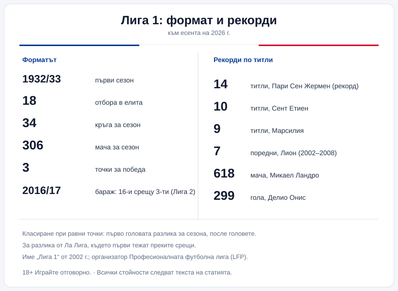

<!-- 04-seo · Audit: primary 'Лига 1 / ligue 1 / френско първенство' covered in H1+lead+body; entities (формат, 18 отбора, 34 кръга, точкуване, класиране, тайбрек, изпадане/бараж, Европа, рекорди) present. Title tag + meta set (below). Internal links [LINK] realised: /zakonno-li-e/, /bonus-ruletka/sport/vsichki/, /blog/futbol/, /blog/la-liga/, /blog/responsible-gambling/, /otgovorna-igra/. No keyword stuffing; numbers unchanged vs 03. -->

Title tag: Лига 1: формат, отбори и как работи френското първенство | Всички Казина
Meta description: Как работи френската Лига 1: 18 отбора, 34 кръга, точкуване, класиране по голова разлика, бараж за изпадане, билетите за Европа и най-титулуваните клубове. Факти, не прогнози.

---

# Лига 1: как работи френското първенство

Ако два отбора във Франция завършат с еднакви точки, първото нещо, което решава кой е по-напред, не е кой кого е бил, а головата разлика за целия сезон. Дребна на вид подробност, която обаче подрежда таблицата по свой начин и често е спестявала нерви чак до последния кръг.

## Какво е Лига 1

Лига 1 е върхът на професионалния футбол във Франция. Състезанието се организира от Професионалната футболна лига (Ligue de Football Professionnel). Първият сезон се играе през 1932/33, когато първенството тръгва под името „National"; година по-късно става „Division 1", а днешното име Лига 1 носи от 2002 г. насам. Дълго преди това шампионът на Франция се определя по друг ред, но модерната единна лига води началото си оттам.

## Форматът накратко

В елита играят 18 отбора, както е от сезон 2023/24, след като лигата реши да се върне към 18 вместо предишните 20. Всеки се среща с всеки друг два пъти, веднъж като домакин и веднъж като гост, което прави 34 кръга и 306 мача за една кампания. Сезонът върви от август до май. Три точки за победа, една за равен, нула за загуба.

*Форматът и ключовите числа на Лига 1. Всички стойности следват текста на статията.*

## Когато точките се изравнят

Тук е и една от разликите, която си струва да се запомни. Изравнят ли се два отбора по точки, французите гледат първо головата разлика за целия сезон, а след нея общия брой отбелязани голове. Преките срещи помежду им не са водещият критерий, за разлика например от испанската Ла Лига, където точно директните мачове тежат първи. Заради това един и същ сбор от резултати може да нареди отборите по различен начин в двете държави. Ако пък всичко остане наравно там, където се решава титла, изпадане или място за Европа, правилникът оставя вратичка за допълнителен мач на неутрален терен.

## Нагоре и надолу

Най-слабите в класирането слизат в Лига 2, а оттам нагоре идват най-добрите от втория ешелон. От сезон 2016/17 има и един по-напрегнат вариант: отборът, завършил 16-и в елита, не изпада автоматично, а играе двоен бараж срещу третия от Лига 2, като вторият домакинства първата среща. Печелившият от двата мача остава или се качва горе за следващата година. Колко точно отбора падат директно и колко минават през бараж, лигата нагласява по регламента за конкретния сезон, така че за броя в даден момент е най-добре да се погледне официалният източник.

## Билети за Европа

Горната част на таблицата води към европейските турнири, но точната подредба зависи от коефициента на Франция в УЕФА и се мести от година на година. Общата рамка изглежда така: първите четири продължават към Шампионската лига, като трите най-предни влизат директно в основната фаза, а четвъртият минава през квалификации. Петото място праща в Лига Европа, заедно с едно място, което идва по линия на Купата на Франция. Шестият поема към плейофа на Лигата на конференциите, а ако носителят на купата вече се е класирал през първенството, мястото слиза към следващия по ред. Понеже тези квоти не са заковани веднъж завинаги, за актуалния им вид официалната страница на лигата върши по-добра работа от всяка стара таблица.

## Най-титулуваните

Към есента на 2026 г. начело е Пари Сен Жермен с 14 титли, рекорд за първенството, следван от Сент Етиен с 10 и Марсилия с 9. Парижани имат зад гърба си и 5 поредни титли в периода 2021/22–2025/26, но най-дългата серия в историята остава на Лион със 7 последователни купи между 2002 и 2008 г.; Марсилия пък има своите 4 поредни от края на 80-те до началото на 90-те. За цялата история на турнира шампиони са ставали към двайсетина различни клуба. От личните рекорди се помнят 618-те мача на вратаря Микаел Ландро и 299-те гола на Делио Онис. Трофеят, който вдига шампионът, дълго носеше галеното име „Хексагол", а при преоформянето на лигата през 2024 г. получи нов дизайн.

## На пари, отдалеч: футбол, залози и малко трезва сметка

Ако гледаш френския футбол и покрай това залагаш или играеш в казино, важи същото, което важи навсякъде у нас. Законно минава единствено през оператор с лиценз от НАП, вписан в публичния регистър; какво точно е [законно](/zakonno-li-e/) е отделен и доста по-приземен въпрос от това кой колко титли има. Спортните бонуси и промоциите събираме в [раздела за спорт](/bonus-ruletka/sport/vsichki/), а профилите на лиги, клубове и легенди стоят във [футболния раздел](/blog/futbol/), където ще намериш и сестринския разбор на [Ла Лига](/blog/la-liga/). Прогнози за мачове обаче няма и няма да намериш съвет кого да заложиш.

Хазартът не е начин да се печелят пари и залогът върху любимия отбор не променя тази сметка. Бюджет, който можеш да загубиш докрай, и предварително зададени лимити държат вечерта пред телевизора там, където ѝ е мястото, тоест в забавлението; кога играта започва да тежи и какво се прави тогава е тема на [отговорната игра](/blog/responsible-gambling/).

Миналите титли в Лига 1 носят точни дати и точни числа. Следващият мач не се знае предварително и никой залог не го прави по-сигурен.

---

**Георги Тодоров**
Публикувано: 10.11.2026 · Последна редакция: 10.11.2026

**За Всички Казина.** Независим сайт за сравнение на онлайн казина, лицензирани за българския пазар. Оценяваме всяко казино по публична методика с шест претеглени критерия и проверяваме лиценза в регистъра на НАП, преди да дадем оценка. Не сме оператор и не продаваме съвети за печалба; сравняваме, проверяваме и обясняваме, за да избираш с отворени очи.

**Отговорна игра.** 18+ Хазартът може да пристрасти. Играйте отговорно. Ако усетиш, че играта излиза извън контрол или искаш да я ограничиш, виж [инструментите за отговорна игра](/otgovorna-igra/) и възможността за самоизключване чрез националния регистър на уязвимите лица към НАП (подава се писмено само от засегнатото лице). Национална информационна линия за наркотиците, алкохола и хазарта („Солидарност") 0888 99 18 66, делнични дни 10:00-17:00.

**Разкриване на партньорства.** Сайтът съдържа партньорски (афилиейт) връзки; когато отвориш оферта през такава връзка, това може да финансира сайта, без да променя цената за теб и без да влияе на оценките ни. От 1 август 2026 г. дейността на афилиейт оператори в България се лицензира съгласно Закона за държавния бюджет за 2026 г. (ДВ, бр. 69 от 31.07.2026 г.). Всички Казина е подало заявление за лиценз пред Националната агенция по приходите и очаква издаването му.
