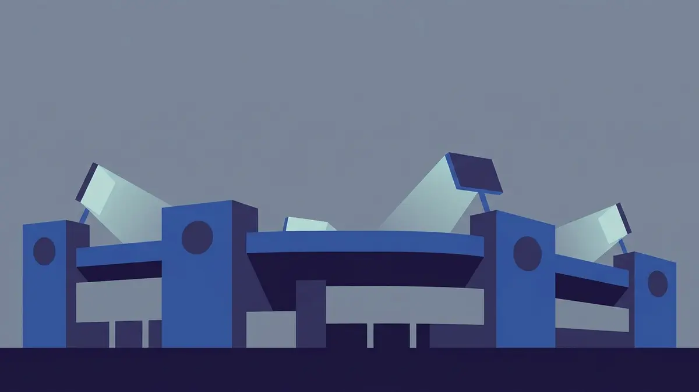

# Челси: историята, трофеите, стадионът и легендите

През лятото на 2025 г. Челси стана първият клуб, вдигал и четирите основни клубни трофея на УЕФА. Шампионска лига, Лига Европа, старата Купа на носителите на купи и най-новата Лига на конференциите: пълната колекция, която дотогава никой друг не беше събрал.

## От една кръчма до футболен клуб

Историята тръгва от стадиона, не от отбора. През 1904 г. бизнесменът Гъс Миърс купува игрището „Стамфорд Бридж" с идеята там да се играе голям футбол. Първо предлага наема на съседния „Фулъм", но получава отказ. Тогава Миърс решава да създаде собствен клуб, който да пълни трибуните. Така на 10 март 1905 г. в кръчмата The Rising Sun, точно срещу входа на стадиона, се ражда Chelsea Football Club. Името идва от съседния квартал Челси.

## „Сините" и „Пенсионерите"

Прякорът „Сините" идва право от екипа: кралскосиньото е цветът на клуба от над век. По-ранният прякор беше „Пенсионерите", заради фигурата на ветеран от болницата Chelsea Royal Hospital в стария герб. С годините тя отпадна и днес почти никой не използва старото име.

## Витрината в Англия

Вкъщи Челси е сред най-титулуваните английски клубове, макар повечето трофеи да идват след 2000 г. Към есента на 2026 г. клубът има 6 титли в английския елит. Първата е отдавнашна, от сезон 1954/55, а останалите пет са от модерната епоха, последната през 2016/17. Към тях вървят 8 купи на Англия (ФА Къп), с които „Сините" са сред водещите в този турнир, и 5 Купи на лигата.

*Трофеите и ключовите числа на Челси. Всички стойности следват текста на статията.*

## Европа и светът

В Европа клубът става известен най-напред с Купата на носителите на купи през 1971 г., повторена през 1998 г. Истинският връх са двете титли в Шампионската лига: първата през 2012 г., спечелена на финал срещу Байерн в самия Мюнхен, и втората през 2021 г. Към тях клубът има 2 трофея в Лига Европа (2013 и 2019 г.), 2 Суперкупи на УЕФА (1998 и 2021 г.) и титлата в Лигата на конференциите от 2025 г., с която затвори целия кръг европейски трофеи. Два пъти Челси е ставал и световен клубен шампион, през 2021 и 2025 г.

## Стамфорд Бридж

Домът на клуба е „Стамфорд Бридж" и приема мачовете на отбора още от основаването му през 1905 г. Събира 40 044 зрители към есента на 2026 г., което го прави сравнително малък за ранга на клуба. Стадионът стои в западната част на Лондон, притиснат между жилищни улици и железопътна линия, и тъкмо тази теснота обяснява защо разширяването му години наред опира в границите на квартала.

## Легендите

Голмайстор номер едно в историята на клуба е Франк Лампард, полузащитник с рядко висок за позицията си брой голове. Около него се върти цяло поколение: капитанът и защитник Джон Тери, нападателят Дидие Дрогба, вратарят Петър Чех. По-назад във времето остават техничният Джанфранко Дзола и Питър Осгуд от по-ранните успешни години.

Най-успешният период в историята на клуба започва през 2003 г., когато Челси е купен от Роман Абрамович. През 2022 г. собствеността премина към консорциум начело с Тод Бьоли.

## Съперничества

Най-горещите мачове на Челси са лондонските дербита, преди всичко срещу „Арсенал" и „Тотнъм" от северната част на града, както и локалното дерби със съседа „Фулъм". Тук няма единствен голям съперник от ранга на класическите двойки в други държави; напрежението е разпределено между няколко отбора в самата столица.

## На пари, отдалеч: футбол, залози и малко трезва сметка

Ако гледаш мачовете и покрай това залагаш или играеш в казино, важи същото, което важи навсякъде в България. Законно минава само през оператор с лиценз от НАП, вписан в публичния регистър; какво точно е [законно](/zakonno-li-e/) е отделен и доста по-приземен въпрос от трофейната витрина. Спортната част на сайта, заедно с бонусите за спорт, събираме в [раздела за спорт](/bonus-ruletka/sport/vsichki/), а профилите на клубовете и турнирите стоят във [футболния раздел](/blog/futbol/). Прогнози за мачове там няма и няма да намериш съвет кого да заложиш.

Хазартът не е доходоносна стратегия и залогът върху любимия отбор не променя тази сметка. Бюджет, който можеш да загубиш докрай, и лимити, зададени предварително, пазят вечерта пред телевизора да си остане забавление. Кога играта започва да тежи и какво да се направи тогава е тема на [отговорната игра](/blog/responsible-gambling/).

Трофеите на Челси носят точни дати. Изходът от следващия мач не се знае предварително и никой залог не го гарантира.

---

**Георги Тодоров**
Публикувано: 29.10.2026 · Последна редакция: 29.10.2026

**За Всички Казина.** Независим сайт за сравнение на онлайн казина, лицензирани за българския пазар. Оценяваме всяко казино по публична методика с шест претеглени критерия и проверяваме лиценза в регистъра на НАП, преди да дадем оценка. Не сме оператор и не продаваме съвети за печалба; сравняваме, проверяваме и обясняваме, за да избираш с отворени очи.

**Отговорна игра.** 18+ Хазартът може да пристрасти. Играйте отговорно. Ако усетиш, че играта излиза извън контрол или искаш да я ограничиш, виж [инструментите за отговорна игра](/otgovorna-igra/) и възможността за самоизключване чрез националния регистър на уязвимите лица към НАП (подава се писмено само от засегнатото лице). Национална информационна линия за наркотиците, алкохола и хазарта („Солидарност") 0888 99 18 66, делнични дни 10:00-17:00.

**Разкриване на партньорства.** Сайтът съдържа партньорски (афилиейт) връзки; когато отвориш оферта през такава връзка, това може да финансира сайта, без да променя цената за теб и без да влияе на оценките ни. От 1 август 2026 г. дейността на афилиейт оператори в България се лицензира съгласно Закона за държавния бюджет за 2026 г. (ДВ, бр. 69 от 31.07.2026 г.). Всички Казина е подало заявление за лиценз пред Националната агенция по приходите и очаква издаването му.
