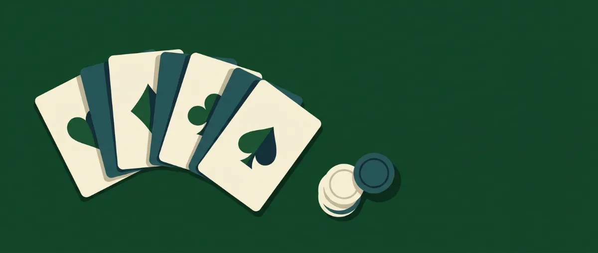
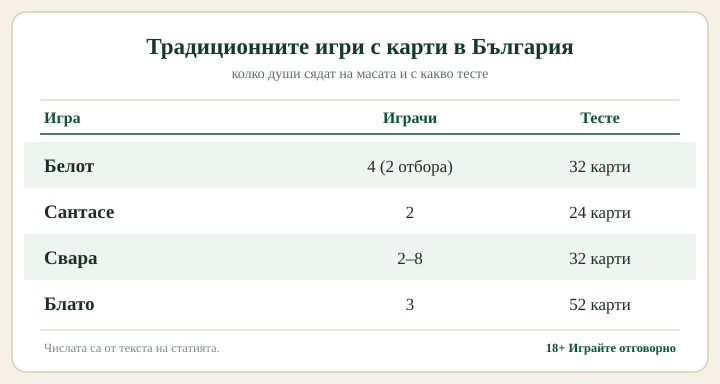

# Игри с карти: кои се играят в България и как се играят

Зад „игри с карти" се крият три доста различни занимания. Едно е да играеш с други хора, където паметта, наддаването и малко блъф тежат колкото самите карти; съвсем друго е казиното, където изходът опира на предварително нагласена в полза на къщата математика. Пасиансът пък стои настрана от двете - реди се сам, без противник и без залог. Коя посока хванеш решава почти всичко нататък, най-вече дали изобщо става дума за пари.

## Срещу хора, срещу къщата или сам

Срещу друг човек уменията имат тежест: следиш какво е излязло, разчиташ партньора си, избираш кога да рискуваш. Казиното не оставя такова пространство - правилата са фиксирани и всяка ръка носи малко предимство на къщата, което опитът не премахва. Пасиансът пък е сам за себе си, игра на търпение и подредба.

## Белот, сантасе, свара: игрите на масата

Белот е най-широко разпространената игра на карти у нас, стигнала до нещо като социално явление. Играе се от четирима в два отбора, с тесте от 32 карти от седмица до асо, и дошла по френска линия. Силата ѝ не е само в това кои карти държиш, а в наддаването за коз и в това колко добре двамата с партньора ви играете заедно. Оттам идва и bridge-белотът, по-състезателната ѝ версия.

Сантасе, която мнозина знаят като „шейсет и шест", е игра за двама с умалено тесте от 24 карти, от девятка до асо. Взимаш взятки, пазиш коз за точния момент и обявяваш двайсе и четирийсе, когато държиш попа и дамата от една боя. Накрая има и затваряне, което сменя темпото и наказва прибързания.

Свара се раздава по три карти на всеки, срещу обща банка в средата. Сядат от двама до осмина, с тесте от 32 карти, а печели както най-силната ръка, така и доброто наддаване, защото често банката отива при онзи, който е изкарал останалите да се откажат. Свара е от игрите, които почти винаги се играят за дребни пари, дори между приятели.

Който търси по-дълга или по-сложна игра, се насочва към блато, канаста или бридж. Блато върви на трима с пълно тесте от 52 карти и наддаване по системата 3-5-8. Канаста се гради на мелди и дълго точкуване. Бриджът е по-скоро клубна и състезателна игра, със своя школа и турнири.

*Колко души сядат на масата и с какво тесте при традиционните игри.*

## В казиното картите играят срещу теб

В казиното не играеш срещу други хора, а срещу къщата, която държи малко математическо предимство на всяка ръка. То е описано като домашно предимство и важи в дългосрочен план, върху хиляди ръце, не върху следващите пет.

При блекджека играеш срещу дилъра с цел да стигнеш до 21, без да я надхвърлиш. При правилна базова стратегия предимството на казиното е сред най-ниските в залата, което прави играта относително щадяща за умелия. Как точно се смята това и защо стратегията има значение, сме разписали на страницата за [блекджек](/kazino-igri/blakdzhak/).

Баккарата е обратното на тази стратегия: залагаш на играч, банкер или равенство и на практика не вземаш решения, защото картите се теглят по фиксирани правила. Боите, тегленето и защо залогът на равенство е най-скъпият са в наръчника ни за [баккара](/blog/bakara-pravila/).

Казино покерът е отделно семейство и лесно се бърка с покера между хора. Във версиите като Casino Hold'em или Three Card Poker играеш срещу дилъра, не срещу масата, и няма блъф срещу жив противник. Общият преглед е на страницата [как се играе покер в казино](/blog/kak-se-igrae-poker-kazino/), а кои ръце бият кои е в [покер комбинациите](/blog/poker-kombinacii/). И при трите казино игри опитът не мести математиката.

## Пасианс: играта за един

Пасиансът не иска противник и не иска залог. Клондайк, Паяк и FreeCell са трите, които почти всеки е отварял на компютъра си. Подреждаш картите по цвят и ред, докато изкараш целия пасианс или опиташ пак. Полезен е и за нещо друго: ако тепърва се запознаваш с тестето, реденето бързо те научава кои са боите и как върви последователността.

## Умение или късмет: какво значи това за избора

Белот и бридж се поддават на упражнение: колкото повече играеш, толкова по-добре четеш масата и партньора. Сантасе и свара искат по-малко школовка, но пак награждават преценката кога да задържиш коз. Срещу казиното обаче този напредък го няма - домашното предимство остава същото, колкото и да усъвършенстваш играта си.

## Къде се играе онлайн

Социалните игри имат свои безплатни платформи, където сядаш срещу истински хора или срещу бот, без да залагаш пари. Belot.BG и Djagi покриват белота и класиките, а за по-широк кръг настолни и картови игри работят сайтове като BoardGameArena или Poki. Там играеш за удоволствие и за точки.

За казино игрите с карти с реални пари единственото законно място е сайт с лиценз за българския пазар. Безплатният демо режим на такъв сайт ти показва тежестта на играта, преди да сложиш и един лев.

## Когато влязат реални пари

Партия белот с приятели за символична сума си е социална игра. Нещата стоят иначе в мига, в който залагаш реални пари срещу непознат в интернет. Тогава играта попада под надзора на НАП и законно се предлага само от лицензиран организатор. Къде минава тази граница сме обяснили на страницата [законно ли е](/zakonno-li-e/), а картовите игри на късмет застават в същия ред като останалите [хазартни игри](/blog/hazartni-igri-vidove/).

## Колко струва играта

Игрите срещу къщата не са източник на доход и не бива да се мерят така. Домашното предимство е построено да печели за казиното в дългосрочен план, а опитът не го изтрива. Затова важи същото, което важи за всяка игра на пари: бюджет, който можеш да загубиш целия, и лимит, сложен преди първия залог. Усетиш ли, че играта вече не е за забавление, [инструментите за отговорна игра](/otgovorna-igra/) са мястото да спреш навреме.

18+ Хазартът може да пристрасти. Играйте отговорно.

---

**Георги Тодоров**
Публикувано: 27.10.2026 · Последна редакция: 27.10.2026

*Георги Тодоров тества лицензирани в България казино сайтове от 2024 г. със собствен бюджет и проверява лиценза в публичния регистър на НАП преди регистрация. Пише за Всички Казина за реалната цена на бонусите, скоростта на тегленията и математиката зад игрите.*

**За Всички Казина:** Всички Казина е независим сайт за сравнение на онлайн казина с лиценз за българския пазар. Не сме оператор и не организираме игри. Сравняваме, проверяваме и обясняваме, за да избирате с отворени очи. Казината оценяваме по публична формула с шест претеглени критерия ([Как оценяваме](/kak-ocenyavame/)), а партньорските връзки, които финансират сайта, са обозначени. Тази статия не съдържа партньорски връзки.

**Отговорна игра.** 18+ Хазартът може да пристрасти. Играйте отговорно. Ако усетиш, че играта излиза извън контрол или искаш да я ограничиш, виж [инструментите за отговорна игра](/otgovorna-igra/) и възможността за самоизключване чрез националния регистър на уязвимите лица към НАП (подава се писмено само от засегнатото лице). Национална информационна линия за наркотиците, алкохола и хазарта („Солидарност") 0888 99 18 66, делнични дни 10:00-17:00.

**Разкриване на партньорства.** Всички Казина съдържа партньорски (афилиейт) връзки; когато отвориш оферта през такава връзка, това може да финансира сайта, без да променя цената за теб и без да влияе на оценките ни. От 1 август 2026 г. дейността на афилиейт оператори в България се лицензира съгласно Закона за държавния бюджет за 2026 г. (ДВ, бр. 69 от 31.07.2026 г.). Всички Казина е подало заявление за лиценз пред Националната агенция по приходите и очаква издаването му.
