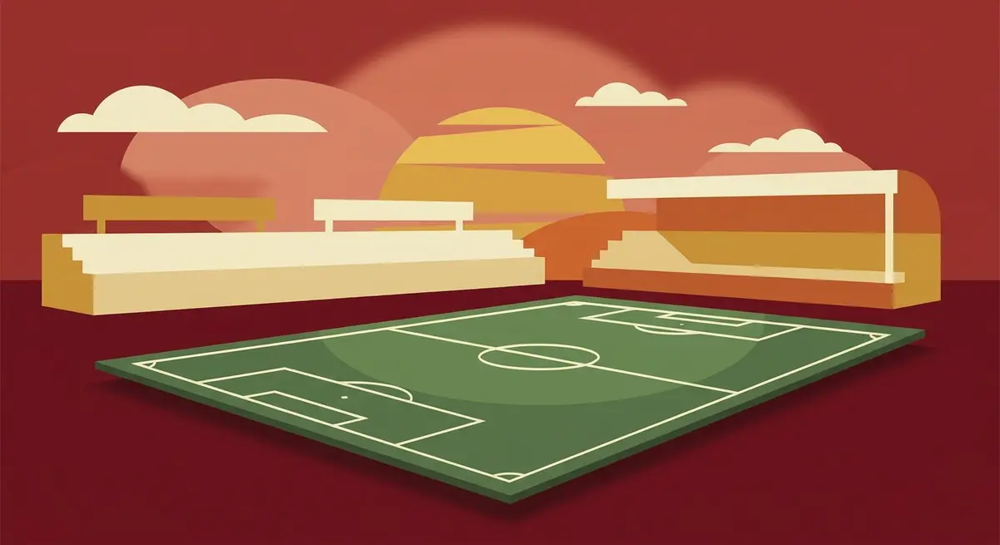
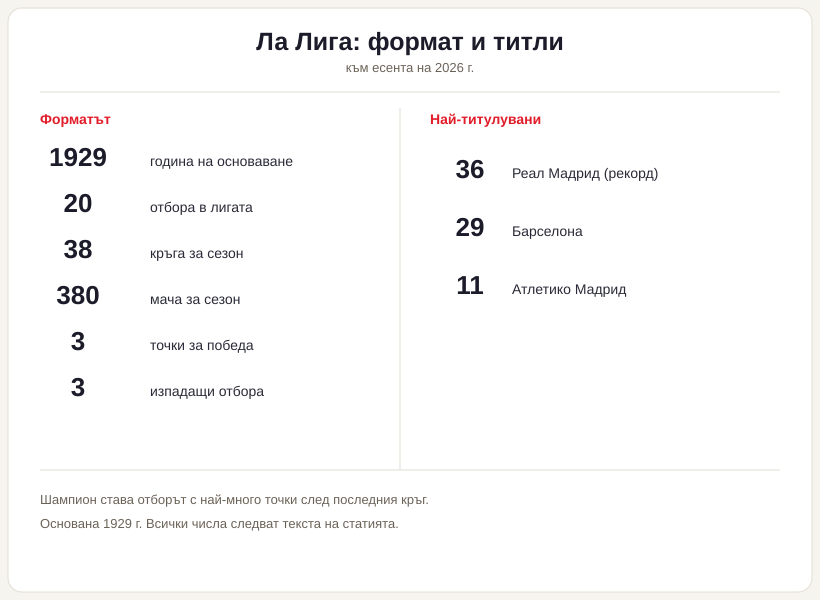

# Ла Лига: как работи испанското първенство

Когато два отбора в Ла Лига завършат сезона с еднакъв брой точки, пръв се гледа не головата разлика, а какво са направили един срещу друг. Тази подробност отличава испанската лига от повечето големи първенства и неведнъж е тежала при разпределянето на титлата.

## Какво е Ла Лига

Ла Лига е най-горното ниво на испанския клубен футбол, тоест Примера дивисион. Ражда се през 1929 г. с десет клуба в първия сезон. Пълното ѝ име е Campeonato Nacional de Liga de Primera División, а зад търговското „LaLiga EA Sports" стои същото състезание. Организацията се води от Liga Nacional de Fútbol Profesional, обединението на професионалните клубове, което накратко всички наричат LaLiga.

## Форматът накратко

В лигата играят 20 отбора. Всеки се среща с всеки друг два пъти, веднъж у дома и веднъж на гости, което прави 38 кръга и 380 мача за сезон. Победата носи 3 точки, равенството 1, а загубата нула, и шампион става онзи, който събере най-много след последния кръг.

*Форматът и ключовите числа на Ла Лига. Всички стойности следват текста на статията.*

## Класиране при равни точки

Изравнят ли се два отбора по точки, редът между тях се решава първо по преките мачове помежду им, по-точно по головата разлика в тези два двубоя. Станат ли трима или повече равни, първо се броят точките, събрани само в срещите между тях. Общата голова разлика за целия сезон идва едва след това, следвана от отбелязаните голове и накрая от точките за феърплей. Английският модел например тръгва направо от головата разлика, така че един и същ сбор резултати понякога подрежда отборите по различен начин в двете държави.

## Нагоре и надолу

Последните три отбора в класирането слизат в Segunda División, второто ниво на испанския футбол. Насреща се качват трима: първите двама от Segunda минават директно, а за третото място се бори плейоф между класиралите се от трето до шесто. Горе-долу по три клуба се сменят всяко лято.

## Билети за Европа

Първите четири отбора продължават в основната фаза на Шампионската лига, а Испания може да получи и пета бройка според коефициента си в УЕФА. Петият заедно с носителя на Копа дел Рей влиза в Лига Европа, следващият по ред поема към Лигата на конференциите. Тези квоти не са заковани веднъж завинаги и се менят от сезон на сезон, затова за актуалната подредба е по-разумно да се погледне официалният източник, вместо да се помни наизуст.

## Най-титулуваните

Към есента на 2026 г. начело е Реал Мадрид с 36 титли. Барселона е втора с 29, Атлетико Мадрид трети с 11. Следват Атлетик Билбао с 8 и Валенсия с 6. За близо век шампиони са ставали само девет клуба. Най-горещият мач в календара е Ел Класико, срещата между Реал Мадрид и Барселона.

## Пичичи и Замора

„Пичичи" отива при голмайстора на сезона и носи името на стар испански нападател; връчва го спортният вестник „Марка". Трофеят „Замора" пък е за вратаря с най-нисък коефициент получени голове на мач. И двата се следят почти толкова внимателно, колкото и битката за първото място.

## На пари, отдалеч: футбол, залози и малко трезва сметка

Ако гледаш испанския футбол и покрай това залагаш или играеш в казино, важи същото, което важи навсякъде в България. Законно минава само през оператор с лиценз от НАП, вписан в публичния регистър; какво точно е [законно](/zakonno-li-e/) е отделен и доста по-приземен въпрос от таблицата на титлите. Спортната част на сайта, заедно с бонусите за спорт, събираме в [раздела за спорт](/bonus-ruletka/sport/vsichki/), а профилите на клубовете и турнирите стоят във [футболния раздел](/blog/futbol/). Прогнози за мачове там няма и няма да намериш съвет кого да заложиш.

Хазартът не е доходоносна стратегия и залогът върху фаворита не променя тази сметка. Бюджет, който можеш да загубиш докрай, и зададени предварително лимити пазят вечерта пред телевизора да си остане забавление. Кога играта започва да тежи и какво да се направи тогава е тема на [отговорната игра](/blog/responsible-gambling/).

Миналите титли в Ла Лига носят точни дати и точни числа. Изходът от следващия мач не се знае предварително и никой залог не го гарантира.

---

**Георги Тодоров**
Публикувано: 29.10.2026 · Последна редакция: 29.10.2026

**За Всички Казина.** Независим сайт за сравнение на онлайн казина, лицензирани за българския пазар. Оценяваме всяко казино по публична методика с шест претеглени критерия и проверяваме лиценза в регистъра на НАП, преди да дадем оценка. Не сме оператор и не продаваме съвети за печалба; сравняваме, проверяваме и обясняваме, за да избираш с отворени очи.

**Отговорна игра.** 18+ Хазартът може да пристрасти. Играйте отговорно. Ако усетиш, че играта излиза извън контрол или искаш да я ограничиш, виж [инструментите за отговорна игра](/otgovorna-igra/) и възможността за самоизключване чрез националния регистър на уязвимите лица към НАП (подава се писмено само от засегнатото лице). Национална информационна линия за наркотиците, алкохола и хазарта („Солидарност") 0888 99 18 66, делнични дни 10:00-17:00.

**Разкриване на партньорства.** Сайтът съдържа партньорски (афилиейт) връзки; когато отвориш оферта през такава връзка, това може да финансира сайта, без да променя цената за теб и без да влияе на оценките ни. От 1 август 2026 г. дейността на афилиейт оператори в България се лицензира съгласно Закона за държавния бюджет за 2026 г. (ДВ, бр. 69 от 31.07.2026 г.). Всички Казина е подало заявление за лиценз пред Националната агенция по приходите и очаква издаването му.
