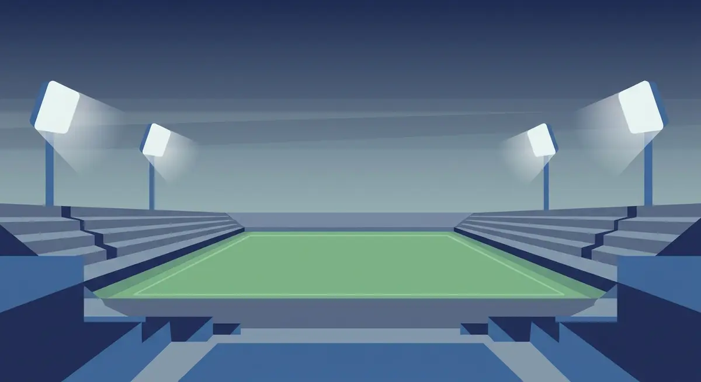

# Лига на конференциите: третият европейски турнир и как работи

Лигата на конференциите дава редовно място на европейската сцена на клубове от по-малките първенства, които иначе рядко биха стигнали дотам. Тя е най-младото от трите клубни състезания на УЕФА и единственото, чийто победител се качва едно ниво нагоре още на следващата година.

## Какво е Лига на конференциите

Лигата на конференциите е третото по сила клубно състезание на УЕФА, точно под Шампионската лига и Лига Европа. Турнирът е сравнително нов — първият сезон е 2021/22. Първият отбор, който вдигна трофея, беше Рома, с победа с 1:0 над Фейеноорд на финала в Тирана на 25 май 2022 г. Отначало името беше по-дълго, „Европа Лига на конференциите"; от сезон 2024/25 УЕФА махна „Европа" и остана само Лига на конференциите.

## 36 отбора в една таблица

От сезон 2024/25 старата групова фаза отстъпва място на лигова фаза по така наречения швейцарски модел, в който всички 36 отбора стоят в една обща класация, без малки групи. Всеки клуб играе шест мача, три у дома и три на чужд терен, срещу шест различни съперника, два по-малко от осемте в Шампионската лига и Лига Европа. Жребият подрежда отборите в шест урни по шест според коефициента им в УЕФА и тегли по един противник от всяка урна. Клубове от една и съща държава не се падат в лиговата фаза.

*Форматът и ключовите числа на Лига на конференциите. Всички стойности следват текста на статията.*

## Кой продължава и какво печели

След шестте кръга таблицата се дели на три части. Първите осем прескачат направо на 1/8-финал и си спестяват допълнителен плейоф. Отборите от девето до двадесет и четвърто място влизат в двоен плейоф на разменено гостуване и победителите се присъединяват към осмината. За последните дванадесет, от двадесет и пето до тридесет и шесто, сезонът в Европа свършва дотук; с тях отпадат и губещите в плейофа. После се върви по класическа елиминационна схема, а финалът е единичен мач на предварително избран неутрален стадион.

Голямата награда за победителя е място в лиговата фаза на следващата Лига Европа — той се качва едно ниво нагоре; ако вече се е класирал за Шампионската лига през първенството си, може да избере. Спрямо по-горните два турнира липсва едно: носителят не играе за Суперкупата на УЕФА, която остава само между шампионите на Шампионската лига и на Лига Европа.

## Как отборите влизат

До лиговата фаза се стига през квалификации: три кръга плюс плейофен кръг, разделени на шампионски и основен път. Колко места получава всяка футболна асоциация зависи от коефициента ѝ в УЕФА. Разбивката по държави се сменя всеки сезон и е публикувана на официалния сайт на УЕФА. Към лиговата фаза се добавят и клубовете, отпаднали в плейофа на Лига Европа, които продължават сезона едно ниво по-долу.

## Носителите досега

Досега турнирът има петима носители. Рома го вдига първа през 2022 г., следват Уест Хям Юнайтед през 2023 г., Олимпиакос през 2024 г., Челси през 2025 г. и Кристъл Палас през 2026 г. По държави най-напред е Англия с три титли. Нито един клуб не е печелил турнира два пъти.

## На пари, отдалеч: футбол, залози и трезва сметка

Ако гледаш европейските вечери и покрай тях залагаш или играеш в казино, важи едно и също навсякъде в България. Законно минава само през оператор с лиценз от НАП, вписан в публичния регистър; какво точно е [законно](/zakonno-li-e/) е отделен въпрос от това кой клуб колко купи има. Спортната част и бонусите за спорт сме събрали в [раздела за спорт](/bonus-ruletka/sport/vsichki/), а профилите на турнирите и клубовете стоят във [футболния раздел](/blog/futbol/). Прогнози кой ще спечели мача там няма.

Хазартът не е начин да изкараш пари и залогът върху фаворита не променя тази сметка. Предварително зададените лимити и бюджет, който можеш да загубиш докрай, са ключът вечерта пред телевизора да си остане просто забавление. Кога играта започва да тежи и какво се прави тогава е темата на [отговорната игра](/blog/responsible-gambling/).

Никой мач в турнира не идва с предварително известен изход, включително когато играе досегашен носител; спортният залог си остава разход за забавление, а не план за печалба.

---

**Георги Тодоров**
Публикувано: 02.11.2026 · Последна редакция: 02.11.2026

**За Всички Казина.** Независим сайт за сравнение на онлайн казина, лицензирани за българския пазар. Оценяваме всяко казино по публична методика с шест претеглени критерия и проверяваме лиценза в регистъра на НАП, преди да дадем оценка. Не сме оператор и не продаваме съвети за печалба; сравняваме, проверяваме и обясняваме, за да избираш с отворени очи.

**Отговорна игра.** 18+ Хазартът може да пристрасти. Играйте отговорно. Ако усетиш, че играта излиза извън контрол или искаш да я ограничиш, виж [инструментите за отговорна игра](/otgovorna-igra/) и възможността за самоизключване чрез националния регистър на уязвимите лица към НАП (подава се писмено само от засегнатото лице). Национална информационна линия за наркотиците, алкохола и хазарта („Солидарност") 0888 99 18 66, делнични дни 10:00-17:00.

**Разкриване на партньорства.** Сайтът съдържа партньорски (афилиейт) връзки; когато отвориш оферта през такава връзка, това може да финансира сайта, без да променя цената за теб и без да влияе на оценките ни. От 1 август 2026 г. дейността на афилиейт оператори в България се лицензира съгласно Закона за държавния бюджет за 2026 г. (ДВ, бр. 69 от 31.07.2026 г.). Всички Казина е подало заявление за лиценз пред Националната агенция по приходите и очаква издаването му.
