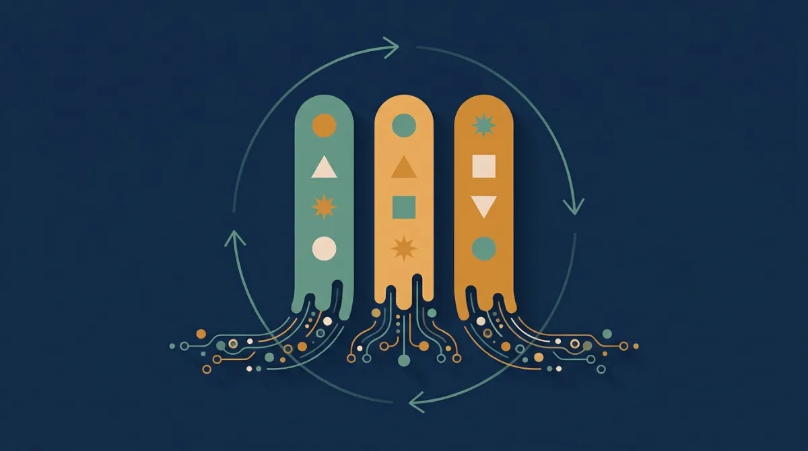
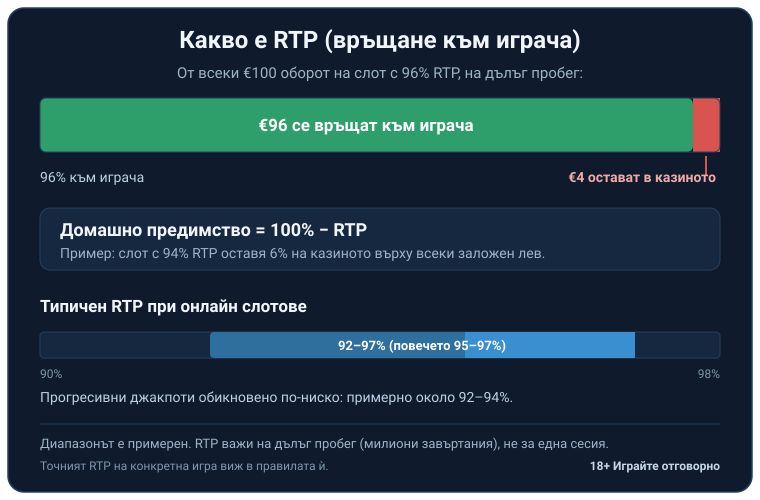
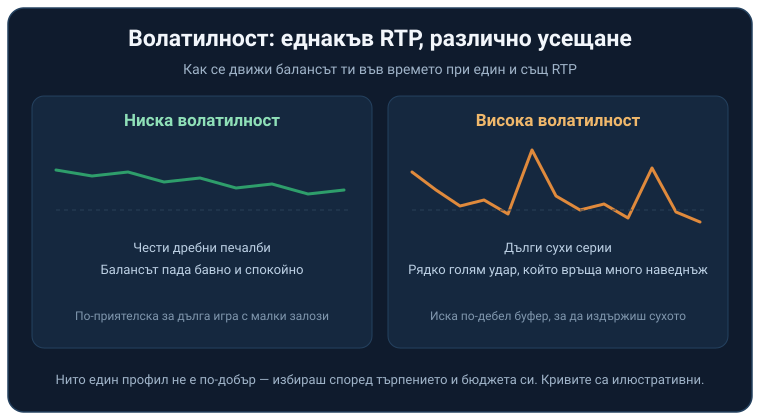

# Как работят онлайн машините: механиката зад барабаните

Едно завъртане на онлайн ротативка, или слот, е по същество едно теглене на число. Натискаш бутона, генераторът на случайни числа избира стойност, тя се превежда в символи по барабаните и това е резултатът ти. Нищо отпреди не го е подготвяло. Хванеш ли тази единствена стъпка, повечето приказки за „горещи" и „студени" машини увисват от само себе си.

## Барабаните, символите и числото зад тях

Когато символите се завъртят, под тях вече работи генераторът на случайни числа: при всяко завъртане той тегли стойности, те се картографират към позиции по барабаните, и спирането, което после виждаш на екрана, всъщност е решено още в мига на натискането. Барабаните са пълни със символи и когато достатъчно еднакви се подредят по активна линия, идва печалба. Въртенето е театър; сметката е готова преди него.

Генераторът няма памет за предишния резултат. Машина, която „от половин час не плаща", има абсолютно същия шанс на следващото завъртане, какъвто е имала и преди час. Гореща серия забелязваш, като се обърнеш назад. Не е състояние, в което играта влиза и от което да се възползваш в движение.

Паднат ли пет пъти ези, шестото хвърляне пак е петдесет на петдесет; монетата не помни и не изравнява стари сметки. Барабаните вървят по същата логика, само с много повече възможни изхода на всяко завъртане. Няколко губещи завъртания не правят следващото по-склонно да плати, нито няколко печалби подред го правят по-малко вероятно. Оттам идва и безсмислието да смениш автомата, защото „този вече даде", или да висиш край друг, който „отдавна не е пускал".

Независими лаборатории като eCOGRA и iTech Labs проверяват самия генератор и реалното поведение на игрите, преди те изобщо да стигнат до лицензиран пазар. Одитираното RNG върви в комплект с лиценза: не отваряй акаунт никъде, докато не намериш оператора в публичния регистър на НАП. Самата [проверка на лиценза на казино](/blog/proverka-licenz-kazino/) отнема минута-две.

## Какво всъщност значи RTP

RTP, връщането към играча, е теоретичният дял от всички заложени пари, който една игра връща на дълъг пробег. При 96% RTP играта връща около €96 от всеки заложени €100, пак на много дълга дистанция. Числото се усреднява едва след огромен брой завъртания, често симулирани над милион, и в никакъв случай не е прогноза колко ще прибереш тази вечер.

Обърнато, RTP е и домашното предимство: 100% минус RTP. Слот с 94% RTP оставя 6% на казиното върху всеки заложен лев, отново на дълъг пробег. При €100 оборот това прави средно €6 в полза на казиното, разпределени през стотици завъртания, вместо отнети наведнъж. Типичните стойности при онлайн слотовете обикновено са между 92% и 97%, като повечето заглавия стоят около 95–97%. Диапазонът е примерен; точният RTP на конкретна игра го пише в правилата и в описанието ѝ, така че не приемай чуждо число за даденост. Ако нарочно гониш заглавия от горния край, точно те са подбрани в [слотове с високо RTP](/slot-igri/visok-rtp/).

*RTP и домашно предимство на €100 оборот: при 96% RTP се връщат €96, а €4 са предимството на казиното (числата са примерни, важат на дълъг пробег).*

RTP е среден разход, не гаранция. Същите €4 на всеки €100, за които вече стана дума, в реална сесия почти никога не излизат точно толкова. Може да платиш доста повече, може и да си тръгнеш на плюс. Процентът се сбъдва чак на милионите завъртания, които лабораториите симулират, докато го смятат.

За една вечер пред екрана обаче важи друго. В краткосрочен план резултатите са напълно непредвидими. На същия 96% слот е съвсем нормално да станеш солидно на печалба или на загуба в рамките на една сесия, а процентът се показва едва когато завъртанията станат десетки и стотици хиляди. RTP ти казва коя игра е по-щедра по конструкция. Колко ще отнесеш у дома довечера е въпрос на късмет в тази кратка сесия.

## Волатилност и защо еднакъв RTP се усеща различно

Волатилността описва колко неравномерно плаща една игра, и тъкмо тя обяснява защо два слота с еднакъв RTP се усещат като съвсем различни играчки. Ниската дава чести дребни печалби и баланс, който пада бавно и кротко. Високата е друго животно: дълги сухи серии, прекъсвани рядко от голям удар, който на практика носи почти целия обявен процент наведнъж. Между двете стоят и по-балансирани профили. Нито един профил не е по-добър от друг; избираш според това колко търпение и бюджет имаш за сухите периоди.

*Ниска срещу висока волатилност при един и същ RTP: честота и размер на печалбите (кривите са илюстративни).*

Най-честният начин да усетиш темпото, преди да заложиш реални пари, е демо режимът. Завърташ същата игра без депозит и просто гледаш колко бурен или спокоен е ритъмът ѝ. На практика високата волатилност иска по-дебел буфер, за да издържиш сухото до големия удар, докато скромен бюджет се изпарява бързо между редките печалби. Ниската е по-приятелска към дълга, спокойна игра с малки залози.

## Линии на печалба и начини

При класическата система с линии печелиш, когато символите се подредят по конкретна, предварително зададена линия през барабаните. При заглавията с „начини" (ways), например 243 начина, е достатъчно съвпадащите символи да стоят на съседни барабани, независимо къде са по вертикала. Повече обявени [линии на печалба](/blog/linii-na-pechalba/) не значат автоматично повече стойност за теб, понеже залогът обикновено се разхвърля между тях; там ще видиш и как точно се броят и кога си струва да играеш повече.

## Бонус механиките и джакпотите са вградени в RTP

Безплатните завъртания, wild символите (които заместват други), scatter символите, мултипликаторите и механиките тип hold & win са вкалкулирани в RTP на играта. Правят я по-зрелищна и по-напрегната, без да добавят и стотинка върху обявения процент. Когато голяма част от връщането е натъпкана в бонус рундовете, базовата игра става по-суха, а това обикновено върви ръка за ръка с по-висока волатилност. Богата на функции ротативка не връща повече на дълъг пробег от скромна с еднакъв RTP; просто подрежда същите пари по-ефектно. И дългоочакваният голям бонус рунд не прави изключение: когато най-после дойде, той ти връща част от онова, което базовата игра вече е прибрала от оборота ти, вместо да ти носи премия отгоре.

При прогресивните джакпоти базовият RTP обикновено е по-нисък, примерно около 92–94%, защото част от всеки залог не се връща в играта, а отива в джакпот пула. Пулът расте със залозите на всички играчи, докато някой не го удари, и малкият отрязък, който се отделя от всеки залог, обяснява по-ниския базов процент спрямо обикновен слот. Дали изобщо си струва да гониш такъв джакпот и как се мени сметката, щом пулът порасне, е темата на [прогресивни джакпоти](/blog/progresivni-dzhakpoti/).

## Защо няма система, която да бие слота

Щом всяко завъртане е независимо и домашното предимство се начислява върху всеки залог, никоя схема от залози не мести математиката на дълъг пробег. Няма „закъсняла" печалба. Няма машина, която да ти „дължи" след серия загуби. Системите за гонене на гореща машина се борят срещу генератор без никаква памет и губят по дефиниция. Лошият късмет в конкретния ден няма пръст тук. Слотовете са платено забавление с горе-долу предвидима цена на дълъг пробег; като начин да изкараш пари просто не стават. Всеки лицензиран оператор строи бизнеса си върху това предимство; ако математиката не беше в негова полза, изобщо нямаше да пуска игрите. Да я разбираш няма да ти донесе печалба, но ще ти спести пари, хвърлени по несъществуващи системи, и ще ти даде трезва представа какво купуваш, когато натиснеш бутона: време и забавление, понякога с печалба, по-често без.

Тъй като математиката е в полза на казиното, най-важното е да контролираш колко залагаш и колко дълго играеш. Сложи си лимит на депозита и на сесията още преди първото завъртане и влагай само пари, които можеш да загубиш изцяло, без да опре до сметки за наем или ток. Усетиш ли, че въртиш по инерция или гониш загуба, спри. Това е моментът да станеш. 18+ Хазартът може да пристрасти. Играйте отговорно. Повече за лимитите и самоизключването има на страницата за [отговорна игра](/otgovorna-igra/).

**Георги Тодоров**
