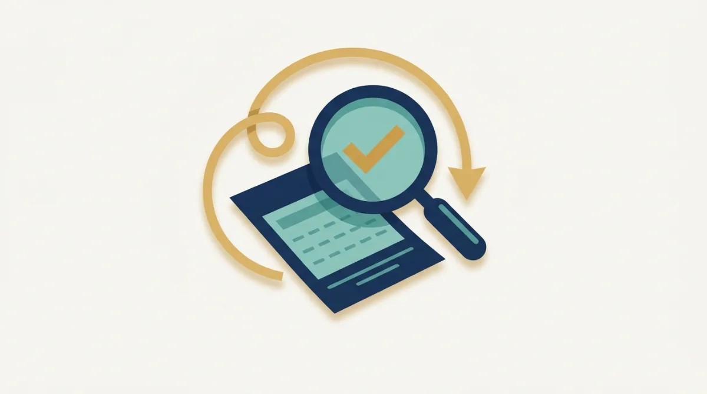
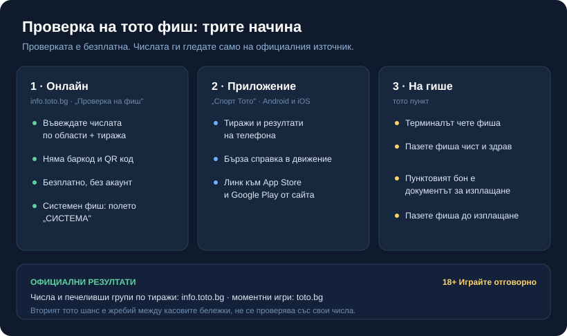

# Проверка на фиш Тото: как да проверите печалба онлайн, в приложението и на гише

Фиш от ТОТО се проверява безплатно и на три места: онлайн на сайта на тотализатора, в официалното приложение и на самото гише, където сте го купили. Онлайн проверката не сканира хартиения фиш; въвеждате числата, с които сте играли, и избирате тиража. Печелившите числа се сменят с всеки тираж, затова ги сверявате на официалния източник, а не по спомен.

## Онлайн: въвеждате числата и тиража

Онлайн проверката е отделна за всяка игра и живее на info.toto.bg под „Проверка на фиш": 6 от 49, 6 от 42, 5 от 35, Зодиак и Рожден ден имат собствена форма. Няма баркод, няма QR код и няма сериен номер за въвеждане; попълвате ръчно това, което сте играли.

1. Отворете info.toto.bg и изберете играта, с която е фишът ви.
2. Отбележете по области всички числа, с които сте играли, точно както са на листчето.
3. От полето „ТИРАЖ" изберете тиража, за който проверявате.
4. Натиснете „ПРОВЕРИ ФИШ". Ако сте сгрешили при попълването, „Изчисти" зачиства и започвате наново.

Ако сте играли с абонамент, от полето „ТИРАЖ" избирате последния тираж, включен в абонамента. Формата сравнява вашите числа с изтеглените за избрания тираж и ви казва има ли съвпадения. Проверката онлайн не иска регистрация и е безплатна: отваряте формата, попълвате я и виждате резултата веднага. Двете най-чести грешки тук са банални: грешен тираж в падащото меню и пропуснато или разменено число при попълването. Затова преписвайте от листчето бавно и проверете тиража, преди да натиснете бутона.

*Трите начина за проверка и къде стоят официалните резултати. Данните са от публичните страници на тотализатора (info.toto.bg), проверени към 27.10.2026 г.*

## Системен фиш и Джокер

Ако фишът ви е системен, формата има и поле „СИСТЕМА", където отбелязвате системата, с която сте играли, за да се изчислят правилно комбинациите. Какво точно е системен фиш и как една система умножава залога сме обяснили в [ръководството за тото системите](/blog/toto-sistemi-kombinacii/); тук е важно само да го маркирате, иначе проверката брои различен брой комбинации от вашите.

Джокерът не се проверява като отделен ред с числа. Той върви с номера на фиша и се маркира заедно с него, така че проверявате основната игра и Джокера наведнъж. Как се чете печалбата от Джокер и какъв е реалният шанс сме разписали в [статията за Тото Джокер](/blog/toto-dzhoker/).

## В приложението „Спорт Тото"

Тотализаторът има официално приложение „Спорт Тото" за Android и iOS, с връзки към App Store и Google Play направо от info.toto.bg. През него следите тиражите и виждате резултатите на телефона си, без да сядате пред компютър. Проверката на конкретен фиш вътре в приложението, със сканиране или с ръчно въвеждане като на сайта, зависи от текущата му версия; отворете менютата за резултати и за проверка, за да видите какво предлага. Резултатите по тиражи при всички случаи са там. Приложението е удобно за бърза справка в движение, но за спорен или по-объркан фиш формата на сайта и гишето остават най-ясни.

## На гише в тото пункт

Най-старият начин работи и до днес: занасяте фиша на тото пункт и там на терминала го проверяват. Пазете листчето чисто и здраво, защото скъсан или зацапан фиш може да създаде проблем при разчитането. Какъв е редът за изплащане на гише и какъв документ ви издават към печалбата, вижте на самото гише или в актуалните правила на тотализатора, вместо да разчитате на спомен от стар ред. Докато не си получите печалбата, пазете самия фиш: изгубено или унищожено листче трудно се доказва.

## Къде са официалните резултати

Официалните печеливши числа и печелившите групи по тиражи стоят на info.toto.bg в раздела с резултатите на всяка игра, 6 от 49, 6 от 42, 5 от 35, Джокер, Зодиак и останалите. Там се сверяват и съмненията „това число 4 ли беше, или 14". Числата се менят на всеки тираж и на другия ден подвеждат, затова ги четете от страницата, не от екранна снимка или публикация в социалните мрежи: такива се редактират лесно, а официалният източник е един. За обща карта на игрите в тотализатора вижте [прегледа на тото игрите](/blog/lottery-toto/), а за трите основни числови игри, 6 от 49, 6 от 42 и 5 от 35, [разбора на Тото 2](/blog/toto-2-igri/).

Моментните игри, тоест стъргалките, се проверяват по друг път: отделна проверка на toto.bg, а не формата с числата. А Вторият тото шанс изобщо не е числова игра. Той е безплатен жребий между касовите бележки; печелившите се теглят на случаен принцип и се обявяват официално, така че него не го „проверявате" със свои числа.

## Спечелихте: как се получава печалбата

Проверката е безплатна; получаването на парите минава по ред на тотализатора. По-малките печалби обикновено се осребряват на тото пункт, а по-големите се получават централно. Прагът, над който печалбата минава през централата, е записан в актуалните правила на тотализатора. Печалбата се търси и в определен срок, който също е посочен в правилника на съответната игра, затова го проверете там или на пункта веднага щом видите съвпадение, а не в последния момент.

Данъкът върху печалби от лотария е отделна тема: въпрос към счетоводител или към НАП, не нещо, което да приемате от форум или от нас на доверие.

## Цената на играта и отговорността

Проверката на фиш е безплатна и отнема минута; самата игра не е безплатна и има известна цена, която операторът залага в правилата си. Лотарията е платено забавление, не план за доходи. Заложете толкова, колкото сте готови да не си върнете, проверете спокойно, и ако някога усетите, че гоните изгубено, спрете да проверявате и вижте [инструментите за отговорна игра](/otgovorna-igra/).

---

**Георги Тодоров**
Публикувано: 27.10.2026 · Последна редакция: 27.10.2026

**За Всички Казина.** Независим сайт за сравнение на онлайн казина, лицензирани за българския пазар. Оценяваме всяко казино по публична методика с шест претеглени критерия и проверяваме лиценза в регистъра на НАП, преди да дадем оценка. Не сме оператор и не продаваме съвети за печалба; сравняваме, проверяваме и обясняваме, за да избираш с отворени очи.

**Отговорна игра.** 18+ Хазартът може да пристрасти. Играйте отговорно. Ако усетиш, че играта излиза извън контрол или искаш да я ограничиш, виж [инструментите за отговорна игра](/otgovorna-igra/) и възможността за самоизключване чрез националния регистър на уязвимите лица към НАП (подава се писмено само от засегнатото лице). Национална информационна линия за наркотиците, алкохола и хазарта („Солидарност") 0888 99 18 66, делнични дни 10:00-17:00.

**Разкриване на партньорства.** Сайтът съдържа партньорски (афилиейт) връзки; когато отвориш оферта през такава връзка, това може да финансира сайта, без да променя цената за теб и без да влияе на оценките ни. От 1 август 2026 г. дейността на афилиейт оператори в България се лицензира съгласно Закона за държавния бюджет за 2026 г. (ДВ, бр. 69 от 31.07.2026 г.). Всички Казина е подало заявление за лиценз пред Националната агенция по приходите и очаква издаването му.
