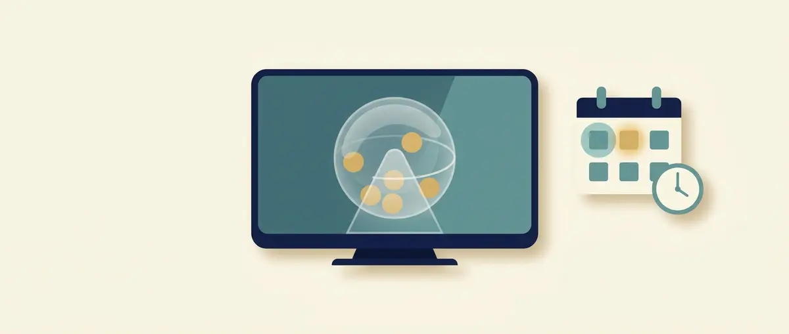
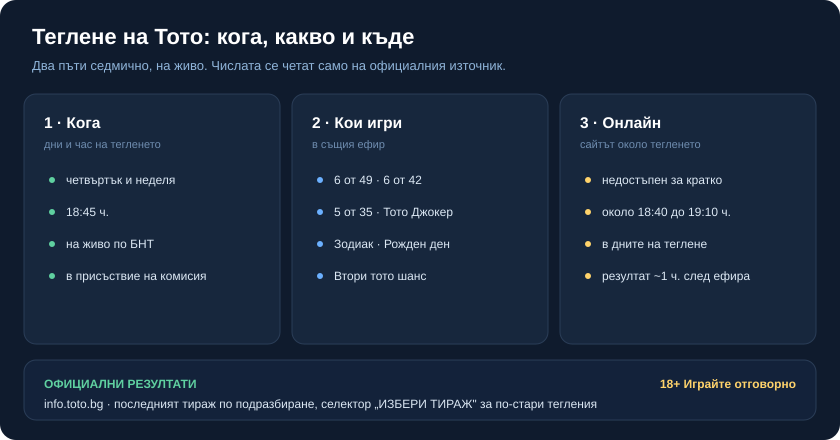

# Теглене на Тото: кога са тиражите на 6 от 49, 6 от 42 и 5 от 35 и къде да ги гледате

Тегленията на Тото вървят по график: в два фиксирани дни от седмицата, в един и същи час, на живо по националната телевизия. Дали „днес има теглене" зависи единствено от това кой ден е. Веднага след ефира официалните числа се публикуват на сайта на тотализатора, тираж по тираж.

Числата от конкретно теглене тук няма да намерите изписани, и това е нарочно. Печелившите числа се сменят всеки път и на другия ден подвеждат; единственото място, където ги четете без грешка, е официалната страница на играта. Затова по-долу е кога и къде е самото теглене, и къде стои последният тираж, а не кои числа са паднали.

## Кои дни и в колко часа е тегленето

Тегленето е в **четвъртък и неделя от 18:45 ч.** В този ефир се изтеглят наведнъж всички основни игри на Тото 2: 6 от 49, 6 от 42, 5 от 35, Тото Джокер, Зодиак, Рожден ден и Вторият тото шанс. Тоест два пъти седмично, по едно и също време, за цялата програма на тотализатора.

*Графикът на тегленето и къде излизат официалните числа. Данните са от публичните страници на тотализатора (info.toto.bg), проверени към 27.10.2026 г.*

Няма отделни дни за отделните игри: ако е четвъртък или неделя вечер, тегли се всичко изброено; ако е друг ден, няма теглене и последните числа са от предходния тираж.

Около самото теглене онлайн сайтът на тотализатора е недостъпен за кратко, в четвъртък и неделя приблизително между 18:40 и 19:10 ч. Ако отворите страницата точно в този прозорец и тя не зарежда, не е проблем при вас: изчакайте няколко минути след края на предаването и опитайте пак.

## Къде се излъчва тегленето

Тегленето се предава на живо по Българската национална телевизия и по правило е част от отделно предаване в ранната вечер; точния канал и час в момента вижте в програмата на БНТ или на info.toto.bg. Излъчва се само по БНТ от 3 май 2020 г. Важното за зрителя е, че е на живо и в присъствието на тричленна комисия: барабаните се въртят пред камера, а комисията е гаранцията, че нищо не е записано предварително или нагласено.

Телевизионните тегления не са от вчера. Вървят по екран от септември 1975 г., дълги години от студио на БНТ, а от юни 2013 г. се провеждат в собствено HD студио на тотализатора със специализирани машини. Ако предпочитате да не чакате ефира, резултатът е онлайн броени минути след тегленето.

## Последният тираж: къде са официалните числа

Печелившите числа и печелившите групи за всеки тираж стоят на info.toto.bg, в раздела с резултатите на съответната игра: 6 от 49, 6 от 42, 5 от 35, Джокер, Зодиак и останалите. Страницата отваря последния тираж по подразбиране, а с полето „ИЗБЕРИ ТИРАЖ" се връщате и към по-стари тегления.

За всеки тираж виждате номера му и датата, изтеглените числа, джакпота и таблица с печалбите по категории: колко са печелившите, какъв е размерът на печалбата и общата сума. Сумите са в евро, както е навсякъде от въвеждането на еврото в България. Числата се обработват бързо: тиражът се пуска за изплащане до около час след края на телевизионното предаване, така че малко след ефира резултатът вече е официален. Ако търсите „последен тираж 6 от 49" или „5 от 35", това е страницата, а не пост в социалните мрежи, който отваряте, за да не се окажете пред стари или редактирани числа.

## Защо числата ги четете само от официалния източник

Един тираж надживява ефира си с ден, не повече. На следващото теглене числата вече са други, а екранните снимки и публикациите в социалните мрежи се редактират за секунди, нарочно или по невнимание. Официалната страница е една, води се от тотализатора и се сверяват точно там и съмненията от рода на „това четворка ли беше, или четиринайсет".

Оттук идва и една граница, която пазим съзнателно: последните числа са факт, но не са подсказка. Миналите тегления не казват нищо за следващото; всяко е независимо и статистиката на „горещите" числа не променя шанса. За това колко всъщност струва играта и какъв е реалният шанс сме писали отделно в [прегледа на игрите на Тото 2](/blog/toto-2-igri/); тук е достатъчно да се каже, че никой график и никоя таблица с минали резултати не предсказва бъдещото теглене.

## Джокерът и Вторият тото шанс в същото теглене

В същия ефир се теглят и две игри, които лесно се бъркат. Тото Джокер не е отделен ред с числа, който проверявате сам за себе си: той върви с номера на фиша и се тегли заедно с основната игра. Как се чете печалбата от него и какъв е шансът сме разписали в [статията за Тото Джокер](/blog/toto-dzhoker/).

Вторият тото шанс пък изобщо не е числова игра. Той е безплатен жребий между касовите бележки и печелившите се теглят на случаен принцип, а не по избрани от вас числа. Затова при него няма „познах/не познах" по число; има изтеглени бележки, които се обявяват официално. Подробностите са в [обяснението на Втория тото шанс](/blog/vtori-toto-shans/). За обща карта на всички игри в тотализатора вижте [прегледа на тото игрите](/blog/lottery-toto/).

## Колко струва играта и защо проверявате трезво

Да гледате тегленето и да сверите числата е безплатно и отнема минута. Самата игра не е безплатна: всеки фиш има цена и тотализаторът, като всяка лотария, е устроен така, че в дългосрочен план печели организаторът. Лотарията е платено забавление, не план за доходи и не начин да върнете загубени пари.

Заложете колкото сте готови да не си върнете, гледайте тегленето за удоволствието от него, и ако усетите, че чакате тиража с напрежение или гоните изгубено, спрете и вижте [инструментите за отговорна игра](/otgovorna-igra/).

---

**Георги Тодоров**
Публикувано: 27.10.2026 · Последна редакция: 27.10.2026

**За Всички Казина.** Независим сайт за сравнение на онлайн казина, лицензирани за българския пазар. Оценяваме всяко казино по публична методика с шест претеглени критерия и проверяваме лиценза в регистъра на НАП, преди да дадем оценка. Не сме оператор и не продаваме съвети за печалба; сравняваме, проверяваме и обясняваме, за да избираш с отворени очи.

**Отговорна игра.** 18+ Хазартът може да пристрасти. Играйте отговорно. Ако усетиш, че играта излиза извън контрол или искаш да я ограничиш, виж [инструментите за отговорна игра](/otgovorna-igra/) и възможността за самоизключване чрез националния регистър на уязвимите лица към НАП (подава се писмено само от засегнатото лице). Национална информационна линия за наркотиците, алкохола и хазарта („Солидарност") 0888 99 18 66, делнични дни 10:00-17:00.

**Разкриване на партньорства.** Сайтът съдържа партньорски (афилиейт) връзки; когато отвориш оферта през такава връзка, това може да финансира сайта, без да променя цената за теб и без да влияе на оценките ни. От 1 август 2026 г. дейността на афилиейт оператори в България се лицензира съгласно Закона за държавния бюджет за 2026 г. (ДВ, бр. 69 от 31.07.2026 г.). Всички Казина е подало заявление за лиценз пред Националната агенция по приходите и очаква издаването му.
