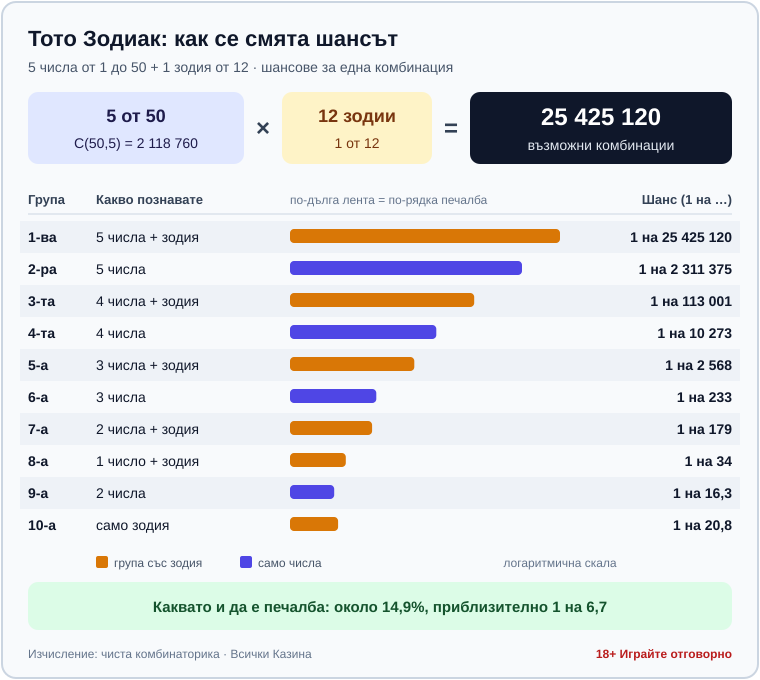

# Тото Зодиак: правила, печеливши групи и реалният шанс за джакпот

**Автор: Георги Тодоров · Всички Казина**

*Публикувано: 10.10.2026 · Последна актуализация: 11.10.2026*

Шансът да спечелите джакпота на тото Зодиак с една комбинация е 1 на 25 425 120. Никоя система за избор на числа не може да помръдне това число. Затова тук ще намерите правилата, тиражите и сметката, но не и числа за залагане или съвети кога и колко да играете.

ТОТО 2 – Зодиак е числова игра на Български спортен тотализатор (БСТ), стартирала на 17.08.2014, с формат 5 от 50 плюс 1 от 12. По правилата на БСТ всички печалби в играта са фиксирани, включително джакпотът: 500 000 евро на печеливша комбинация, ако те са до три, а ако са повече, между тях се делят поравно 1 500 000 евро. Затова toto.bg показва и за тираж 79 (08.10.2026) джакпот от 1 500 000 евро, но той не набъбва от тираж на тираж, както при 6/49.

## Как се играе: 5 от 50 и една зодия

На фиша отбелязвате пет числа от 1 до 50 и една зодия от дванадесетте, а при тегленето БСТ изтегля пет числа и една „печеливша зодия“. В тираж 79 се паднаха 1, 6, 7, 20 и 24 със зодия № 9, защото в официалните резултати зодията излиза като номер: по правилата от комплект от 12 топки с номера от 1 до 12 се изтегля една и тя определя печелившата зодия. Изборът на знак не мести шанса, дванадесетте зодии са равностойни. Фиш се пуска в пункт на БСТ или онлайн на toto.bg, където плащанията минават през ePay.bg или с карта през БОРИКА.

Една комбинация (5 числа + 1 зодия) струва 0,50 евро. Освен с четирите области на фиша можете да играете с поле „Автоматично“, при което системата избира числата и зодията вместо вас, със системи за пълно комбиниране или с абонамент за два или пет поредни тиража.

Да не се бърка с моментната талонна игра „Зодиак“ на БСТ от края на 90-те: днешното ТОТО 2 – Зодиак (теглене 5 от 50 + 1 от 12, от 2014 г.) няма връзка с нея.

## Кога е тегленето и докога се пуска фиш

Зодиак участва и в двата седмични тиража на БСТ. За нечетния тираж залози се приемат от неделя 19:20 до четвъртък 18:00 ч., а тегленето е в четвъртък. За четния тираж приемът е от четвъртък 19:20 до неделя 18:00 ч., а тегленето е в неделя.

Тегленето е на живо по БНТ 1 в предаването на БСТ, което започва в 18:45 ч. в четвъртък и в неделя. Тиражът се пуска за изплащане до 1 ч. след края на предаването, а при онлайн игра печалбата влиза автоматично в сметката ви. Печалба до 500 евро от хартиена квитанция се изплаща в брой във всеки пункт на БСТ с терминал. За по-голяма сума се идентифицирате с лични данни, а над 1 500 евро парите идват само по банков път. Срокът е 45 дни от деня след тиража, след това правото на печалбата се погасява, така че не оставяйте квитанцията в чекмеджето.

## Десетте печеливши групи и колко често печелят

За разлика от 6/49, при Зодиак печелите и с много малко познати числа, стига зодията да съвпадне, а самата зодия без нито едно число също е печеливша група. Шансовете в таблицата са чиста комбинаторика за една комбинация. Печалбите са фиксираните суми от правилата на БСТ, а броят печеливши е от тираж 79 от 08.10.2026.

| Група | Какво трябва да познаете | Шанс (1 на …) | Печалба | Тираж 79: печеливши |
|---|---|---|---|---|
| 1-ва | 5 числа + зодия | 25 425 120 | €500 000 (или дял от €1 500 000) | 0 |
| 2-ра | 5 числа | 2 311 375 | €15 000,00 | 0 |
| 3-та | 4 числа + зодия | 113 001 | €3 000,00 | 2 |
| 4-та | 4 числа | 10 273 | €300,00 | 12 |
| 5-а | 3 числа + зодия | 2 568 | €60,00 | 41 |
| 6-а | 3 числа | 233 | €6,00 | 575 |
| 7-а | 2 числа + зодия | 179 | €3,00 | 521 |
| 8-а | 1 число + зодия | 34 | €1,00 | 2 509 |
| 9-а | 2 числа | 16,3 | €0,50 | 6 375 |
| 10-а | само зодия | 20,8 | €0,60 | 3 796 |

„5 числа“, „4 числа“ и т.н. без зодия означава, че числата са познати, а зодията не е.

Последните два реда вървят обратно на номерацията: десетата група (само зодия) се уцелва по-трудно от деветата, 1 на 20,8 срещу 1 на 16,3, и затова плаща малко повече: €0,60 срещу €0,50. Ако съберете всички десет групи, около 14,9% от комбинациите печелят нещо, приблизително 1 на 6,7. А колко е това „нещо“, личи от тираж 79: 13 831 печеливши, общо €25 047,10 изплатени, като над 13 000 от тях са получили между €0,50 и €3.

*Десетте печеливши групи на Зодиак и шансът за всяка от тях при една комбинация (чиста комбинаторика).*

## Как се разпределя фондът и защо джакпотът не расте

По правилата на БСТ наградният фонд на Зодиак е 50% от залозите за тиража, приети в пунктовете и онлайн. Другата половина изобщо не се връща като печалби, а отива за организатора и за обществените цели, заради които се издава лицензът.

От 2-ра до 10-а група печалбите са фиксирани: всеки печеливш получава сумата от таблицата, колкото и да са печелившите в групата. Каквото остане от фонда след тях, БСТ заделя в т.нар. „Стартов джакпот“, от който се осигуряват парите за 1-ва група.

Затова при Зодиак джакпотът не набъбва от тираж на тираж, както при 6/49: той е 500 000 евро за всяка печеливша комбинация, ако те са до три, а при повече 1 500 000 евро се делят поравно. Ако го спечелите, до 100 000 евро получавате в срок от 45 дни, а остатъкът идва на равни месечни вноски от поне 10 000 евро.

## Колко нереален е джакпотът

Пет числа от 50 могат да се изберат по C(50,5) = 2 118 760 начина, а умножени по 12 зодии, те дават 25 425 120 комбинации, от които печели една. При ТОТО 2 6/49 комбинациите са 13 983 816, така че джакпотът на Зодиак е около 1,8 пъти по-труден.

С една комбинация във всеки от двата тиража седмично ще чакате средно около 244 000 години до първия джакпот.

Понеже всички печалби са фиксирани, очакваната стойност се смята точно: средно една комбинация за 0,50 евро връща около 0,24 евро, от които едва около 2 цента идват от джакпота. Губите средно около половината от всеки залог, тоест очакваната стойност е отрицателна. Плащате за тръпката от тегленето, и толкова.

## Има ли печеливши числа за тото Зодиак?

Не.

Всяка комбинация от пет числа и зодия има един и същ шанс във всеки тираж, 1 на 25 425 120, а тегленията са независими едно от друго, така че „горещи“ и „студени“ числа просто не съществуват, колкото и таблици с честоти да обикаляте. Изборът ви може да промени само едно нещо: дали ще делите джакпота, ако го уцелите. До три печеливши комбинации получават по 500 000 евро, но при четири и повече всички делят 1 500 000 евро. Много играчи залагат рождени дати, тоест числа до 31, и при такава популярна комбинация рискът да делите е по-голям при абсолютно същия шанс за печалба. НАП също посочва, че „стратегиите за добър късмет“ не увеличават шансовете. Затова не публикуваме числа за тото Зодиак и не бихме се доверили на сайт, който го прави.

## Закон, възраст и отговорна игра

Тото, лото, кено и другите числови лотарийни игри са хазарт по българския Закон за хазарта. Лиценз за организирането им издава само изпълнителният директор на НАП (чл. 3), а държавата може да получи лиценз единствено за подпомагане на спорта, културата, здравеопазването, образованието и социалното дело. По-подробно за [правния статус на хазарта в България](/zakonno-li-e/) и за [данъците върху печалбите](/blog/danaci-pechalbi-onlajn-kazino/) сме писали отделно.

Участието на непълнолетни законът забранява, така че Зодиак е игра само за пълнолетни (18+). Ако ви интересуват и други числови тегления, вижте [правилата на кено](/blog/keno-pravila/).

Никоя комбинация не прави очакваната стойност положителна, така че реално контролирате само колко харчите. НАП препоръчва бюджетът за хазарт да не надвишава 5% от нетните доходи. Определете месечната сума за Зодиак, преди да погледнете колко е джакпотът, и не я вдигайте, когато той порасне. Ако играта престане да бъде забавление, можете да се впишете в Регистъра на уязвимите лица (чл. 10г) към НАП, информация на 0700 18 700. Повече има в раздела ни за [отговорна игра](/otgovorna-igra/).

## Бързи отговори

**Колко числа се отбелязват на Зодиак?** Пет, от 1 до 50, плюс една зодия от 12.

**Кога е тегленето?** В четвъртък и в неделя на живо по БНТ 1, предаването започва в 18:45 ч. Фишът трябва да е пуснат до 18:00 ч. същия ден.

**Колко струва една комбинация?** 0,50 евро за пет числа и една зодия.

**Само зодия печели ли нещо?** Да, дори без нито едно познато число уцелената зодия носи малка печалба от 10-а група. Шансът е 1 на 20,8, а печалбата е фиксирани €0,60.

**Какъв е шансът за джакпот?** С една комбинация е 1 на 25 425 120.

**Има ли числа, които излизат по-често?** Не. Във всеки тираж всяка комбинация има същия шанс като всяка друга.

---

**За автора:** Георги Тодоров тества лицензирани в България казино сайтове от 2024 г. със собствен бюджет и проверява лиценза в публичния регистър на НАП преди регистрация. Пише за Всички Казина за реалната цена на бонусите, скоростта на тегленията и математиката зад игрите.

**За Всички Казина:** Всички Казина е независим сайт за сравнение на онлайн казина с лиценз за българския пазар. Не сме оператор и не организираме игри. Сравняваме, проверяваме и обясняваме, за да избирате с отворени очи. Казината оценяваме по публична формула с шест претеглени критерия ([Как оценяваме](/kak-ocenyavame/)), а партньорските връзки, които финансират сайта, са обозначени. Тази статия не съдържа партньорски връзки.

**Отговорна игра:** *18+ Хазартът може да пристрасти. Играйте отговорно.* Насоки за лимити и самоизключване: [отговорна игра](/otgovorna-igra/). Самоизключване от всички лицензирани организатори в България: национален регистър на уязвимите лица към НАП (заявява се писмено от самия засегнат). Помощ: Национална информационна линия за наркотиците, алкохола и хазарта „Солидарност" 0888 99 18 66, делнични дни 10:00–17:00.

От 1 август 2026 г. дейността на афилиейт оператори в България се лицензира съгласно Закона за държавния бюджет за 2026 г. (ДВ, бр. 69 от 31.07.2026 г.). Всички Казина е подало заявление за лиценз пред Националната агенция по приходите и очаква издаването му.
